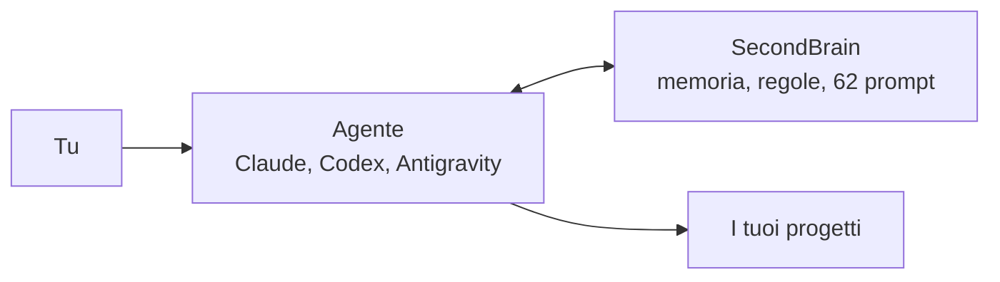
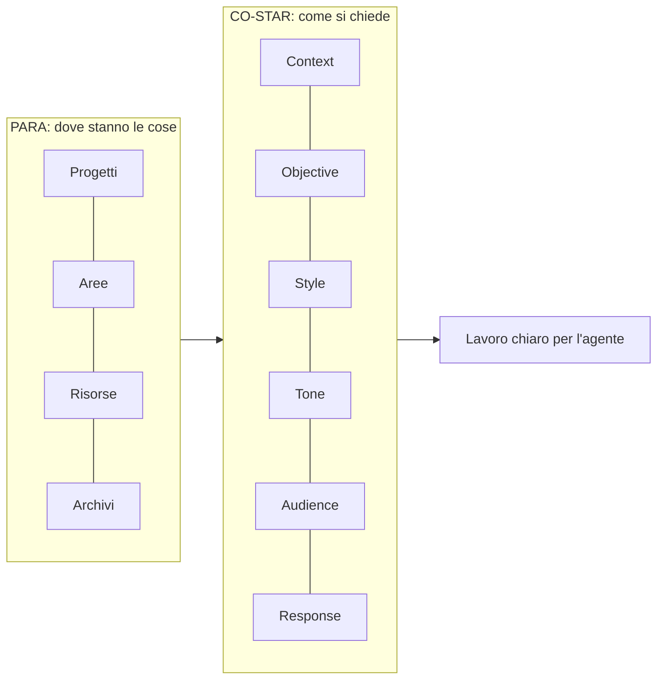

# SecondBrain

  

**Dà ai tuoi agenti di sviluppo una memoria e le stesse regole su tutti i progetti.**

Ogni agente riparte da quello che sa già: contesto, decisioni e task. I tuoi dati restano sul tuo PC.



## Inizia

Servono Windows, Git e PowerShell 7.5+. Prima leggi [cosa viene modificato](docs/sicurezza.md).

```powershell
git clone https://github.com/dennidalpos/SecondBrain.git C:/Progetti/SecondBrain
cd C:/Progetti/SecondBrain
pwsh -NoProfile -File scripts/secondbrain.ps1 -Setup -Interactive
pwsh -NoProfile -File scripts/secondbrain.ps1 -Sync
pwsh -NoProfile -File scripts/mcp-server.ps1 -Pair -Target claude -Apply
```

Poi, nella chat dell'agente, scrivi `sb prompt`. Passo per passo: [guida di avvio](docs/inizia.md).

## Cosa fa

| Funzione | Cosa ottieni |
|---|---|
| Memoria | Contesto, decisioni e task di ogni progetto, sempre pronti |
| Regole comuni | Le stesse istruzioni per tutti gli agenti e i progetti |
| 62 prompt pronti | Sviluppo, test, sicurezza, documentazione, rilascio |
| Controllo prima di pubblicare | Blocca dati privati e segreti prima del push |
| Backup | Ogni file sostituito resta recuperabile |

## Due metodi e un criterio di lettura



- **PARA** ordina le informazioni in quattro cartelle. [Come si usa](docs/uso-quotidiano.md).
- **CO-STAR** dà a ogni prompt composto da SecondBrain la stessa struttura. [Come funziona](docs/prompt.md).
- **Progressive Summarization** (stesso autore di PARA) dà il nome al caricamento a strati: l'agente parte da un riassunto essenziale e scende ai dettagli solo se servono. [Come si carica](docs/riferimento/runtime-maintenance.md).

## Strumenti convalidati

| Strumento | Regole | Collegamento MCP |
|---|---|---|
| Claude per Windows | automatico | `-Target claude` |
| ChatGPT Codex per Windows | automatico | `-Target codex` |
| Antigravity per Windows | automatico | `-Target antigravity` |

Dettagli e limiti: [agenti e MCP](docs/ide-e-mcp.md).

## Guide

| Guida | Per |
|---|---|
| [Guida unica](docs/guida.md) | Tutto in una pagina: installazione, IDE e CLI, variabili, concorrenza, casi limite |
| [Inizia](docs/inizia.md) | Installare e attivare |
| [Uso quotidiano](docs/uso-quotidiano.md) | Lavorare ogni giorno |
| [Prompt](docs/prompt.md) | Usare e modificare i prompt |
| [Agenti e MCP](docs/ide-e-mcp.md) | Collegare gli strumenti |
| [Sicurezza](docs/sicurezza.md) | Backup, ripristino, disinstallazione |
| [Riferimento tecnico](docs/riferimento/operations.md) | Tutti i dettagli |

## Limiti

- Solo Windows.
- Un file aggiornato non prova che l'agente lo abbia caricato: controlla in una nuova sessione.
- I test usano dati di prova, non ogni app reale.

Licenza MIT. Fonti e riconoscimenti: [CREDITS](CREDITS.md). Manutenzione e backup centrali: [runtime](docs/riferimento/runtime-maintenance.md).
