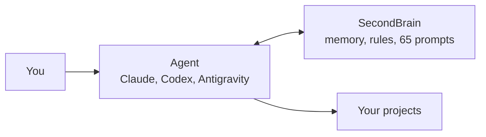
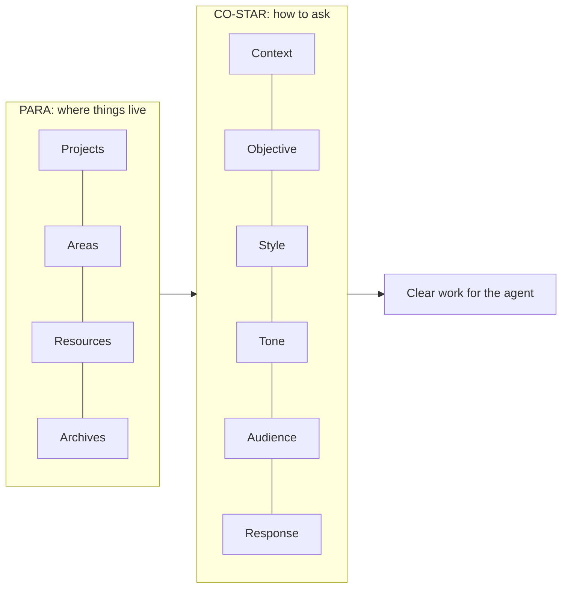

# SecondBrain

  

English · [Italiano](#italiano)

**Gives your development agents a memory and the same rules across all projects.**

Every agent restarts from what it already knows: context, decisions and tasks. Your data stays on your PC.



## Get started

You need Windows, Git 2.42+ and PowerShell 7.5+. First read [what gets modified](docs/sicurezza.md) (in Italian).

```powershell
git clone https://github.com/dennidalpos/SecondBrain.git C:/Progetti/SecondBrain
cd C:/Progetti/SecondBrain
pwsh -NoProfile -File scripts/secondbrain.ps1 -Setup -Interactive
pwsh -NoProfile -File scripts/secondbrain.ps1 -Sync
pwsh -NoProfile -File scripts/mcp-server.ps1 -Pair -Target claude -Apply
```

Then, in the agent chat, type `sb prompt`. Step by step: [getting-started guide](docs/inizia.md) (in Italian).

## What it does

| Feature | What you get |
|---|---|
| Memory | Context, decisions and tasks of every project, always at hand |
| Common rules | The same instructions for every agent and project |
| 65 ready-made prompts | Development, testing, security, documentation, release; in Italian and English (plus 17 maintenance prompts: `sb prompt maintenance`) |
| Pre-publish check | Blocks private data and secrets before the push |
| Backup | Every replaced file stays recoverable |

## Two methods and a reading criterion



- **PARA** sorts information into four folders. [How to use it](docs/uso-quotidiano.md) (in Italian).
- **CO-STAR** gives every prompt composed by SecondBrain the same structure. [How it works](docs/prompt.md) (in Italian).
- **Progressive Summarization** (same author as PARA) names the layered loading: the agent starts from an essential summary and goes down to details only when needed. [How it loads](docs/riferimento/runtime-maintenance.md) (in Italian).

## Configured integrations

| Tool | Rules file sync | MCP link |
|---|---|---|
| Claude for Windows | supported | `-Target claude` |
| ChatGPT Codex for Windows | supported | `-Target codex` |
| Antigravity for Windows | supported | `-Target antigravity` |

MCP is optional; the same content is also available from the command line.

- **With MCP:** agent-ready tools and compact answers; at startup and on lookups it picks up queued, already-authorized dossier writes. [Deferred writes and permissions](docs/riferimento/pending-writes.md) (in Italian).
- **Without MCP:** the agent runs the scripts from a shell; approval requirements depend on the IDE configuration.

Details, diagnostics and limits: [agents and MCP](docs/ide-e-mcp.md) (in Italian).

## Guides

The guides are written in Italian.

| Guide | For |
|---|---|
| [Single guide](docs/guida.md) | Everything on one page: installation, IDEs and CLI, variables, concurrency, edge cases |
| [Getting started](docs/inizia.md) | Install and activate |
| [Daily use](docs/uso-quotidiano.md) | Working day to day |
| [Per-product flow](docs/flusso-prodotto.md) | The steps in order, in chat and from scripts |
| [Prompts](docs/prompt.md) | Use and edit the prompts |
| [Agents and MCP](docs/ide-e-mcp.md) | Connect the tools |
| [Security](docs/sicurezza.md) | Backup, restore, uninstall |
| [Technical reference](docs/riferimento/operations.md) | All the details |

## Development checks

Run these commands from the repository root with PowerShell 7.5+ and Git. Quick is pure (no Git or child processes), with a 15-second budget. The default essential checks have a 90-second budget; Full adds critical boundaries with a 5-minute budget on the reference workstation. For a change without commit or publication, run a final Quick and the relevant sub-suites. Fast runs before a commit; Full runs before publication. Fixtures, logs and a unique `run.json` report stay in the local runtime after success or failure; `-KeepFixtures` remains accepted for compatibility. `esito.json` links the latest report. Reuse evidence only after checking matching inputs and environment; changed inputs invalidate it. See [run evidence and limits](docs/riferimento/runtime-maintenance.md#suite-di-test-livelli-e-fixture).

```powershell
pwsh -NoProfile -File scripts/test-secondbrain.ps1 -Quick -KeepFixtures
pwsh -NoProfile -File scripts/test-secondbrain.ps1 -KeepFixtures
pwsh -NoProfile -File scripts/test-secondbrain.ps1 -Full -KeepFixtures
pwsh -NoProfile -File scripts/build-prompts.ps1 -Check
pwsh -NoProfile -File scripts/check-distribution.ps1
```

Publication also requires [SEC07](docs/riferimento/operations.md#verifica-prima-del-push), which checks private data and secrets in the working tree, index and relevant history. Test levels and limits: [runtime maintenance](docs/riferimento/runtime-maintenance.md).

## Limits

- Windows only.
- An updated file does not prove that the agent loaded it: check in a new session.
- Tests use sample data, not every real app.

MIT License. Sources and acknowledgements: [CREDITS](CREDITS.md). Central maintenance and backup: [runtime](docs/riferimento/runtime-maintenance.md).

---

## Italiano

**Dà ai tuoi agenti di sviluppo una memoria e le stesse regole su tutti i progetti.**

Ogni agente riparte da quello che sa già: contesto, decisioni e task. I tuoi dati restano sul tuo PC.

### Inizia

Servono Windows, Git 2.42+ e PowerShell 7.5+. Prima leggi [cosa viene modificato](docs/sicurezza.md). I comandi di installazione sono quelli della sezione [Get started](#get-started); poi, nella chat dell'agente, scrivi `sb prompt`. Passo per passo: [guida di avvio](docs/inizia.md).

### Cosa fa

| Funzione | Cosa ottieni |
|---|---|
| Memoria | Contesto, decisioni e task di ogni progetto, sempre pronti |
| Regole comuni | Le stesse istruzioni per tutti gli agenti e i progetti |
| 65 prompt pronti | Sviluppo, test, sicurezza, documentazione, rilascio; in italiano e in inglese (più 17 di manutenzione: `sb prompt maintenance`) |
| Controllo prima di pubblicare | Blocca dati privati e segreti prima del push |
| Backup | Ogni file sostituito resta recuperabile |

### Due metodi e un criterio di lettura

- **PARA** ordina le informazioni in quattro cartelle. [Come si usa](docs/uso-quotidiano.md).
- **CO-STAR** dà a ogni prompt composto da SecondBrain la stessa struttura. [Come funziona](docs/prompt.md).
- **Progressive Summarization** (stesso autore di PARA) dà il nome al caricamento a strati: l'agente parte da un riassunto essenziale e scende ai dettagli solo se servono. [Come si carica](docs/riferimento/runtime-maintenance.md).

### Integrazioni configurate

Sync supporta i file delle direttive di Claude per Windows, ChatGPT Codex per Windows e Antigravity per Windows; il caricamento nella sessione va verificato separatamente. Il collegamento MCP è facoltativo (`-Target claude`, `codex` o `antigravity`) e gli stessi contenuti arrivano anche dalla riga di comando.

- **Con MCP:** strumenti pronti per l'agente e risposte compatte; all'avvio e nelle consultazioni recupera le scritture di dossier già autorizzate e accodate. [Scritture differite e permessi](docs/riferimento/pending-writes.md).
- **Senza MCP:** l'agente esegue gli script dalla shell; le richieste di approvazione dipendono dalla configurazione dell'IDE.

Dettagli, diagnosi e limiti: [agenti e MCP](docs/ide-e-mcp.md). Tutte le guide sono nella tabella [Guides](#guides).

### Verifiche per lo sviluppo

I comandi sono nella sezione [Development checks](#development-checks): Quick sulle modifiche, Fast prima del commit e Full prima della pubblicazione, conservando le fixture. Prima del push serve anche SEC07; livelli e limiti nella [guida runtime](docs/riferimento/runtime-maintenance.md).

### Limiti

- Solo Windows.
- Un file aggiornato non prova che l'agente lo abbia caricato: controlla in una nuova sessione.
- I test usano dati di prova, non ogni app reale.

Licenza MIT. Fonti e riconoscimenti: [CREDITS](CREDITS.md). Manutenzione e backup centrali: [runtime](docs/riferimento/runtime-maintenance.md).
