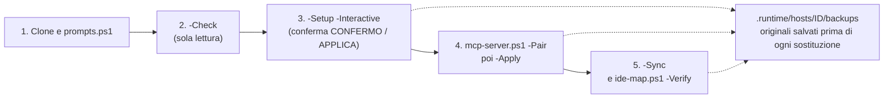
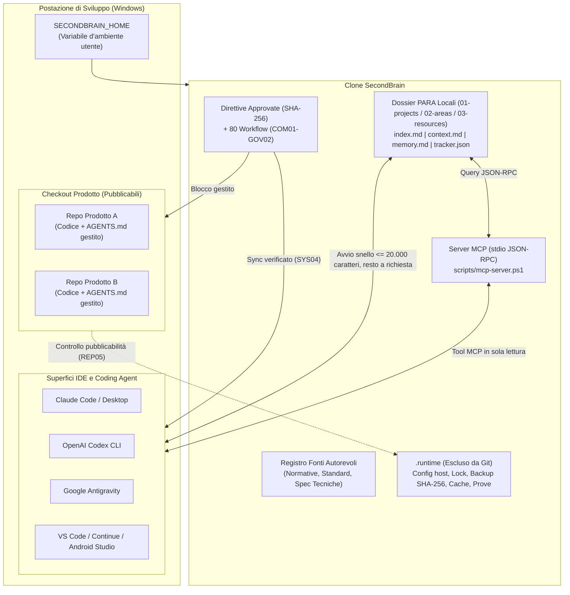
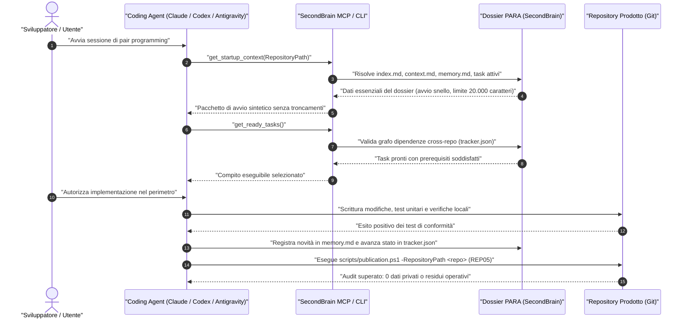
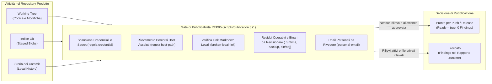
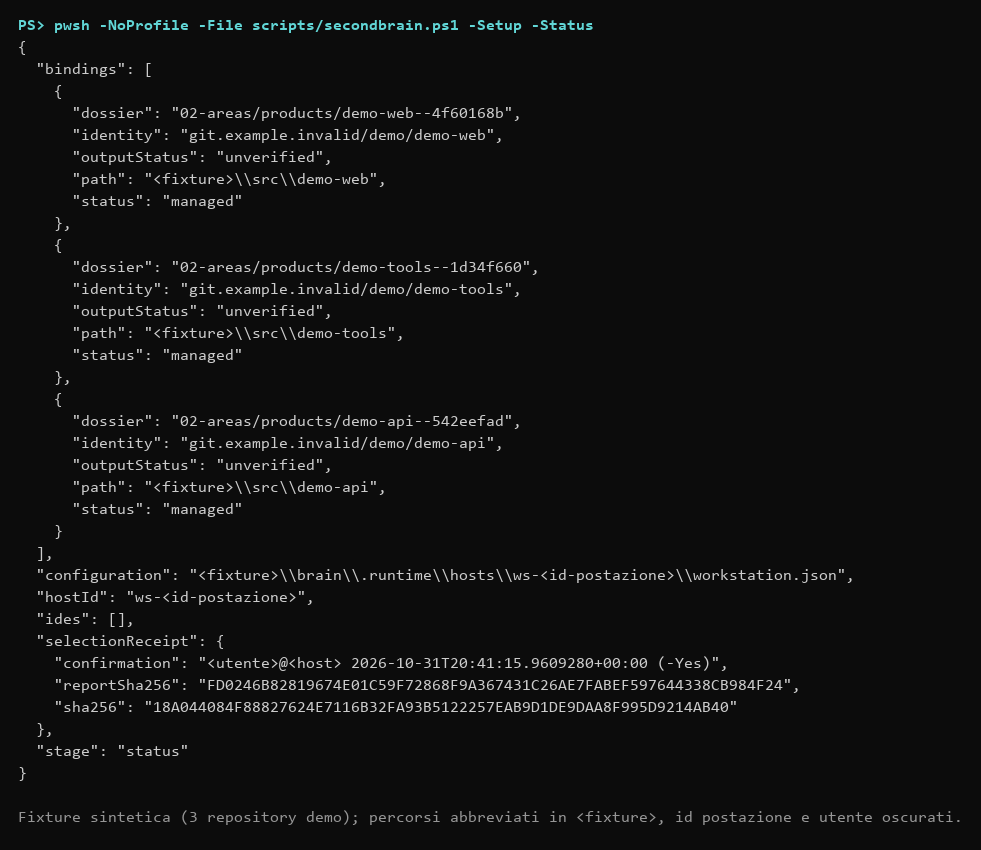
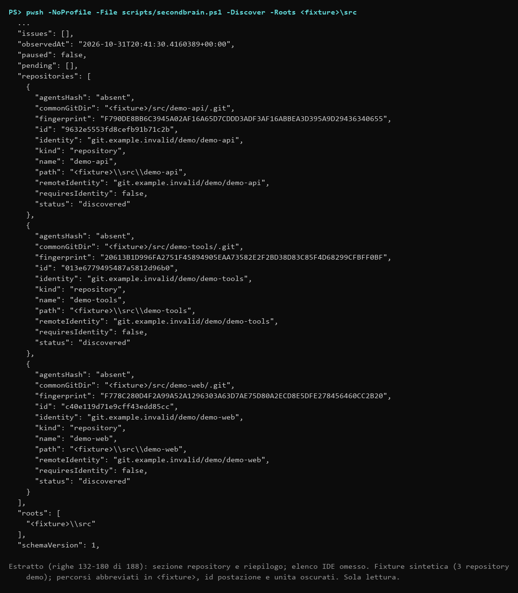
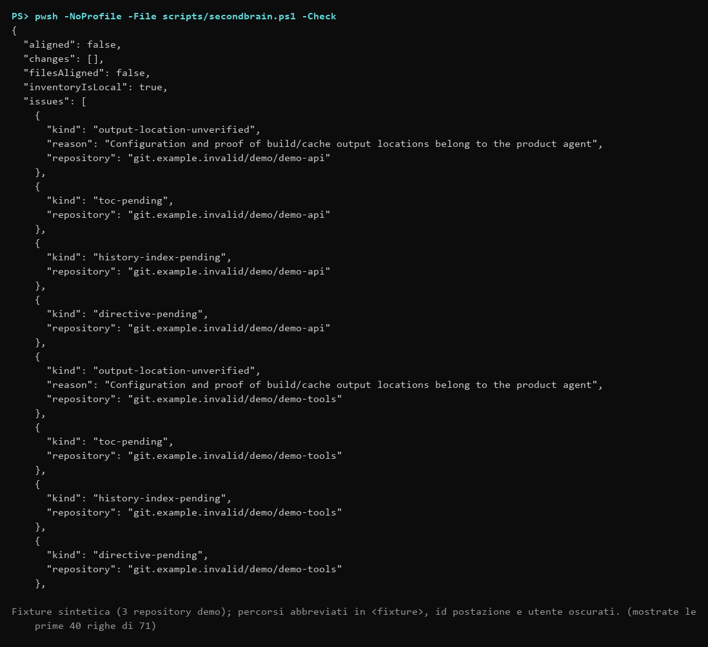
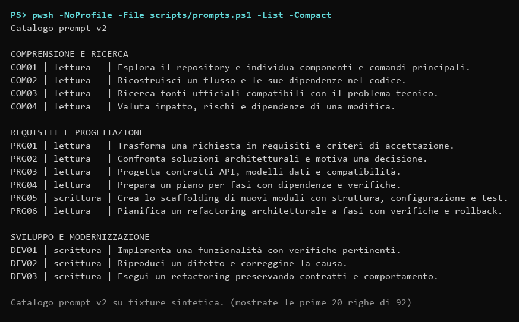

# SecondBrain — Governance Multi-Repository, Memoria Privata e Controllo Deterministico per Coding Agent

[](#prerequisiti)
[](#prerequisiti)
[](#i-6-pilastri-ingegneristici)
[](config/tracker.schema.json)
[-orange)](direttive/prompts/README.md)

**SecondBrain** è una piattaforma locale per Windows (PowerShell 7.5+ e Git) progettata per chi sviluppa e mantiene **decine di repository software** impiegando contemporaneamente più **IDE e coding agent** (Claude Code, OpenAI Codex, Google Antigravity, Continue, VS Code, Cursor, Android Studio).

A differenza dei memory bank arbitrari o dei vault generici gestiti autonomamente dagli LLM, SecondBrain applica **invarianti ingegneristici deterministici**: separa fisicamente il codice distribuibile dalla memoria privata di progetto, sincronizza direttive comuni approvate tramite hash crittografici SHA-256, governa un grafo di task inter-repository validato da JSON Schema e blocca la pubblicazione accidentale di dati sensibili o artefatti operativi.

---

## Inizia qui: impostare SecondBrain, server MCP e direttive globali

> **Prima di lanciare gli script**: alcuni comandi scrivono file tuoi fuori dal clone (direttive degli IDE come `~/.claude/CLAUDE.md`, configurazione MCP, `AGENTS.md` dei repository). Scrivono solo un blocco gestito delimitato da marcatori, non toccano il tuo codice e salvano l'originale in `.runtime/` (escluso da Git) prima di sostituirlo. Cosa tocca ogni comando, dove sono i backup, come ripristinare e come disinstallare: **[Cosa modifica SecondBrain e dove sono i backup](docs/safety-backups.md)**.

Requisiti: Windows, **PowerShell 7.5+**, **Git**. Ogni comando seguente si lancia dalla radice del clone; quelli senza `-Apply` non scrivono nulla.

```powershell
# 1. Clone (meglio un tuo repository privato: i dossier e i backup restano locali) e schermata iniziale
git clone https://github.com/dennidalpos/SecondBrain.git C:/Progetti/SecondBrain
cd C:/Progetti/SecondBrain
pwsh -NoProfile -File scripts/prompts.ps1          # è ciò che mostra `sb prompt` nella chat dell'IDE

# 2. Controllo in sola lettura (al primo avvio il codice di uscita 1 significa «ancora da allineare»)
pwsh -NoProfile -File scripts/secondbrain.ps1 -Check

# 3. Attivazione guidata: elenca repository e IDE e scrive solo dopo che digiti CONFERMO e APPLICA
pwsh -NoProfile -File scripts/secondbrain.ps1 -Setup -Interactive

# 4. Server MCP: prima l'anteprima, poi l'applicazione a un IDE (il file esistente viene salvato)
pwsh -NoProfile -File scripts/mcp-server.ps1 -Pair -Target claude
pwsh -NoProfile -File scripts/mcp-server.ps1 -Pair -Target claude -Apply

# 5. Direttive globali: distribuisce il blocco gestito in AGENTS.md e nei file IDE, poi verifica
pwsh -NoProfile -File scripts/secondbrain.ps1 -Sync
pwsh -NoProfile -File scripts/ide-map.ps1 -Verify
```



Dopo l'attivazione, nella chat dell'IDE scrivi `sb prompt`: mostra comandi, primi passi e le guide ([setup](docs/setup.md), [server MCP](docs/mcp-setup.md), [modifica dei prompt](docs/customizing-prompts-and-directives.md#modifica-dei-prompt), [modifica delle direttive](docs/customizing-prompts-and-directives.md#modifica-delle-direttive), [ripristino](docs/recovery.md)). Per gli IDE senza file locale (impostazioni account web, Continue, Android Studio) il testo da incollare è in `.runtime/hosts/<id>/istruzioni-globali.md`. Se qualcosa non va, `scripts/restore-managed.ps1 -List -Path <file>` trova il backup di un file sostituito.

---

## Perché serve ai Team e agli Sviluppatori Multi-Prodotto

Quando si scala l'uso degli agenti AI su 10, 20 o 50 repository, emergono problemi strutturali concreti:

1. **Inquinamento dei repository prodotto:** gli agenti salvano note, todo-list, memorie di sessione, file `.bak` e prove di debug dentro il working tree del progetto, rischiando di pubblicarli nei commit dei clienti o su repository open-source.
2. **Deriva delle regole tra IDE e repository:** mantenere allineati `AGENTS.md`, `CLAUDE.md`, `GEMINI.md` e le istruzioni account su più macchine e superfici diventa ingestibile a mano.
3. **Amnesia o esplosione del contesto:** caricare interi storici satura la finestra di contesto dell'LLM; lasciare che l'agente "riassuma da solo" i file di memoria porta alla perdita silenziosa di vincoli tecnici, gotcha architetturali e decisioni passate.
4. **Task frammentati e dipendenze invisibili:** una modifica su una libreria o su un servizio blocca altri prodotti, ma i file `TODO.md` isolati non vedono le dipendenze cross-repository.
5. **Azioni distruttive o non autorizzate:** senza confini rigidi, gli agenti eseguono pulizia impropria di artefatti, commit/push impliciti o build non richieste fuori dal perimetro del task.

---

## Architettura del Sistema



### Flusso Operativo del Coding Agent

Il seguente diagramma di sequenza illustra il ciclo deterministico di interazione tra sviluppatore, coding agent e SecondBrain (tramite server MCP stdio o CLI `prompts.ps1`) durante una sessione di sviluppo:



### I 6 Pilastri Ingegneristici

| Modulo | Funzione Verificata |
| :--- | :--- |
| **Separazione Codice / Dossier (`SecondBrain.Para.psm1`)** | I repository prodotto mantengono esclusivamente codice, istruzioni tecniche e documentazione pubblica. Contesto, decisioni tecniche (`memory.md`), cronologia e tracker risiedono nel dossier PARA locale corrispondente in SecondBrain, risolto tramite identità Git e `repository.json`. |
| **Avvio Snello a Livelli e Compattazione (`SecondBrain.Knowledge.psm1`)** | Compone il pacchetto di avvio iniziale (indice, sezioni essenziali di `context.md` e `memory.md`, task pronti in una riga e l'elenco dei livelli non caricati) entro **20.000 caratteri**, solo per il primo caricamento: dopo, `-Profile Full` e la ricerca non hanno tetto. Nessun troncamento silenzioso. Se il dossier cresce, il workflow SYS05 guida una compattazione assistita che archivia gli originali esatti per hash SHA-256 (`history/compaction/<sha256>/`). |
| **Grafo Task Multi-Repository (`SecondBrain.Tracker.psm1`)** | Ogni dossier possiede un `tracker.json` conforme a JSON Schema Draft 2020-12. Il validatore verifica unicità degli ID, stati, criteri di accettazione, assenza di cicli e **dipendenze incrociate tra repository diversi** (`repository` + `id`). |
| **Governance Direttive e IDE (`SecondBrain.Portable.psm1`)** | Nessuna direttiva viene distribuita se il suo hash SHA-256 non corrisponde alla ricevuta registrata in `direttive/approved.json`. Distingue formalmente tra *file allineato su disco*, *impostazione account manuale* e *prova di effettivo caricamento nella sessione* (SYS01). |
| **Transazioni, Lock e Recupero (`SecondBrain.Access.psm1`)** | Tutte le scritture verificano l'hash precedente del file, salvano backup verificati sotto `.runtime` e usano sessioni di lock con recupero transazionale atomico (`scripts/recover.ps1`). Nessun demone, timer o monitor periodico gira in background. |
| **Gate di Pubblicabilità e Asset Reali (`SecondBrain.Publication.psm1`)** | Il workflow REP05 ispeziona working tree, indice e blob storici Git alla ricerca di credenziali, percorsi host assoluti, email private, link Markdown rotti e binari non revisionati; supporta l'installazione opzionale di un hook Git pre-push. Il workflow REP07 certifica che gli screenshot pubblici (`docs/assets/*.png`) provengano dall'app reale con dati sintetici. |
| **Integrazione IDE e Server MCP (`SecondBrain.Mcp.psm1`)** | Server stdio JSON-RPC locale in sola lettura (`scripts/mcp-server.ps1`) che espone agli IDE (Cursor, Claude, Antigravity, VS Code, Windsurf) il contesto di avvio entro budget, i task pronti con dipendenze soddisfatte (`-ReadyOnly`), la ricerca trasversale nei dossier e il catalogo prompt v2. |

---

## Igiene del Repository e Privacy ("Code-Only")

SecondBrain implementa un modello a doppio confine:

```
SecondBrain/ (Clone Locale)
├── scripts/              <-- [PUBBLICO] Moduli PowerShell, CLI, test runner e validatori
├── direttive/            <-- [PUBBLICO] Direttive comuni approvate e 80 schede workflow Greenfield
├── config/               <-- [PUBBLICO] Schemi JSON (tracker, cataloghi, configurazioni)
├── docs/                 <-- [PUBBLICO] Documentazione architetturale e contratti tecnici
├── README.md, AGENTS.md  <-- [PUBBLICO] Presentazione e regole di governance
│
├── .gitignore            <-- [CONFINE DETERMINISTICO] Esclude categoricamente:
├── 01-projects/          <-- [PRIVATO LOCALE] Piani di lavoro e brief attivi
├── 02-areas/             <-- [PRIVATO LOCALE] Dossier dei prodotti (context, memory, tracker)
├── 03-resources/         <-- [PRIVATO LOCALE] Fonti normative e radar tecnologico
├── 04-archives/          <-- [PRIVATO LOCALE] Aree ritirate e storici conservati
└── .runtime/             <-- [PRIVATO LOCALE] Lock, backup SHA-256, selezioni host, cache
```

Questo garantisce che il codice della piattaforma possa essere clonato o aggiornato pubblicamente su GitHub senza alcun rischio di esporre note private, log di sessione, percorsi locali o dati di prodotti terzi.

### Flusso di Pubblicabilità e Safe Gate (REP05)

Prima di qualsiasi commit, push o rilascio pubblico, SecondBrain esegue una scansione deterministica del working tree, dell'indice e della cronologia Git (`scripts/publication.ps1 -RepositoryPath <repo>`):



---

## Integrazione nei Repository Prodotto

Nei repository prodotto gestiti da SecondBrain, il file `AGENTS.md` (o `CLAUDE.md`, `GEMINI.md`) riceve un blocco gestito delimitato e generato automaticamente da `scripts/secondbrain.ps1 -Sync`:

```markdown
<!-- secondbrain:repository:begin -->
Direttive comuni applicate: revisione 4.3 — 2026-10-31.
<!-- secondbrain:source global=<sha256> workstation=<sha256> -->
SecondBrain: integrazione opzionale della conoscenza e delle direttive comuni.
Risolvi SECONDBRAIN_HOME dall'ambiente utente della postazione; nessun percorso
personale è conservato in questo repository. Se il clone privato non è disponibile,
prosegui con le istruzioni tecniche locali e segnala l'integrazione non configurata.
Dal clone SecondBrain usa:
  pwsh -File scripts/prompts.ps1 -Context -RepositoryPath <checkout-corrente>
per risolvere il dossier e il suo index.md. Carica indice, contesto sintetico,
memoria essenziale e proiezione task pertinente. Memorie private, tracker interni,
backup e output operativi risiedono in SecondBrain. Conserva qui solo codice,
guide e asset pubblicabili.
<!-- secondbrain:repository:end -->
```

Questo approccio consente a qualsiasi agente aperto nel repository satellite di risolvere la memoria storica senza sporcare il repository satellite stesso.

---

## Catalogo degli 80 Workflow Operativi (v2)

I workflow sono schede ingegneristiche standardizzate composte dalla CLI (`scripts/prompts.ps1`) che forniscono all'agente contesto verificato, riferimenti locali e criteri di accettazione:

In chat (con le direttive caricate) `sb prompt` mostra il link al file Markdown del catalogo completo e la tabella dei comandi `sb`; `sb prompt tutti` elenca tutti gli 80 workflow, uno per riga; `sb prompt ambito test`, `sb prompt mostra TST04` e `sb prompt TST04: obiettivo` filtrano per area, mostrano una scheda o compongono il prompt. Il diagramma delle forme è in [Workflow di prompting](docs/prompt-workflows.md).

| Ambito | Codici | Scopo |
| :--- | :--- | :--- |
| **Comprensione e Ricerca** | `COM01`–`COM04` | Esplorazione architettura, ricostruzione flussi, ricerca fonti ufficiali, analisi di impatto e rischi. |
| **Requisiti e Progettazione** | `PRG01`–`PRG06` | Formalizzazione requisiti, confronto architetturale, design API/dati, pianificazione per fasi, scaffolding (PRG05) e piano di refactoring (PRG06). |
| **Sviluppo e Modernizzazione**| `DEV01`–`DEV10` | Nuove feature con test, riproduzione bug e root cause, refactoring conservativo, aggiornamento dipendenze, migrazione stack, linter e analisi statica (DEV06), triage di issue (DEV07) e revisione di qualità del codice (DEV08). |
| **Test e Verifica** | `TST01`–`TST07` | Test unitari/integrazione, test end-to-end, diagnosi test instabili (flaky), correzione fallimenti CI, collaudo funzionale, benchmark prestazioni, test harness protetto (TST07). |
| **Review e Sicurezza** | `SEC01`–`SEC09` | Code review con rilievi verificati, threat modeling e confini di fiducia, mitigazione vulnerabilità, secret scanning (SEC04), isolamento dati e GDPR (SEC05), hardening (SEC06), dati sensibili prima del push (SEC07), esposizione remota (SEC08), reset del remoto GitHub (SEC09). |
| **Interfaccia ed Esperienza** | `INT01`–`INT04` | Valutazione usabilità e stati UX, implementazione UI conforme ai requisiti, accessibilità (a11y) e navigazione da tastiera, internazionalizzazione e localizzazione (INT04). |
| **Dati e Integrazioni** | `DAT01`–`DAT03` | Migrazioni schema con verifica e rollback, pipeline di importazione/trasformazione deterministiche, integrazioni API resilienti. |
| **Build e Operatività** | `OPS01`–`OPS04` | Packaging artefatti, pipeline CI/CD e Infrastructure-as-Code, osservabilità e log diagnostici, note di rilascio e verifiche di consegna. |
| **Repository e Documentazione**| `REP01`–`REP10` | Esecuzione del prossimo task, guide coerenti col codice reale, documentazione contratti API, pulizia verificata, verifica pubblicabilità (REP05), preparazione README (REP06), screenshot reali certificati (REP07), ispezione repo e residui (REP08), preparazione di commit e pull request (REP09). |
| **Memoria e Continuità** | `MEM01`–`MEM04`, `SYS06` | Allineamento istruzioni locali/memoria/tracker, migrazione progettazione nel dossier PARA, handoff di sessione verificabile, elenco task tracker (MEM04), caricamento di memoria e contesto del repository (SYS06). |
| **Manutenzione Centrale** | `SYS01`–`SYS11` | Verifica e mappatura IDE, conformità fonti autorevoli, discovery e attivazione postazione (SYS03), check/sync della postazione (SYS04), compattazione dossier a budget fisso (SYS05), PARA (SYS07), metriche (SYS08), backup (SYS09), gestione del catalogo prompt (SYS11). |
| **Audit e Metriche** | `AUD01`–`AUD06` | Audit completo, metriche del repository, architettura e debito tecnico, dipendenze, prestazioni, esportazione dei rapporti in Markdown, JSON, HTML, CSV, SARIF, DOCX, PDF o XLSX. |
| **Governance e Licenze** | `GOV01`, `GOV02` | Verifica conformità licenze open source SPDX (GOV01), registro CREDITS e licenze terze parti (GOV02). |

### Interazione Guidata con Tool Use e Architettura Anti-Overload (Revisione 4.2)

- **Selezione Interattiva (Function Calling)**: I prompt decisionali (`COM01`, `COM02`, `PRG01`, `PRG02`, `SYS03`, `SYS04`, `SYS05`, `REP05`) adottano prioritariamente strumenti di Function Calling/Tool Use (come `ask_question`) per presentare selezioni a scelta multipla nell'interfaccia dell'IDE anziché richiedere continue conferme testuali o risposte a testo libero ripetitive.
- **Recupero a Strati e Budget Rigoroso**: La pipeline `scripts/knowledge.ps1` e il server MCP caricano all'avvio solo il contesto essenziale entro **20.000 caratteri** (profilo snello: indice, sezioni essenziali di `context.md` e `memory.md`, task pronti in una riga, livelli non caricati); il tetto vale solo per il primo caricamento, poi il resto si richiede (`-Profile Full`, `-Search`) senza ulteriore tetto. I task conclusi (`done`/`cancelled`) non entrano nella proiezione di avvio, prevenendo la saturazione della memoria di lavoro.
- **Caricamento Atomico On-Demand**: Gli 80 workflow operativi non vengono mai iniettati simultaneamente nel contesto; l'agente o lo sviluppatore richiamano esclusivamente la singola scheda necessaria al task corrente.

---

## Casi d'Uso Reali

### 1. Consulente o Software House Multi-Cliente
* **Scenario:** Lavori su oltre 20 repository per clienti diversi utilizzando agenti AI. Desideri che l'agente ricordi i "gotcha" architetturali, i bug storici e le scelte tecniche, ma **nessuna informazione interna deve comparire nei commit dei clienti**.
* **Come interviene SecondBrain:** L'agente aperto nel repository cliente risolve `SECONDBRAIN_HOME`, legge il contesto dal dossier privato in SecondBrain (`scripts/prompts.ps1 -Context -RepositoryPath .`) e salva lì avanzamenti, note e compiti. Prima della consegna, `scripts/publication.ps1` (REP05) verifica che nel repository del cliente non siano finiti percorsi host, segreti o residui operativi.

### 2. Sviluppatore Multi-IDE su più Postazioni Windows (`sb attiva` / SYS03)
* **Scenario:** Utilizzi Claude Code da riga di comando per i task veloci, Antigravity per il pair programming visivo e Codex per le review, su più PC Windows.
* **Come interviene SecondBrain:** Sul nuovo PC, `scripts/secondbrain.ps1 -Discover` rileva in sola lettura i repository Git e gli IDE installati. Dopo la selezione esplicita (`-Activate -SelectionPath ... -Apply`), SecondBrain crea le associazioni locali e allinea le direttive comuni nei file di configurazione degli IDE preservando le impostazioni personali dell'utente.

### 3. Modifiche Coordinate Cross-Repository
* **Scenario:** Un refactoring nel repository di autenticazione `CoreAuth` richiede modifiche a cascata in `AppDesktop` e `ServiceAPI`. L'agente che lavora su `AppDesktop` non deve considerare il task completabile finché il prerequisito in `CoreAuth` non è chiuso e collaudato.
* **Come interviene SecondBrain:** I file `tracker.json` dei dossier dichiarano la dipendenza tipizzata inter-repository (`repository` + `id`). Il motore `Test-SBTrackerData` verifica il grafo globale, impedisce cicli o dipendenze orfane e segnala all'agente i compiti bloccati.

---

## Confronto con Altri Approcci

| Caratteristica | File `.md` sparsi nel Repo (`MEMORY.md`, `TODO.md`) | Vault Obsidian AI (`obsidian-second-brain`) | **SecondBrain** |
| :--- | :--- | :--- | :--- |
| **Igiene del repo pubblico** | ❌ File interni committati nel codice | ✅ Esterno (nel vault) | ✅ **Totale** (dossier + `.runtime` isolati + gate REP05) |
| **Sincronizzazione regole multi-IDE** | ❌ Manuale per ogni repo/IDE | ⚠️ Tramite compilazione slash command | ✅ **Approvata per SHA-256** con verifica di caricamento (SYS01) |
| **Controllo del budget di contesto** | ❌ Crescita incontrollata | ⚠️ Dipende dalle query dell'agente | ✅ **Avvio snello misurato (20.000 caratteri) e livelli a richiesta** senza troncamenti |
| **Compattazione della memoria** | ❌ Sovrascrittura distruttiva | ❌ Riscrittura autonoma delle note | ✅ **Conservativa (SYS05)**: originali archiviati per hash SHA-256 |
| **Dipendenze task cross-repo** | ❌ Assenti | ❌ Note testuali libere | ✅ **Grafo JSON Schema v1** validato tra repository |
| **Protezione da azioni non autorizzate** | ❌ Affidata solo al prompt | ⚠️ Marker sentinella nelle note | ✅ **Lock di sessione, hash pre-scrittura e manifest di rollback** |

---

## Catalogo Workflow e 13 Aree Ingegneristiche (COM01–GOV02)

Gli 80 prompt ingegneristici di SecondBrain sono organizzati in 13 aree tematiche ben distinte:

| Area | Codici | Scopo e Responsabilità |
| :--- | :--- | :--- |
| **Sistema** | `SYS01..SYS11` | Manutenzione centrale, bootstrap SYS03, allineamento SYS04, compattazione SYS05, navigazione PARA SYS07, metriche memoria SYS08, backup SYS09 e gestione del catalogo prompt SYS11. |
| **Comprensione** | `COM01..COM04` | Esplorazione repository, tracciamento flussi e consultazione fonti ufficiali compatibili. |
| **Progettazione** | `PRG01..PRG06` | Requisiti, architettura, spike tecnici, piani a fasi, scaffolding (PRG05) e piano di refactoring (PRG06). |
| **Sviluppo** | `DEV01..DEV10` | Implementazione incrementale, refactoring, gestione dipendenze, bug fixing, linter/analisi statica (DEV06), triage issue (DEV07) e qualità del codice (DEV08), consolidamento e leggibilità (DEV09) e ottimizzazione (DEV10). |
| **Test** | `TST01..TST07` | Piramide dei test, unità, integrazione, regressione e test harness isolati con fixture protette (TST07). |
| **Sicurezza** | `SEC01..SEC09` | Code review, secret scanning (SEC04), hardening, conformità privacy e isolamento GDPR dei dati personali (SEC05), hardening (SEC06), gate dei dati sensibili prima del push (SEC07), verifica dell’esposizione remota (SEC08) e reset del remoto GitHub (SEC09). |
| **Interfaccia** | `INT01..INT04` | UI/UX, accessibilità da tastiera, flussi utente e internazionalizzazione (INT04). |
| **Dati** | `DAT01..DAT03` | Modellazione dati, migrazioni di schema con rollback e contratti API. |
| **Operatività** | `OPS01..OPS04` | Scripting, automazione build, diagnostica runtime e pipeline CI/CD. |
| **Repository** | `REP01..REP10` | Igiene del repository, gate di pubblicabilità (REP05), README coerenti (REP06), screenshot reali (REP07), ispezione residui/memoria/codice (REP08) preparazione di commit e pull request (REP09) e allineamento di .gitignore e .gitkeep (REP10). |
| **Audit** | `AUD01..AUD06` | Audit completo del repository (AUD01), metriche (AUD02), architettura e debito tecnico (AUD03), dipendenze (AUD04), prestazioni (AUD05) ed esportazione dei rapporti nel formato scelto (AUD06). |
| **Governance** | `GOV01`, `GOV02` | Adozione licenze software (SPDX) e attribuzione crediti terze parti (GOV02 / CREDITS.md). |
| **Memoria** | `MEM01..MEM04`, `SYS06` | Allineamento dossier, migrazione attività, handoff verificabile, elenco/descrizione task del tracker (MEM04) e caricamento di contesto e memoria del repository (SYS06). |

---

## Avvio Rapido (Quickstart in 5 Minuti)

La procedura breve con anteprime e backup è nella sezione [Inizia qui](#inizia-qui-impostare-secondbrain-server-mcp-e-direttive-globali); questa sezione la approfondisce.

### Prerequisiti
* **Windows 10/11** o **Windows Server 2022+**
* **PowerShell 7.5+** (`pwsh`)
* **Git per Windows**

### Passo 1: Discovery e Attivazione Postazione (SYS03)
Dalla radice del clone SecondBrain. I repository possono trovarsi su qualsiasi disco o cartella: indica le radici con `-Roots` (senza `-Roots` vengono scansionati i volumi fissi).

Il percorso principale è lo script guidato `-Setup`: preflight (PowerShell, git, `.runtime` scrivibile, policy condivisa), discovery, proposta, conferma reale, anteprima e applicazione. Report e selezione sono scritti per host in `.runtime/hosts/<id>/` (`discovery.json`, `selection.json`); `selection.json` non si scrive a mano.

```powershell
# Guidato: elenca repository e IDE, chiede la selezione e digitare CONFERMO / APPLICA
pwsh -NoProfile -File scripts/secondbrain.ps1 -Setup -Interactive -Roots "D:\Sviluppo","E:\Clienti"

# Non interattivo (anche per gli agent, SYS03): prima la proposta, poi -Select con -Yes dopo la conferma dell'utente
pwsh -NoProfile -File scripts/secondbrain.ps1 -Setup -Roots "D:\Sviluppo"
pwsh -NoProfile -File scripts/secondbrain.ps1 -Setup -Roots "D:\Sviluppo" -Select mio-prodotto -Yes          # anteprima
pwsh -NoProfile -File scripts/secondbrain.ps1 -Setup -Roots "D:\Sviluppo" -Select mio-prodotto -Yes -Apply   # applica e registra SECONDBRAIN_HOME
```

Exit code di `-Setup`: 0 anteprima valida o attivazione applicata, 1 proposta non confermata o discovery in pausa, 2 errore, 3 archivio occupato. `-Setup -Status` mostra in sola lettura binding, IDE e ultima ricevuta; `-Setup -Unbind <identità|percorso|id IDE|nome IDE> [-Yes] [-Apply]` disassocia repository e integrazioni IDE gestiti con la stessa conferma (dossier e file IDE restano); `-Setup -Output <identità|percorso> -OutputStatus verified|exception-accepted|unverified` registra l'esito della collocazione degli output dopo la prova dell'agent prodotto (guida utente). Dopo `-Apply` viene eseguito un `-Check` (la distribuzione delle direttive resta separata: `-Sync`, oppure `-AndSync`). Le primitive `-Discover` (report per host se manca `-ReportPath`) e `-Activate -SelectionPath <file> [-Apply]` restano disponibili.



*Output reale di `-Setup -Status` su una fixture sintetica (percorsi della fixture abbreviati, id postazione e utente oscurati).*



*Estratto dell'output reale di `-Discover` (sola lettura) sulla stessa fixture, eseguito con profilo utente e `PATH` isolati: sezione repository e riepilogo, elenco IDE omesso; percorsi della fixture abbreviati, id postazione e unità oscurati.*

### Passo 2: Controllo Quotidiano e Sincronizzazione (SYS04)
```powershell
# Verifica in sola lettura lo stato di repository, TOC, budget, tracker e IDE
pwsh -NoProfile -File scripts/secondbrain.ps1 -Check

# Distribuisce le direttive approvate e aggiorna gli indici gestiti
pwsh -NoProfile -File scripts/secondbrain.ps1 -Sync
```



*Output reale di `-Check` sulla stessa fixture (prime 40 righe di 71). L'exit code 1 è corretto: output non verificati, TOC e direttive ancora da distribuire.*

### Passo 3: Consultazione Workflow e Composizione Prompt (COM01–GOV02)
```powershell
# Senza argomenti: link al catalogo completo e tabella dei comandi sb (è ciò che mostra `sb prompt` in chat)
pwsh -NoProfile -File scripts/prompts.ps1

# Tutti gli 80 workflow, una riga ciascuno (è ciò che mostra `sb prompt tutti`)
pwsh -NoProfile -File scripts/prompts.ps1 -List -Compact

# Elenco esteso (ID, scope, requisiti ed esempio) di tutto il catalogo o di un'area, per id o prefisso (test, TST, sistema)
pwsh -NoProfile -File scripts/prompts.ps1 -List
pwsh -NoProfile -File scripts/prompts.ps1 -List -Category TST

# Mostra una scheda specifica (es. REP05 per pubblicabilità o SYS09 per backup)
pwsh -NoProfile -File scripts/prompts.ps1 -Show -Prompt REP05

# Compone il prompt operativo integrando contesto locale e tracker
pwsh -NoProfile -File scripts/prompts.ps1 -Compose -Prompt DEV01 -Objective 'Implementa endpoint' -RepositoryPath C:/Progetti/MioRepo
```



*Output reale di `-List -Compact` su fixture sintetica (prime 20 righe di 92: una riga per prompt, per area), catturato dal commit `8f51ef8` con working tree pulito. `-List` senza `-Compact` mostra le schede estese.*

### Personalizzazione
Aggiungere o rimuovere prompt e aree, scegliere dischi e repository da gestire, configurare `config/shared.json` e importare un tracker esistente: vedi la [guida alla personalizzazione](docs/customizing-prompts-and-directives.md).

### Operazioni Accessorie: Backup e Verifica Pre-Push
```powershell
# Esegue il backup compresso deterministico dei dati locali con verifica crittografica
pwsh -NoProfile -File scripts/backup.ps1
pwsh -NoProfile -File scripts/backup.ps1 -Verify

# Verifica pre-push: accerta che nessun dato privato o locale sia nell'indice Git
pwsh -NoProfile -File scripts/check-distribution.ps1
```

---

## Suite di Verifica e Limiti Dichiarati

I controlli sono deterministici ed eseguibili in ambiente locale disconnesso dalla rete:

```powershell
pwsh -NoProfile -File scripts/test-secondbrain.ps1          # Suite principale (tutte le suite, modalità Fast)
pwsh -NoProfile -File scripts/test-secondbrain-portable.ps1 # Motore portabile
pwsh -NoProfile -File scripts/test-secondbrain-workflows.ps1# Workflow v2 (118 verifiche)
pwsh -NoProfile -File scripts/ide-map.ps1 -Verify          # Mappa e allineamento IDE
pwsh -NoProfile -File scripts/build-prompts.ps1 -Check     # Coerenza catalogo prompt
pwsh -NoProfile -File scripts/para.ps1 -Check              # Indice PARA e integrità dossier
```

### Limiti Effettivi Dichiarati
* **Piattaforma:** progettato, sviluppato e testato specificamente per ambienti **Windows** con PowerShell 7.5+.
* **Superfici IDE manuali:** per gli IDE che non espongono file di configurazione locali su disco (es. impostazioni account web di Claude, Continue, Android Studio), SecondBrain genera il testo certificato e registra le prove di osservazione (SYS01), senza automatizzare il login né modificare configurazioni non documentate.
* **Isolamento runtime (`work.ps1`):** il wrapper reindirizza `TEMP`/`TMP` e le cartelle di cache standard sotto `.runtime`, ma i flag di output specifici di ogni compilatore (es. MSBuild, Gradle, bundler) devono essere qualificati nel singolo repository prodotto.
* **Audit di pubblicabilità (`publication.ps1`):** la verifica si basa su regole sintattiche, regex per credenziali/percorsi e ispezione dei binari dichiarati; non sostituisce una consulenza legale sulla proprietà intellettuale.
* **Asset visivi e politica screenshot (REP07):** gli eventuali screenshot pubblici risiedono esclusivamente in `docs/assets/` e derivano dall'applicazione reale con dati sintetici verificati; nessuna interfaccia simulata o mockup viene impiegato per sostituire catture mancanti. Le immagini attuali sono output reale della console (testo di stdout conservato nel runtime e rasterizzato con Pillow, non una finestra del terminale) catturato su un working tree con modifiche non committate; non esiste ancora una cattura del solo `-Discover`, il cui output reale elenca IDE e unità della macchina.

---

## Assistenza, Segnalazioni e Contributi

* **Segnalazione Bug e Richieste:** Per segnalare anomalie nei cmdlet PowerShell, falsi positivi nel gate REP05 o discrepanze nella validazione del tracker JSON Schema, apri una issue su [GitHub Issues](https://github.com/dennidalpos/SecondBrain/issues).
* **Linee Guida per i Contributi:** Ogni pull request deve rispettare le direttive comuni approvate (`direttive/AGENTS.global_ide.md`), superare la suite di test completa (`pwsh -NoProfile -File scripts/test-secondbrain.ps1`) e superare il controllo di pubblicabilità (`scripts/publication.ps1 -RepositoryPath .`).
* **Sicurezza e Riservatezza:** Per segnalazioni relative alla sicurezza o all'esposizione accidentale di dati, contatta privatamente il maintainer prima di aprire issue pubbliche.

---

## Documentazione e Guide

* [Cosa modifica SecondBrain e dove sono i backup](docs/safety-backups.md)
* [Manutenzione di .runtime e contesto iniziale](docs/runtime-maintenance.md)
* [Guida Utente End-to-End](docs/user-guide.md)
* [Architettura e Moduli di Sistema](docs/architecture.md)
* [Guida Setup e Pairing Server MCP negli IDE](docs/mcp-setup.md)
* [Personalizzazione di Prompt, Direttive, Repository e Tracker](docs/customizing-prompts-and-directives.md)
* [Catalogo degli 80 Workflow (COM01–GOV02)](direttive/prompts/README.md)
* [Motore Portabile e Discovery (SYS03)](docs/portable-brain.md)
* [SecondBrain su una share di rete con più PC](docs/shared-brain.md)
* [Sessioni di Accesso, Lock e Concorrenza](docs/access.md)
* [Recupero Transazionale e Pulizia Sicura](docs/recovery.md)
* [Contratto Tracker JSON Schema v1 e Migrazioni](docs/trackers.md)
* [Superfici IDE, Profili e Verifica SYS01](docs/adapters.md)
* [Registro Fonti Autorevoli e Standard (SYS02)](docs/authoritative-sources.md)
* [Indice delle Procedure Operative](docs/operations.md)
* [Alberatura e cartelle cancellabili](docs/tree.md)
* [Licenza MIT](LICENSE)
* [Credits e Attribuzioni Terze Parti](CREDITS.md)
