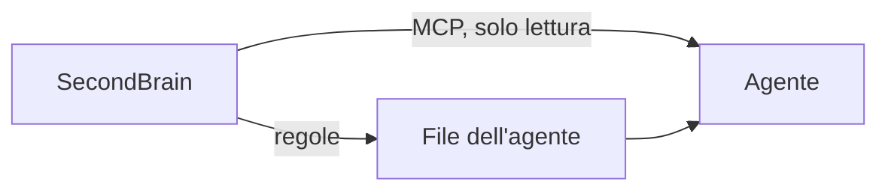

# Agenti e MCP

Ogni agente riceve due cose: le **regole** e il **collegamento MCP**, che gli permette di leggere memoria e prompt.



## Strumenti convalidati

| Strumento | File di regole | Comando MCP |
|---|---|---|
| Claude per Windows | `~/.claude/CLAUDE.md` | `-Target claude` |
| ChatGPT Codex per Windows | `~/.codex/AGENTS.md` | `-Target codex` |
| Antigravity per Windows | `~/.gemini/GEMINI.md` | `-Target antigravity` |

Le impostazioni dell'account Claude non hanno un file: incolla il testo di `.runtime/hosts/<id>/istruzioni-globali.md`.

Con più account o più radici di configurazione dello stesso strumento, registra ogni integrazione con `sb prompt SYS12` (procedura e disclaimer in [IDE](riferimento/adapters.md)): SecondBrain non rileva gli account, li dichiari tu.

## Collega

```powershell
pwsh -NoProfile -File scripts/mcp-server.ps1 -Pair -Target codex
pwsh -NoProfile -File scripts/mcp-server.ps1 -Pair -Target codex -Apply
```

Il primo mostra l'anteprima, il secondo applica e salva prima il file esistente. Poi riavvia l'agente.

## Cosa può fare l'agente con MCP

| Strumento | A cosa serve |
|---|---|
| `get_startup_context` | Leggere contesto e memoria del progetto |
| `get_ready_tasks` | Vedere i task pronti |
| `get_task` | Leggere un task per intero (criteri, evidenze), anche archiviato |
| `search_knowledge` | Cercare negli appunti (archivio e report inclusi, a pagine) |
| `list_prompts`, `get_prompt`, `get_prompt_home` | Consultare i prompt |
| `check_publication` | Controllare un progetto prima del push |

Il server gira solo sul tuo PC: nessuna porta di rete e nessuna modifica ai file.

## Senza MCP

MCP è opzionale. Senza server l'agente (o tu) ottiene gli stessi contenuti dalla riga di comando: un test confronta i due percorsi sugli stessi input per tutti gli 8 strumenti (la CLI aggiunge solo l'intestazione `CATALOGO PROMPT` in `-Show`).

| Strumento MCP | Comando CLI | Comando `sb` nell'IDE |
|---|---|---|
| `get_startup_context` | `knowledge.ps1 -Startup [-Profile Full]` | — |
| `get_ready_tasks` | `knowledge.ps1 -Tasks -ReadyOnly` (`-All` per la vista globale) | — |
| `get_task` | `knowledge.ps1 -Task <id o #seq>` | — |
| `search_knowledge` | `knowledge.ps1 -Search <testo> [-Mode Relevance]` | — |
| `get_prompt_home` | `prompts.ps1` | `sb prompt` |
| `list_prompts` | `prompts.ps1 -List -Compact` | `sb prompt tutti` |
| `get_prompt` | `prompts.ps1 -Show -Prompt <CHIAVE>` | `sb prompt mostra CHIAVE` |
| `check_publication` | `publication.ps1 -RepositoryPath <repo>` | `sb prompt REP05` |

Dal checkout di un repository gestito i comandi `knowledge.ps1` risolvono da soli il dossier; altrove indica `-Repository` o `-CheckoutPath`. `sb controlla` e `sb allinea` corrispondono a `secondbrain.ps1 -Check` e `-Sync`.
## Controlla

```powershell
pwsh -NoProfile -File scripts/ide-map.ps1 -Verify
```

Un file aggiornato non basta: apri una nuova sessione e scrivi `sb prompt`.

## Altri strumenti

Il codice riconosce anche VS Code, Cursor, Windsurf, Continue, JetBrains e Android Studio. Sono presenti ma **non convalidati**.

Dettagli: [agenti](riferimento/adapters.md), [MCP](riferimento/mcp-setup.md).
