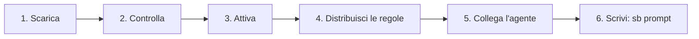

# Inizia

Dieci minuti per attivare SecondBrain. Niente viene scritto senza la tua conferma.



Servono Windows, Git 2.42+ e PowerShell 7.5+. Il preflight rifiuta Git assente, non eseguibile, precedente a 2.42 o con versione non riconoscibile.

## 1. Scarica

```powershell
git clone https://github.com/dennidalpos/SecondBrain.git C:/Progetti/SecondBrain
cd C:/Progetti/SecondBrain
```

Meglio un tuo repository privato: le note restano sul PC, ma così puoi salvarle.

## 2. Controlla

```powershell
pwsh -NoProfile -File scripts/secondbrain.ps1 -Check
```

Non scrive nulla. La prima volta dice `Postazione non attivata`: è normale, si risolve al passo 3.

## 3. Attiva

```powershell
pwsh -NoProfile -File scripts/secondbrain.ps1 -Setup -Interactive
```

Elenca i progetti e gli agenti trovati. Scegli i tuoi, poi conferma scrivendo `CONFERMO` e `APPLICA`.

## 4. Distribuisci le regole

```powershell
pwsh -NoProfile -File scripts/secondbrain.ps1 -Sync
```

Aggiunge un breve testo in `AGENTS.md` dei progetti e nel file di regole di ogni agente. Il resto del file non cambia.

## 5. Collega l'agente

```powershell
pwsh -NoProfile -File scripts/mcp-server.ps1 -Pair -Target claude
pwsh -NoProfile -File scripts/mcp-server.ps1 -Pair -Target claude -Apply
```

Il primo comando mostra cosa farà, il secondo lo fa. Al posto di `claude` puoi usare `codex` o `antigravity`.

## 6. Prova

Riavvia l'agente e scrivi in chat:

```text
sb prompt
```

Se vedi l'elenco dei comandi, è tutto pronto. Per controllare in ogni momento:

```powershell
pwsh -NoProfile -File scripts/ide-map.ps1 -Verify
```

## Se qualcosa non va

| Sintomo | Cosa fare |
|---|---|
| L'agente non conosce `sb prompt` | Riavvialo e apri una nuova sessione |
| Dopo l'attivazione `-Check` termina con codice 1 | Leggi le voci in `issues`: spesso sono solo promemoria |
| Vuoi tornare indietro | [Ripristina un file](sicurezza.it.md#ripristina-un-file) |

Prossimo passo: [uso quotidiano](uso-quotidiano.md). Tutte le opzioni: [configurazione](riferimento/portable-brain.it.md#configurazione-e-prerequisiti).

## Prima configurazione guidata

Su una macchina pulita, dopo il clone, chiedi all'agente `sb setup` (prompt SYS17). Esegue `scripts/setup-status.ps1` (sola lettura: preflight, IDE rilevati e quali funzioni facoltative sono abilitate, disponibili o non supportate, con motivo e comando di anteprima), poi guida attivazione (SYS03), MCP (SYS15) e direttive (SYS01) con una conferma prima di ogni scrittura, e infine propone le funzioni facoltative una alla volta. I consigli derivano dallo stato attuale della postazione, non dalla cronologia dei comandi; nulla viene abilitato senza la tua conferma. Il JSON elenca per prime le funzionalità raccomandate, aggiunge un `summary` per funzionalità e un oggetto `exit` che spiega il codice di uscita (1 indica raccomandazioni o postazione non attivata, non un errore).
