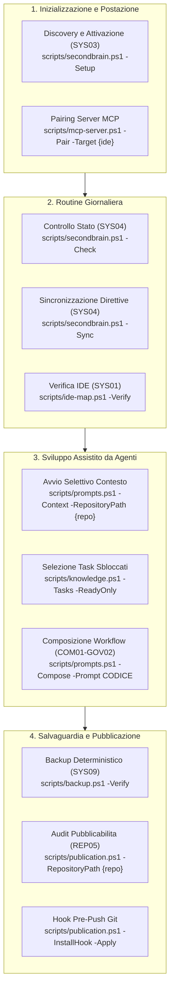

# Guida operativa

> Tool portabile: [procedura corrente](portable-brain.md). Nessun monitor; output operativi sotto .runtime e pulizia solo su richiesta. Revisione comune 4.3 attiva. I comandi e contratti schema precedenti sono conservati esclusivamente per recupero storico e migrazione.

Comandi dalla radice di SecondBrain, con PowerShell 7.5+ e Git. `-ConfigPath` è facoltativo: senza di esso si usa la configurazione della postazione attivata (`.runtime/hosts/<id>/workstation.json`); un percorso inesistente produce l’errore «Configurazione non trovata».

## Mappa delle Procedure Operative

## Indice dei Documenti Operativi

| Ambito | Contenuto |
|---|---|
| [Manutenzione di .runtime e contesto iniziale](runtime-maintenance.md) | Categorie di .runtime, routine mensile, proposta di pulizia, profilo di avvio snello |
| [Sicurezza e backup](safety-backups.md) | Cosa modifica SecondBrain, dove sono i backup, ripristino e disinstallazione (da leggere per primo) |
| [Guida Utente End-to-End](user-guide.md) | Installazione, discovery, sincronizzazione, workflow e backup |
| [Architettura](architecture.md) | Visione d'insieme, moduli PowerShell, diagrammi Mermaid e invarianti |
| [Integrazione MCP](mcp-setup.md) | Setup server stdio locale e pairing con Codex, Claude, Cursor, VS Code |
| [Workflow Operativi (COM01-GOV02)](prompt-workflows.md) | Catalogo dei 67 workflow, 12 aree tematiche e schede v2 |
| [Configurazione](setup.md) | Requisiti, percorsi, schemi e nuovo PC |
| [Check e Sync](check-sync.md) | Controlli, file generati, exit code |
| [Accessi](access.md) | Letture dirette, sessioni Write, lock e rinnovo |
| [Recupero](recovery.md) | Pulizia, backup gestiti e transazioni PARA |
| [Alberatura](tree.md) | Ogni cartella del clone e di `.runtime`, chi la scrive e cosa si può cancellare a mano |
| [Direttive e cataloghi](directives-prompts.md) | Approvazioni, catalogo v2 e generazione |
| [IDE](adapters.md) | Mappa, verifica dei file e caricamento manuale |
| [PARA e workflow](para-costar.md) | Metadati, Progetti, composizione e archiviazione |
| [Tracker](trackers.md) | Fonti autorevoli, conversione, manifest, ripresa e recupero |
| [Registro delle fonti](authoritative-sources.md) | Normative, standard, dati ufficiali, applicabilita e verifica settimanale |
| [Audit GitHub](external-audit.md) | Raccolta GET esplicita, paginazione, copertura e limiti esterni |

Fonti operative: [script installati](../scripts/), [regole del repository](../AGENTS.md). Le evidenze storiche e il tracker corrente (conservato nel dossier locale SecondBrain) restano separati dalle procedure.
