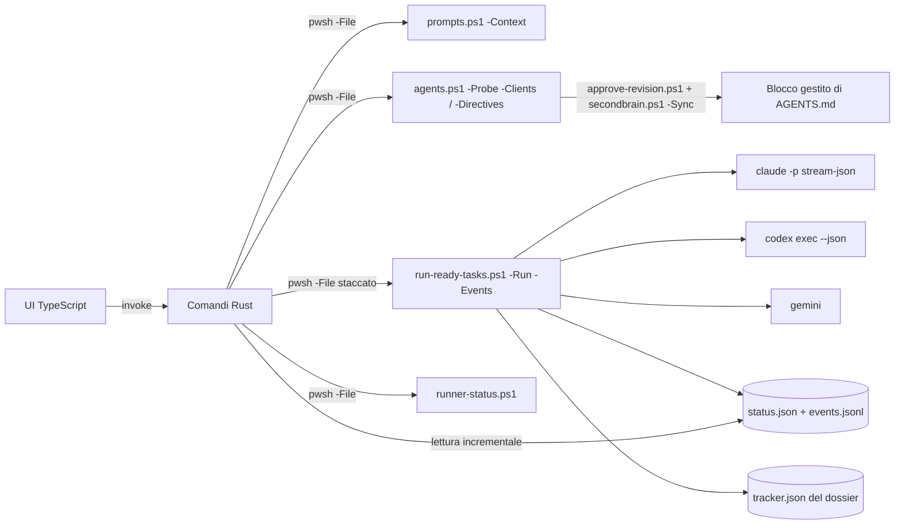

# Orchestratore desktop

[English](orchestratore.md)

`app/orchestrator` è una piccola app desktop Tauri 2 per Windows, macOS e Linux. Le indichi il checkout di un repository gestito da SecondBrain: l'app elenca i task pronti del suo tracker e li esegue uno dopo l'altro con Claude Code, Codex o Gemini CLI finché la coda non è esaurita, mostrando durante il run se l'agente sta lavorando o è fermo. Tutte le regole stanno negli script PowerShell di SecondBrain. L'app raccoglie le tue scelte, avvia quegli script e legge i file di stato del run.



## Avvio rapido

In chat `sb runner` pone una domanda a scelta multipla, app desktop (consigliata) o riga di comando, e passa il checkout corrente. Da script, dalla radice del clone SecondBrain:

```bash
pwsh -NoProfile -File scripts/runner.ps1 -RepositoryPath <checkout>
```

`runner.ps1` accetta `-Mode auto|gui|cli` (predefinito `auto`; `-RepositoryPath` vale per impostazione predefinita la radice Git della cartella corrente). `auto` e `gui` chiamano `runner-gui.ps1 -RepositoryPath`, che apre l'app con quel repository caricato e la sua coda in vista. Se la finestra non può partire, `auto` ripiega sull'anteprima da riga di comando (`run-ready-tasks.ps1 -MaxTasks 0`, che non esegue nulla) e ne indica il motivo in `fallbackReason`: `prerequisites-missing` (manca npm o cargo, oppure il binario), `build-failed`, `no-display` (Linux senza `DISPLAY` né `WAYLAND_DISPLAY`) o `launch-failed` (l'app non è partita o è uscita con errore entro 3 secondi). `gui` riporta lo stesso errore senza ripiegare. Il JSON su standard output contiene `mode`, `requested`, `repository`, `launched`, `fallbackReason`, `gui`, `preview` e `next`.

`runner-gui.ps1` compila l'app con `npm run tauri build -- --no-bundle` (e `npm ci` se manca `node_modules`) quando `src-tauri/target/release/secondbrain-orchestrator` (`.exe` su Windows) manca o è più vecchio del più recente fra `src/**`, `index.html`, `package.json`, `package-lock.json`, `src-tauri/src/**`, `Cargo.toml` e `tauri.conf.json`. La compilazione richiede `npm` e `cargo` nel `PATH`; su Linux anche le librerie WebKitGTK indicate sotto. L'app parte staccata con `SECONDBRAIN_HOME` impostata sul clone e `--repo <checkout>` se indicato; su macOS e Linux il suo output va in `.runtime/hosts/<host>/logs/runner-gui.log`.

- `-Rebuild` forza la compilazione, `-NoLaunch` compila se serve senza avviare l'app, `-WhatIf` non compila né avvia nulla e riporta la decisione.
- Codici di uscita: 2 prerequisito o binario mancante, 3 compilazione non riuscita, 4 nessuna sessione grafica, 5 avvio non riuscito.
- Su Linux: `sudo apt-get install -y libwebkit2gtk-4.1-dev libappindicator3-dev librsvg2-dev patchelf`.

## Requisiti

- PowerShell 7.5+ (`pwsh`) e un checkout di SecondBrain. L'app trova il checkout dalla scheda Impostazioni, poi da `SECONDBRAIN_HOME`, poi dal checkout da cui è stata compilata.
- Almeno una CLI di agente: `claude`, `codex` o `gemini`. Il rilevamento non si ferma al `PATH` ereditato, perché le app desktop non ricevono quello della shell: su Windows rilegge il `PATH` utente e di sistema dal registro e cerca in WinGet Links, WindowsApps, npm, pnpm, Volta, scoop e bun; su macOS e Linux in Homebrew, snap, nvm, fnm, Volta, bun e `~/.local/bin`; trova anche Codex installato dal Microsoft Store (pacchetto `OpenAI.Codex`).
- Per compilare: Node.js 22, Rust stable e i [prerequisiti Tauri](https://v2.tauri.app/start/prerequisites/) del sistema (WebView2 su Windows, `libwebkit2gtk-4.1-dev` su Linux).

```bash
cd app/orchestrator
npm ci
npm run tauri dev      # finestra di sviluppo
npm run tauri build    # installer in src-tauri/target/release/bundle
```

## Passi

La testata mostra sempre il repository caricato, il suo tracker e lo stato del run. I passi da 2 a 4 restano disattivati finché non è caricato un repository; ogni passo mostra i propri errori.

1. **Repository.** Aperta con `sb runner`, l'app ha già caricato il repository da cui hai lanciato il prompt e passa subito alla coda. Altrimenti carica l'ultimo repository usato che esiste ancora. `prompts.ps1 -Context` risolve dossier e tracker; un checkout senza dossier attivo viene rifiutato, con il comando che lo registra. **Usati di recente** elenca i repository precedenti: **Apri** ne carica uno, **Rimuovi** lo toglie dall'elenco (il checkout e il suo dossier non vengono toccati). Le voci la cui cartella non esiste più sono segnate «non trovato» e si possono rimuovere. L'elenco si legge e si scrive nel file delle impostazioni a ogni modifica, quindi una voce rimossa non ricompare dopo la riapertura, né quando un'altra finestra salva le proprie impostazioni.
2. **Direttive.** Il bersaglio è sempre `AGENTS.managed.md` nel dossier; `secondbrain.ps1 -Sync` lo allinea nel blocco gestito dell'`AGENTS.md` del checkout, che `CLAUDE.md` e `GEMINI.md` importano. Scrivi le direttive specifiche di sviluppo e di tracciamento dei task. **Importa testo da file** copia un file Markdown nell'editor, **Inserisci modello** parte dal modello incluso, **Ricarica dal dossier** scarta le modifiche. **Anteprima proposta** copia il testo in una cartella di lavoro SecondBrain ed esegue `approve-revision.ps1 -Preview`; ogni modifica successiva richiede una nuova anteprima. **Approva e applica** esegue `approve-revision.ps1` con l'hash dell'anteprima, poi `secondbrain.ps1 -Sync -Repository <identità>`. L'app lo segnala se l'anteprima non restituisce l'hash. Nessuno dei due passi modifica direttamente il checkout o il dossier.
3. **Coda.** All'avvio `agents.ps1 -Probe -Clients` sonda i tre provider in parallelo (**Rileva di nuovo** lo ripete). Ogni scheda dell'agente mostra stato (pronto, non installato, non risponde), versione e dove è stato trovato; si possono scegliere solo gli agenti pronti. Gli elenchi di modelli e livelli di impegno contengono solo ciò che la CLI installata e la sua configurazione espongono: la tabella di riserva non li riempie più, e un agente non installato non mostra modelli. «Predefinito della CLI» non passa nulla, quindi la CLI usa il valore che ha configurato; **Modello non in elenco** passa un ID personalizzato con `-AllowCustomModel`. **Altri IDE e client rilevati** elenca gli IDE non pilotabili senza una CLI non interattiva, con il motivo. La tabella mostra i task eseguibili dell'anteprima del runner per l'agente scelto; all'apertura non è selezionato nessun task, e puoi selezionarli e riordinarli. Gli esclusi compaiono con il motivo, compreso `awaiting:<valore>` per quelli che attendono il consenso della persona titolare.
4. **Esecuzione.** L'app avvia `run-ready-tasks.ps1 -Run -Events -TaskIds … -StallMinutes <n>` come processo staccato. Segue il run tramite `events.jsonl` (ogni secondo) e `runner-status.ps1` (ogni 4 secondi) e mostra il verdetto (in lavoro, possibile stallo, concluso, interrotto), il task corrente, il tempo trascorso, l'età dell'ultimo segnale dell'agente, i passi dell'agente (strumento con percorso o comando, testo, risultato), l'esito di ogni task e il registro completo. **Ferma dopo il task corrente** scrive il file di arresto del run. **Interrompi subito** termina il runner e il suo agente (`taskkill /T` su Windows, il gruppo di processi altrove). Dopo un'interruzione il task resta nello stato lasciato dall'agente e la sua cartella di report resta aperta.

**Chiudere la finestra durante un run** apre una domanda: lascia in esecuzione e chiudi, ferma dopo il task e chiudi, interrompi subito e chiudi, oppure annulla. Un run lasciato in esecuzione continua a lavorare; quando riapri l'app su quel repository lo ritrova tramite `status.json`, lo riaggancia, ripropone i passi dell'agente e lo segue fino alla fine. Il runner rifiuta un secondo run sullo stesso repository finché il primo è vivo, sia dall'app sia da riga di comando.

Impostazioni e repository recenti sono salvati nella cartella di configurazione dell'app, non nel repository.

## Verifica

`pwsh -NoProfile -File scripts/test-secondbrain.ps1 -Only orchestrator-e2e` (incluso anche in `-Full`) avvia su Windows il binario di rilascio con la porta DevTools di WebView2 aperta e lo pilota con Playwright (`app/orchestrator/e2e/`). Usa un SecondBrain sintetico creato da `scripts/test-orchestrator-fixture.ps1`, con impostazioni dell'app isolate e un Claude Code finto. Quattro scenari: precaricamento da `--repo` e rimozione delle voci recenti, entrambi persistenti dopo la riapertura; tutti i pulsanti delle Direttive, con il blocco gestito verificato su disco e il testo di nuovo presente dopo la riapertura; agenti e modelli limitati a quelli installati; una coda seguita in tempo reale, chiusa con «lascia in esecuzione» e ritrovata alla riapertura fino alla conclusione. La suite si salta con il motivo fuori da Windows o se mancano il binario o Playwright, e fallisce se il binario è più vecchio dei sorgenti.

## Limiti

- Gli agenti modificano file nel checkout. Per Claude Code commit, push, tag, reset e cancellazioni sono vietati. Codex lavora in `workspace-write` e Gemini in `auto_edit`. Dopo ogni giro controlla `git status` e le cartelle di report.
- Verificato su Windows: le suite PowerShell (`runner`, `agents`), `cargo test`, la build TypeScript, la build di rilascio e i quattro scenari end-to-end descritti sopra con un agente finto; il probe reale su questa postazione trova Claude Code nel `PATH` e Codex solo come pacchetto del Microsoft Store. Non verificati qui: sessioni reali di Codex o Gemini, i pacchetti di installazione e le finestre su macOS o Linux (percorsi di ricerca degli agenti e identificativo della postazione sono coperti solo da simulazioni e test unitari). I selettori nativi di cartelle e file (**Sfoglia**, **Importa testo da file**) non si pilotano via DevTools; il test end-to-end verifica invece il comando che sta dietro all'importazione.
- Gemini mostra i passi in tempo reale solo se il suo `--help` offre `stream-json`; altrimenti i passi compaiono a fine task.
- I task che richiedono computer use non vengono selezionati, salvo che il preflight del runner li consenta (vedi [operazioni](riferimento/operations.it.md)).
