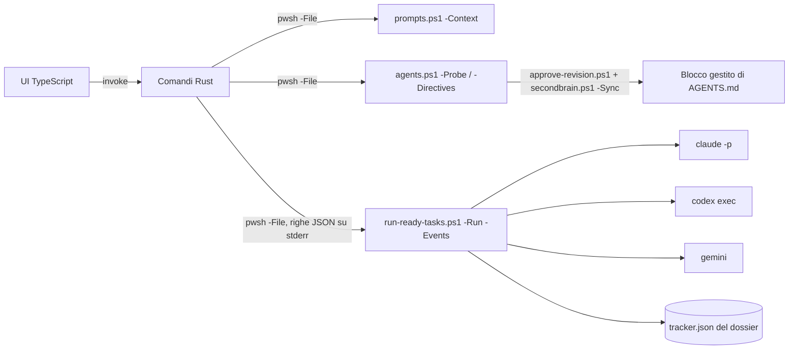

# Orchestratore desktop

[English](orchestratore.md)

`app/orchestrator` è una piccola app desktop Tauri 2 per Windows, macOS e Linux. Le indichi il checkout di un repository gestito da SecondBrain: l'app elenca i task pronti del suo tracker e li esegue uno dopo l'altro con Claude Code, Codex o Gemini CLI finché la coda non è esaurita. Tutte le regole stanno negli script PowerShell di SecondBrain. L'app raccoglie solo le tue scelte e avvia quegli script.



## Avvio rapido

In chat `sb runner`; da script, dalla radice del clone SecondBrain:

```bash
pwsh -NoProfile -File scripts/runner-gui.ps1
```

Lo script apre l'app su Windows, macOS e Linux. Prima la compila con `npm run tauri build -- --no-bundle` (e `npm ci` se manca `node_modules`) quando `src-tauri/target/release/secondbrain-orchestrator` (`.exe` su Windows) manca o è più vecchio del più recente fra `src/**`, `index.html`, `package.json`, `package-lock.json`, `src-tauri/src/**`, `Cargo.toml` e `tauri.conf.json`. La compilazione richiede `npm` e `cargo` nel `PATH` (vedi Requisiti); su Linux anche le librerie WebKitGTK indicate sotto. L'app parte staccata con `SECONDBRAIN_HOME` impostata sul clone; su macOS e Linux il suo output va in `.runtime/hosts/<host>/logs/runner-gui.log`.

- `-Rebuild` forza la compilazione, `-NoLaunch` compila se serve senza avviare l'app, `-WhatIf` non compila né avvia nulla e riporta la decisione.
- Lo standard output contiene un riepilogo JSON (`reason`: `current`, `stale`, `missing` o `forced`; `built`; `launched`). L'uscita 2 indica un prerequisito o un binario mancante, la 3 una compilazione non riuscita.
- Su Linux: `sudo apt-get install -y libwebkit2gtk-4.1-dev libappindicator3-dev librsvg2-dev patchelf`.

## Requisiti

- PowerShell 7.5+ (`pwsh`) e un checkout di SecondBrain. L'app trova il checkout dalla scheda Impostazioni, poi da `SECONDBRAIN_HOME`, poi dal checkout da cui è stata compilata.
- Almeno una CLI di agente nel `PATH`: `claude`, `codex` o `gemini`. Su macOS e Linux l'app cerca anche in `/opt/homebrew/bin`, `/usr/local/bin` e `~/.local/bin`, perché le app desktop non ereditano il `PATH` della shell.
- Per compilare: Node.js 22, Rust stable e i [prerequisiti Tauri](https://v2.tauri.app/start/prerequisites/) del sistema (WebView2 su Windows, `libwebkit2gtk-4.1-dev` su Linux).

```bash
cd app/orchestrator
npm ci
npm run tauri dev      # finestra di sviluppo
npm run tauri build    # installer in src-tauri/target/release/bundle
```

## Passi

1. **Repository.** Scegli il checkout. `prompts.ps1 -Context` ne risolve dossier e tracker. Un checkout senza dossier attivo viene rifiutato, con il comando che lo registra.
2. **Direttive.** Scegli il file delle direttive (per impostazione predefinita l'`AGENTS.md` del repository; `CLAUDE.md` e `GEMINI.md` lo importano). Scrivi le direttive specifiche di sviluppo e di tracciamento dei task, oppure parti dal modello incluso. **Anteprima proposta** copia il testo in una cartella di lavoro SecondBrain ed esegue `approve-revision.ps1 -Preview`. **Approva e applica** esegue `approve-revision.ps1` con l'hash dell'anteprima, poi `secondbrain.ps1 -Sync -Repository <identità>`. Nessuno dei due passi modifica direttamente il checkout o il dossier.
3. **Coda.** L'elenco dei provider viene da `agents.ps1 -Probe`. Per ogni provider, gli elenchi di modelli e livelli di impegno vengono prima dalla CLI installata, poi dalla sua configurazione, poi dalla tabella di riserva, e ogni voce mostra la fonte. "Predefinito della CLI" non passa nulla, quindi la CLI usa il valore che ha configurato. Un modello personalizzato viene passato con `-AllowCustomModel`. La tabella mostra i task eseguibili dell'anteprima del runner, che puoi selezionare e riordinare; all'apertura non è selezionato nessun task (usa «Seleziona tutti» per sceglierli tutti). I task che attendono il consenso della persona titolare (`awaiting`) sono esclusi dall'anteprima e compaiono con il motivo `awaiting:<valore>`.
4. **Esecuzione.** L'app esegue `run-ready-tasks.ps1 -Run -Events -TaskIds …` e mostra le righe di avanzamento e l'esito di ogni task. **Ferma dopo il task corrente** crea il file di arresto. **Interrompi subito** termina il runner e il suo agente (`taskkill /T` su Windows, il gruppo di processi altrove). Dopo un'interruzione il task resta nello stato lasciato dall'agente e la sua cartella di report resta aperta.

Impostazioni e repository recenti sono salvati nella cartella di configurazione dell'app, non nel repository.

## Limiti

- Gli agenti modificano file nel checkout. Per Claude Code commit, push, tag, reset e cancellazioni sono vietati. Codex lavora in `workspace-write` e Gemini in `auto_edit`. Dopo ogni giro controlla `git status` e le cartelle di report.
- Verificato su Windows: la parte PowerShell (suite `-Only agents` e `-Only runner`, più un probe reale di Claude Code 2.1.318) la build TypeScript, `cargo test` e `npm run tauri build -- --no-bundle` con Rust 1.98.1; nella finestra di rilascio il passo Repository risolve il dossier e il passo Coda mostra probe del provider, modelli, livelli di impegno e task. Non eseguiti qui: l'avvio di una coda dalla finestra, i pacchetti di installazione e sessioni reali di Codex o Gemini. Il job CI `orchestrator` compila il frontend ed esegue `cargo test` e `cargo build` su Ubuntu, macOS e Windows, ma GitHub Actions è disabilitato sul repository e il job non è ancora partito.
- I task che richiedono computer use non vengono selezionati, salvo che il preflight del runner li consenta (vedi [operazioni](riferimento/operations.it.md)).
