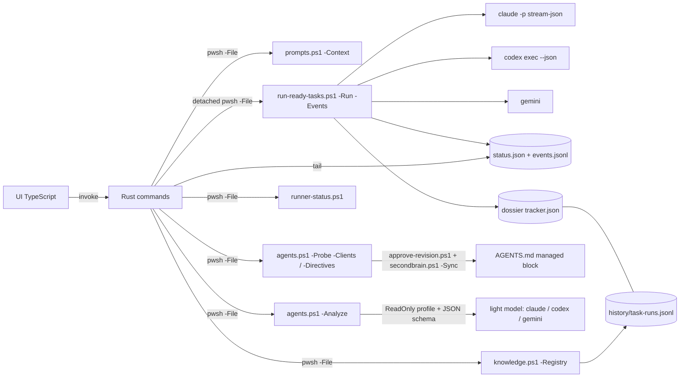

# Desktop orchestrator

[Italiano](orchestratore.it.md)

`app/orchestrator` is a small Tauri 2 desktop app for Windows, macOS and Linux. You point it at a repository checkout that SecondBrain manages. It lists the ready tasks of that repository's tracker and runs them one after the other with Claude Code, Codex or Gemini CLI until the queue is done, and it shows while the run is going whether the agent is working or stalled. Every rule lives in the SecondBrain PowerShell scripts. The app only collects your choices, starts those scripts and reads the run's status files.



## Quick start

In the chat, `sb runner` asks one multiple-choice question, desktop app (recommended) or command line, and passes the current checkout. From a script, from the SecondBrain clone root:

```bash
pwsh -NoProfile -File scripts/runner.ps1 -RepositoryPath <checkout>
```

`runner.ps1` takes `-Mode auto|gui|cli` (default `auto`; `-RepositoryPath` defaults to the Git root of the current folder). `auto` and `gui` call `runner-gui.ps1 -RepositoryPath`, which opens the app with that repository loaded and its queue shown. When the window cannot start, `auto` falls back to the command-line preview (`run-ready-tasks.ps1 -MaxTasks 0`, which runs nothing) and reports why in `fallbackReason`: `prerequisites-missing` (no npm or cargo, or no binary), `build-failed`, `no-display` (Linux without `DISPLAY` or `WAYLAND_DISPLAY`) or `launch-failed` (the app did not start or exited with an error within 3 seconds). `gui` reports the same failure without falling back. The JSON on standard output carries `mode`, `requested`, `repository`, `launched`, `fallbackReason`, `gui`, `preview` and `next`.

`runner-gui.ps1` builds the app with `npm run tauri build -- --no-bundle` (and `npm ci` when `node_modules` is missing) if `src-tauri/target/release/secondbrain-orchestrator` (`.exe` on Windows) is missing or older than the newest of `src/**`, `index.html`, `package.json`, `package-lock.json`, `src-tauri/src/**`, `Cargo.toml` and `tauri.conf.json`. The build needs `npm` and `cargo` on the `PATH`; on Linux also the WebKitGTK libraries listed below. The app starts detached with `SECONDBRAIN_HOME` set to the clone and `--repo <checkout>` when given; on macOS and Linux its output goes to `.runtime/hosts/<host>/logs/runner-gui.log`.

On Windows, when `sb runner` runs inside an MSIX package or a job object, as an agent started from Claude desktop does, a normally started child stays in them. Windows then closes the app together with the caller when that app is closed, crashes or is updated, and the queue stops at the current task. In that case `runner-gui.ps1` starts the app through WMI (`Win32_Process.Create`): it runs outside the package and the job, with the caller's environment and `SECONDBRAIN_HOME`, and carries on even if the calling app closes. Elsewhere it keeps ShellExecute. The JSON reports `launchMethod` (`wmi`, `shell` or `nohup`), `packageFullName`, `inJob` and, for WMI, `pid`; `-LaunchMethod shell|wmi` forces the method (tests).

- `-Rebuild` forces the build, `-NoLaunch` builds when needed without starting the app, `-WhatIf` builds and starts nothing and reports the decision.
- Exit codes: 2 missing prerequisite or binary, 3 failed build, 4 no graphical session, 5 failed launch.
- On Linux: `sudo apt-get install -y libwebkit2gtk-4.1-dev libappindicator3-dev librsvg2-dev patchelf`.

## Requirements

- PowerShell 7.5+ (`pwsh`) and a SecondBrain checkout. The app finds the checkout through the Settings tab, then `SECONDBRAIN_HOME`, then the checkout it was built from.
- At least one agent CLI: `claude`, `codex` or `gemini`. The probe looks beyond the inherited `PATH`, because desktop apps do not get the shell's: the user and machine `PATH` from the registry, WinGet Links, WindowsApps, npm, pnpm, Volta, scoop and bun on Windows; Homebrew, snap, nvm, fnm, Volta, bun and `~/.local/bin` on macOS and Linux; Codex installed from the Microsoft Store (package `OpenAI.Codex`).
- To build: Node.js 22, Rust stable and the [Tauri prerequisites](https://v2.tauri.app/start/prerequisites/) for your system (WebView2 on Windows, `libwebkit2gtk-4.1-dev` on Linux).

```bash
cd app/orchestrator
npm ci
npm run tauri dev      # development window
npm run tauri build    # installers in src-tauri/target/release/bundle
```

## Steps

The header always shows the loaded repository, its tracker and the run badge. Steps 2 to 5 stay disabled until a repository is loaded; each step shows its own errors.

1. **Repository.** Opened by `sb runner`, the repository you launched from is already loaded and the app goes straight to the queue. Otherwise the app loads the most recent repository that still exists. `prompts.ps1 -Context` resolves the dossier and tracker; a checkout without an active dossier is refused, with the command that registers it. **Recently used** lists the earlier repositories: **Open** loads one, **Remove** takes it off the list (the checkout and its dossier are not touched). Entries whose folder no longer exists are marked "not found" and can be removed. The list is read and written in the settings file at each change, so a removed entry does not come back after restarting, nor when another window saves its settings.
2. **Directives.** The target is always `AGENTS.managed.md` in the dossier; `secondbrain.ps1 -Sync` aligns it into the managed block of the checkout's `AGENTS.md`, which `CLAUDE.md` and `GEMINI.md` import. Write the repository-specific development and task-tracking directives. **Import text from file** copies a Markdown file into the editor, **Reload from dossier** discards the edits. **Propose structure (light model)** runs `agents.ps1 -Analyze -Kind directives`: the light model reads the checkout with read-only tools (prompt card DOC06) and proposes only what the blocks already loaded in every session do not cover. Each section comes with its rationale and sources, and topics already covered are listed apart. **Use the proposal in the editor** replaces the text and **Append** adds it at the end. A proposal that holds absolute paths, `{{` placeholders or `secondbrain:` markers is refused. The button is disabled, with the reason, when no agent CLI is ready. **Blocks already loaded in every session** shows, read-only, the global directives, the common repository block, `AGENTS.md` outside the managed blocks and the resulting repository block with the editor text, each with its character count against the 25,000-character startup budget. **Preview proposal** copies the text into a SecondBrain work folder and runs `approve-revision.ps1 -Preview`; any edit afterwards requires a new preview. **Approve and apply** runs `approve-revision.ps1` with the preview hash, then `secondbrain.ps1 -Sync -Repository <identity>`. The app says so when the preview returns no hash. Neither step edits the checkout or the dossier directly.
3. **Queue.** `agents.ps1 -Probe -Clients` probes the three providers in parallel when the app starts (**Detect again** repeats it). Each agent card shows its status (ready, not installed, not responding), version and where it was found; only ready agents can be chosen. The model and effort lists contain only what the installed CLI and its configuration expose: the fallback table no longer fills them, and an agent that is not installed shows no models. "CLI default" passes no model or effort (the runner gets `-UseCliDefault`), so the CLI uses its own configured value; pressing **Start** probes the agents again and the confirmation names the effective model and effort, the default included; **Model not listed** passes a custom ID with `-AllowCustomModel`. **Other IDEs and clients detected** lists the IDEs that cannot be driven without a headless CLI, with the reason. The table shows the runnable tasks from the runner preview for the chosen agent; nothing is selected at first, and you can select and reorder tasks. **Not runnable on their own** lists every task the runner leaves out, with the reason: `awaiting:<value>` for those waiting for the owner's consent, `status:blocked`, `status:unknown` and `dependency:<id>` included. **Analyze** (or **Analyze selected**) runs `agents.ps1 -Analyze -Kind task` with the light model, read-only (prompt card REP18). The answer is a set of tool calls: each `ask_user` becomes a multiple-choice question with the recommended option first and free text under "Other". The answers go back through `-Kind task-resolve` (three rounds at most) until the model returns `propose_task_update`. You then review a before/after diff, and the tracker changes only when you confirm. The owner's decisions are stored in `extensions.decisions[]`, and the runner prompt passes them to the agent in a "Decisioni della persona" block, so it never asks again. `not-automatable` leaves the task as it is and records the reason in `stateReason`. Consent (`awaiting=owner-consent`) and destructive operations are never cleared without an explicit answer to the matching question. The analysis state and answers stay in the analysis work folder, so closing the window loses nothing.
4. **Run.** The app starts `run-ready-tasks.ps1 -Run -Events -TaskIds … -StallMinutes <n>` as a detached process. It follows the run through `events.jsonl` (every second) and `runner-status.ps1` (every 4 seconds) and shows the verdict (working, possibly stalled, finished, interrupted), the quota read before each task and, for a closed run, its stop reason with the closing date, the current task, elapsed time, the age of the agent's last signal, the agent's steps (tool and path or command, text, result), the outcome of each task and the log of the current run. The window's own notes (start, stop, reattach) are written as `ui` events into the run's `events.jsonl`, so they survive a reattach. **Stop after the current task** writes the run's stop file. **Abort now** ends the runner and its agent (`taskkill /T` on Windows, the process group elsewhere). After an abort, the task keeps the status the agent left and its report folder stays open.
5. **Registry.** `knowledge.ps1 -Registry` lists every task of the repository, archived ones included. It joins the tracker, the archive, the dossier ledger `history/task-runs.jsonl` and the runner reports of this workstation, and shows a colored badge per tool that worked on each task (Claude, Codex, Gemini, Antigravity, human, unknown). Filters cover tool, status, archive and text, with pages of 50; each row expands into the task's history. **Runner runs** lists the past runs from their `status.json` files (`runner-status.ps1 -List`): agent, model and effort, counts, stop reason and folder.

**Closing the window during a run** asks what to do: leave it running and close, stop after the task and close, abort now and close, or cancel. A run left running keeps working; when the app is opened again on that repository it finds the run through `status.json`, reattaches, replays the agent's steps and follows it to the end. The runner refuses a second run on the same repository while the first is alive, from the app or from the command line.

Settings and recent repositories are saved in the app's own configuration folder, not in the repository. **Light model for analyses** in Settings picks the agent, model and effort of the two analyses. Left empty, the agent chosen in the queue runs with `roles.light` of `config/agent-models.json` (Claude haiku, Gemini flash, Codex with effort `low`), which `agent-models.local.json` can override.

The ledger records who changed a task. Every change of status, execution or evidence adds a record in the same transaction as the tracker write, with the executor resolved in this order: explicit, `SECONDBRAIN_EXECUTOR` (set by the runner and by the analyses), the agent CLI environment, the MCP session client, else `unknown`. `knowledge.ps1 -BackfillTaskRuns` copies older runner reports into the ledger (preview unless `-Apply`, once per report).

## Verification

`pwsh -NoProfile -File scripts/test-secondbrain.ps1 -Only orchestrator-e2e` (also part of `-Full`) starts the release binary on Windows with the WebView2 DevTools port open and drives it with Playwright (`app/orchestrator/e2e/`). It uses a synthetic SecondBrain from `scripts/test-orchestrator-fixture.ps1` with isolated app settings and a fake Claude Code. Six scenarios: preload from `--repo` and removal of recent entries, both persistent across restarts; the light-model proposal and every Directives button, with the managed block checked on disk and the text present again after a restart; agents and models limited to what is installed; a queue run followed live, closed with "leave running" and found again on reopening until it finishes; the registry with tool badges, an archived task and the runner history; a task that cannot run alone analyzed, answered and made autonomous. The app passes `WEBVIEW2_ADDITIONAL_BROWSER_ARGUMENTS` to its windows after wry's defaults, because the WebView2 runtime ignores the variable once the app sets its own arguments. The suite is skipped with a reason off Windows or when the binary or Playwright is missing, and fails when the binary is older than the sources.

## Limits

- The agents edit files in the checkout. Commit, push, tags, resets and deletion are denied for Claude Code. Codex runs in `workspace-write` and Gemini in `auto_edit`. Check `git status` and the report folders after each run. The analyses run with the ReadOnly profile: Claude Code in `plan` mode with Read, Grep and Glob only, Codex in the `read-only` sandbox, Gemini with `--approval-mode plan`.
- Verified on Windows: the PowerShell suites (`runner`, `agents`, `trackers`), `cargo test`, the TypeScript build, the release build and the six end-to-end scenarios above with a fake agent; the live probe on this workstation finds Claude Code on the `PATH` and Codex only as a Microsoft Store package. Not verified here: a live analysis with a real light model, real Codex or Gemini sessions, the installer bundles, and macOS or Linux windows (agent search paths and the host ID are covered by simulations and unit tests only). The native folder and file pickers (**Browse**, **Import text from file**) cannot be driven through DevTools; the end-to-end test checks the command behind the import instead.
- Gemini shows its steps live only when its `--help` offers `stream-json`; otherwise the steps appear when the task ends.
- Tasks that need computer use are not selected unless the runner preflight allows them (see [operations](riferimento/operations.md)).
