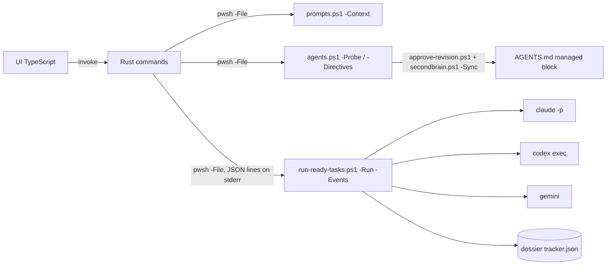

# Desktop orchestrator

[Italiano](orchestratore.it.md)

`app/orchestrator` is a small Tauri 2 desktop app for Windows, macOS and Linux. You point it at a repository checkout that SecondBrain manages. It lists the ready tasks of that repository's tracker and runs them one after the other with Claude Code, Codex or Gemini CLI until the queue is done. Every rule lives in the SecondBrain PowerShell scripts. The app only collects your choices and starts those scripts.



## Quick start

In the chat, `sb runner`; from a script, from the SecondBrain clone root:

```bash
pwsh -NoProfile -File scripts/runner-gui.ps1
```

The script opens the app on Windows, macOS and Linux. It first builds the app with `npm run tauri build -- --no-bundle` (and `npm ci` when `node_modules` is missing) if `src-tauri/target/release/secondbrain-orchestrator` (`.exe` on Windows) is missing or older than the newest of `src/**`, `index.html`, `package.json`, `package-lock.json`, `src-tauri/src/**`, `Cargo.toml` and `tauri.conf.json`. The build needs `npm` and `cargo` on the `PATH` (see Requirements); on Linux also the WebKitGTK libraries listed below. The app starts detached with `SECONDBRAIN_HOME` set to the clone; on macOS and Linux its output goes to `.runtime/hosts/<host>/logs/runner-gui.log`.

- `-Rebuild` forces the build, `-NoLaunch` builds when needed without starting the app, `-WhatIf` builds and starts nothing and reports the decision.
- Standard output carries a JSON summary (`reason`: `current`, `stale`, `missing` or `forced`; `built`; `launched`). Exit 2 means a missing prerequisite or binary, exit 3 a failed build.
- On Linux: `sudo apt-get install -y libwebkit2gtk-4.1-dev libappindicator3-dev librsvg2-dev patchelf`.

## Requirements

- PowerShell 7.5+ (`pwsh`) and a SecondBrain checkout. The app finds the checkout through the Settings tab, then `SECONDBRAIN_HOME`, then the checkout it was built from.
- At least one agent CLI on the `PATH`: `claude`, `codex` or `gemini`. On macOS and Linux the app also looks in `/opt/homebrew/bin`, `/usr/local/bin` and `~/.local/bin`, because desktop apps do not inherit the shell `PATH`.
- To build: Node.js 22, Rust stable and the [Tauri prerequisites](https://v2.tauri.app/start/prerequisites/) for your system (WebView2 on Windows, `libwebkit2gtk-4.1-dev` on Linux).

```bash
cd app/orchestrator
npm ci
npm run tauri dev      # development window
npm run tauri build    # installers in src-tauri/target/release/bundle
```

## Steps

1. **Repository.** Choose the checkout. `prompts.ps1 -Context` resolves its dossier and tracker. A checkout without an active dossier is refused, with the command that registers it.
2. **Directives.** Choose the directive file (by default the repository's `AGENTS.md`; `CLAUDE.md` and `GEMINI.md` import it). Write the repository-specific development and task-tracking directives, or start from the built-in template. **Preview proposal** copies the text into a SecondBrain work folder and runs `approve-revision.ps1 -Preview`. **Approve and apply** runs `approve-revision.ps1` with the preview hash, then `secondbrain.ps1 -Sync -Repository <identity>`. Neither step edits the checkout or the dossier directly.
3. **Queue.** The provider list comes from `agents.ps1 -Probe`. For each provider, the model and effort lists come from the installed CLI first, then its configuration, then the fallback table, and each entry shows its source. "CLI default" passes nothing, so the CLI uses its own configured value. A custom model is passed with `-AllowCustomModel`. The table shows the runnable tasks from the runner preview, which you can select and reorder; excluded tasks are listed with their reason.
4. **Run.** The app runs `run-ready-tasks.ps1 -Run -Events -TaskIds …` and shows its progress lines and the result of each task. **Stop after the current task** creates the stop file. **Abort now** ends the runner and its agent (`taskkill /T` on Windows, the process group elsewhere). After an abort, the task keeps the status the agent left and its report folder stays open.

Settings and recent repositories are saved in the app's own configuration folder, not in the repository.

## Limits

- The agents edit files in the checkout. Commit, push, tags, resets and deletion are denied for Claude Code. Codex runs in `workspace-write` and Gemini in `auto_edit`. Check `git status` and the report folders after each run.
- Verified on Windows: the PowerShell side (`-Only agents` and `-Only runner` suites, plus a live probe of Claude Code 2.1.318) the TypeScript build, `cargo test` and `npm run tauri build -- --no-bundle` with Rust 1.98.1; in the release window, the Repository step resolves the dossier and the Queue step shows the provider probe, models, effort levels and tasks. Not run here: starting a queue from the window, the installer bundles, and real Codex or Gemini sessions. The CI job `orchestrator` builds the frontend and runs `cargo test` and `cargo build` on Ubuntu, macOS and Windows, but GitHub Actions is currently disabled for the repository, so that job has not run yet.
- Tasks that need computer use are not selected unless the runner preflight allows them (see [operations](riferimento/operations.md)).
