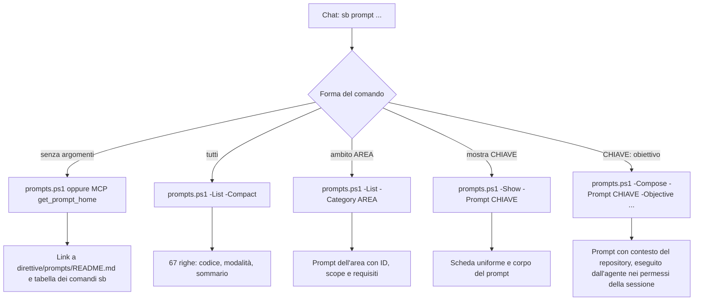

# Workflow di prompting v2

> Tool portabile: [procedura corrente](portable-brain.md). Nessun monitor; output operativi sotto .runtime e pulizia solo su richiesta. I comandi e contratti schema precedenti sotto sono conservati per recupero e migrazione; non inizializzano nuove postazioni. Direttive 4.3 approvate in approved.json.

Il catalogo v2 contiene i workflow specialistici organizzati in 12 aree tematiche. [Indice generato](../direttive/prompts/README.md), [metadati autorevoli](../direttive/prompts/catalog.json).

## Utilizzo dalla chat

Con le direttive comuni 4.3 caricate nella sessione:

```text
sb prompt
sb prompt tutti
sb prompt ambito test
sb prompt mostra TST04
sb prompt TST04: analizza e correggi il fallimento del job Windows
```

La chat è l’interfaccia comune: non è uno slash command nativo né un alias installato nella shell. `sb prompt` mostra il link al file Markdown del catalogo completo e la tabella dei comandi `sb`; `sb prompt tutti` riporta l’elenco compatto integrale (una riga per prompt, mai riassunto). L’agente esegue la CLI centrale e riporta l’output senza riassumerlo. Per applicare il modello carica solo la scheda scelta, risolve il repository corrente e svolge il task nei permessi della conversazione. In modalità Plan prepara il piano senza implementarlo. Se manca un input sostanziale, cerca prima nei file e nella conversazione, poi chiede un chiarimento mirato.

Flusso delle cinque forme (percorso verificato sui set di parametri di `scripts/prompts.ps1`):



Le direttive 4.3 sono approvate e il catalogo v2 è attivo. TXT, parser e compositore precedenti sono ritirati dal percorso operativo. Il caricamento effettivo va verificato in nuove sessioni, separatamente dall allineamento dei file (attivazione e riscontri registrati nello storico del dossier locale SecondBrain).

## CLI centrale

PowerShell 7.5 o successivo, da qualsiasi directory:

```powershell
$brain = $env:SECONDBRAIN_HOME # es. 'C:/Progetti/SecondBrain'
$cfg = "$brain/.runtime/hosts/<id>/workstation.json"
& "$brain/scripts/prompts.ps1"                      # link al catalogo e comandi sb
& "$brain/scripts/prompts.ps1" -List -Compact        # tutti i prompt, una riga ciascuno
& "$brain/scripts/prompts.ps1" -List
& "$brain/scripts/prompts.ps1" -List -Category test   # anche TST o Test
& "$brain/scripts/prompts.ps1" -Show -Prompt TST04
& "$brain/scripts/prompts.ps1" -Context -ConfigPath $cfg
& "$brain/scripts/prompts.ps1" -Compose -Prompt TST04 -Objective 'Correggi il job Windows' -ConfigPath $cfg
& "$brain/scripts/prompts.ps1" -Compose -Prompt SEC01 -RepositoryPath 'C:/Progetti/Repo/src' -ConfigPath $cfg
```

`-List` e `-Show` non richiedono configurazione né repository associato. `-Context` e `-Compose` richiedono `-ConfigPath`; in assenza di selezione esplicita usano Git dalla directory corrente, compresi sottocartelle e worktree. Per identità esplicita usare `-Repository github.com/owner/repo`, eventualmente con `-CheckoutPath`; identità con più checkout richiede selezione. Il checkout deve esistere e avere l’origin dell’identità ammessa, senza deduzioni dal nome della cartella.

Per Progetti usare `-ProjectId`; se ci sono più checkout, `-CheckoutMapPath` contiene un oggetto JSON identità GitHub → percorso checkout. Il compositore include il brief come dato codificato JSON e riferimenti locali, non il contenuto di contesto, memoria o tracker. Non esegue il task e non trasmette dati a servizi AI.

`-OutputPath` crea solo un nuovo TXT. Non sovrascrive file e non segue reparse point. Exit code: 0 successo, 2 errore. `build-prompts.ps1 -Check` restituisce 1 per indice da rigenerare; input invalidi interrompono la generazione prima delle scritture.

## Contratti e caricamento

`catalog.json` schema 2 identifica il catalogo 2, categorie ordinate, `deprecations` facoltative (alias ritirati verso l'ID sostituto) e prompt con `id` (opaco, `pmt-` e 8 esadecimali, immutabile), `code` (alias primario), `aliases`, `category`, `summary`, `target`, `mode`, `file`, `references` e `related`. La destinazione è `repository` o `central`; la modalità è `read`, `write` o `verify`. Le modalità descrivono il workflow e non aumentano permessi o superano Plan. I prompt con destinazione central si compongono solo per SecondBrain; SYS03 dispone del bootstrap senza configurazione.

Le schede Markdown hanno Scopo, Quando usarlo, Input, Attività specifiche, Verifiche, Consegna e Prompt vicini. Il validatore controlla schema, unicità di ID, codici e alias in un solo spazio di nomi, categorie, percorsi confinati, sezioni e riferimenti ai prompt vicini (per ID). Non impone un numero fisso di prompt per sempre né numerazione consecutiva. Il catalogo attuale conta 67 workflow (COM01–GOV02). La sezione opzionale «Decisioni da raccogliere» (se presente: unica, non vuota, con rimando a Function Calling o Tool Use) elenca le scelte da sottoporre all’utente; la procedura per aggiungere, modificare o ritirare un prompt è SYS11.

Un prompt si richiama per ID (`pmt-a709a792`), codice (`COM01`) o alias, con `prompts.ps1 -Show|-Compose -Prompt <chiave>` e dagli strumenti MCP `get_prompt`/`prompts/get`: tutte le chiavi risolvono allo stesso prompt. Un alias ritirato o un prompt deprecato risolve al sostituto con un avviso.

L’elenco legge solo i metadati; `-Show` e `-Compose` caricano solo la scheda selezionata. La build valida tutte le schede prima di generare l’indice. Una riga logica è lunga al massimo 88 caratteri; finestre molto strette possono applicare il wrapping dell’IDE.

La risoluzione delle memorie con -Context funziona anche se il catalogo dei prompt è assente o non valido. Il resolver confronta indice PARA e metadati reali del dossier. Dossier archiviati/ritirati, identità escluse, tracker dichiarati mancanti o invalidi e ambiguità non producono fallback. I riferimenti ad AGENTS, contesto, memoria e fonte tracker sono assoluti. Le istruzioni annidate del repository restano applicabili all’area su cui l’agente lavora.

## Architettura del Catalogo v2

Il catalogo v2 struttura 67 schede operative ingegneristiche (COM01–GOV02) suddivise nelle 12 aree tematiche descritte in precedenza. Ogni prompt opera come un workflow atomico delimitato da scopo, prerequisiti, modalità operative, vincoli e comandi di verifica.

Il caricamento è rigorosamente selettivo: la CLI carica esclusivamente la singola scheda richiesta evitando sovraccarichi di contesto nel prompt dell'agente.

### Interazione Strutturata e Tool Use (Function Calling)

A partire dalla revisione 4.2, i prompt e il compositore centrale integrano il supporto a **Function Calling / Tool Use** (es. strumento `ask_question`) per gestire dubbi, chiarimenti architetturali e scelte tra opzioni predefinite:
- Quando l'agente deve raccogliere una decisione sostanziale non desumibile dal codice (es. in `COM01`, `COM02`, `PRG01`, `PRG02`, `SYS03`, `SYS04`, `SYS05`, `REP05`), adotta prioritariamente il tool use (`ask_question`) per visualizzare una finestra di selezione a scelta multipla nell'interfaccia utente.
- Viene indicata la scelta raccomandata con prefisso `(Recommended)` e opzioni atomiche e non numerate.
- Si evitano domande a testo libero ripetute o continue richieste di conferma per operazioni già autorizzate nel perimetro del task.

## Fonti e scelte

Consultazione online: 28 ottobre 2026. Le schede del registro comune sono riferimenti con URL e sintesi originali; nessun corpus integrale è stato acquisito. Applicabilità tecnica e revisione di una trascrizione sono distinte.

| Fonte | Uso nel catalogo |
|---|---|
| [OpenAI prompt engineering](https://developers.openai.com/api/docs/guides/prompt-engineering) | Istruzioni esplicite, delimitazione di dati, esempi e valutazioni |
| [OpenAI sviluppo per fasi](https://developers.openai.com/cookbook/examples/codex/iterating-development-workflows-with-codex) | Impatto, pianificazione, esecuzione, verifica e continuità |
| [Claude workflow](https://code.claude.com/docs/en/common-workflows) e [libreria](https://code.claude.com/docs/en/prompt-library) | Orientamento, tracciamento, bug, test e risultati osservabili |
| [GitHub Cookbook](https://docs.github.com/en/copilot/tutorials/copilot-cookbook) | CI, dipendenze, dati, prestazioni, integrazioni e test |
| [GitHub prompt files](https://docs.github.com/en/copilot/tutorials/customization-library/prompt-files) | Schede task separate da istruzioni persistenti; README, API e review |
| [Awesome Copilot](https://github.com/github/awesome-copilot) | Esempi comunitari specialistici; nessuna installazione né adozione delle regole degli esempi |
| [Google strategie](https://ai.google.dev/gemini-api/docs/prompting-strategies) | Struttura coerente e iterazione, senza presumere equivalenza fra modelli |

Schede di registro: `openai-prompt-engineering`, `openai-development-workflows`, `anthropic-code-workflows`, `github-copilot-cookbook`, `github-prompt-files`, `github-awesome-copilot`, `google-prompt-strategies`.

I workflow di repository e di sistema (REP01, REP04 e SYS01–SYS02) incorporano anche convenzioni locali SecondBrain: tracker autorevole, blocchi gestiti, migrazione con recupero, centralità delle memorie e distinzione centrale/prodotto. Queste scelte non vengono attribuite ai fornitori. Nessuna raccomandazione specifica di framework, modello o browser è resa universale.

## Verifiche e limiti

`scripts/test-secondbrain-workflows.ps1` verifica catalogo, caricamento selettivo, CLI, risoluzione Git/PARA, output e composizione in fixture isolate sotto SecondBrain/.runtime/tests. Sei fixture per esplorazione, CI, dipendenze, migrazione dati, accessibilità e handoff verificano tramite la CLI selezione della scheda, modalità, preservazione della richiesta e caricamento selettivo. Non sono valutazioni dell’efficacia di un LLM.

La suite principale include queste prove. Generazione: `scripts/build-prompts.ps1 -ConfigPath <config>`; verifica senza scritture con `-Check`. Il Check operativo comprende l indice v2 e richiede il catalogo con le direttive 4.3. Dopo attivazione sono necessari nuovi avvii per provare il caricamento delle direttive; file allineati e fixture superate non ne costituiscono prova.
