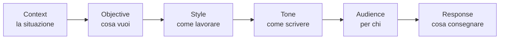

# Prompt

81 prompt pronti in 13 aree. Scegli, aggiungi il tuo obiettivo, e l'agente ha tutto ciò che serve.

```text
sb prompt tutti
sb prompt mostra DEV01
sb prompt DEV01: aggiungi l'esportazione in PDF
```

Elenco completo: [catalogo](../direttive/prompts/README.md).

## Come è fatto: CO-STAR

Ogni prompt composto da SecondBrain ha sempre sei parti, nello stesso ordine.



| Parte | Da dove viene |
|---|---|
| Context | Progetto, cartelle, quando usare il prompt |
| Objective | La tua richiesta e lo scopo del prompt |
| Style | Attività, verifiche, come fare domande |
| Tone | Diretto e fattuale |
| Audience | Chi legge il risultato, secondo l'area |
| Response | Cosa consegnare, quando il lavoro è completo (stessa definizione per tutti i prompt) e come chiuderlo |

Vale per i prompt composti (`sb prompt CODICE: obiettivo`). `sb prompt mostra` fa vedere la scheda sorgente, con le sue sezioni.

## Le aree

| Codice | Area |
|---|---|
| COM | Capire il codice |
| PRG | Requisiti e progetto |
| DEV | Sviluppo |
| TST | Test |
| SEC | Sicurezza |
| AUD | Audit e metriche |
| INT | Interfaccia |
| DAT | Dati |
| OPS | Build e rilascio |
| REP | Repository e documentazione |
| MEM | Memoria |
| SYS | Gestione di SecondBrain |
| GOV | Regole e fonti |

## Personalizza

Il modo più semplice è chiederlo all'agente:

```text
sb prompt SYS11: aggiungi un prompt per le migrazioni del database
```

A mano: [modificare i prompt](riferimento/customizing-prompts-and-directives.md#modifica-dei-prompt) e [modificare le regole](riferimento/customizing-prompts-and-directives.md#modifica-delle-direttive).

Una nuova regola comune richiede sempre la tua approvazione.
