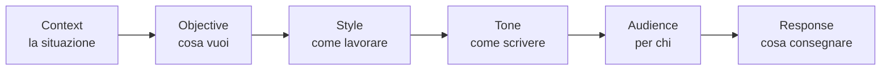

# Prompt

64 prompt generici in 12 aree, più 16 di manutenzione di SecondBrain. Scegli, aggiungi il tuo obiettivo, e l'agente ha tutto ciò che serve.

```text
sb prompt list
sb prompt maintenance
sb prompt mostra DEV01
sb prompt DEV01: aggiungi l'esportazione in PDF
```

Elenco completo: [catalogo generico](../direttive/prompts/README.it.md) ([English](../direttive/prompts/README.md)) e [prompt di manutenzione](../direttive/prompts/README.maintenance.it.md) ([English](../direttive/prompts/README.maintenance.md)); da chat `sb prompt maintenance`.

## Come è fatto: CO-STAR

Ogni prompt composto da SecondBrain ha sempre sei parti, nello stesso ordine.



| Parte | Da dove viene |
|---|---|
| Context | Progetto, cartelle, quando usare il prompt |
| Objective | La tua richiesta e lo scopo del prompt |
| Style | Attività, verifiche, come fare domande |
| Tone | Diretto e fattuale |
| Audience | Chi legge il risultato, secondo l'area |
| Response | Cosa consegnare, quando il lavoro è completo (stessa definizione per tutti i prompt) e come chiuderlo |

Vale per i prompt composti (`sb prompt CODICE: obiettivo`). `sb prompt mostra` fa vedere la scheda sorgente, con le sue sezioni.

Ogni scheda esiste in italiano e in inglese. La lingua di visualizzazione segue `-Language` (`prompts.ps1`), `SECONDBRAIN_LANG` o la lingua del sistema; il tool MCP accetta `language` (`en|it`) su `list_prompts`, `get_prompt_home` e `get_prompt`. Le schede core nascono in inglese (traduzione in `direttive/prompts/it/`), quelle maintenance in italiano (traduzione in `direttive/prompts/en/`); titolo, intestazione e prompt vicini ripetono i valori `i18n` del catalogo. La chiusura dei prompt core è neutra (criteri verificati, documentazione aggiornata, residui dichiarati, nessun riferimento a SecondBrain); quella dei prompt maintenance aggiorna tracker, `memory.md` e `context.md` del dossier. Gli indici sono generati per lingua e pacchetto con `scripts/build-prompts.ps1`.

## Le aree

Pacchetto core (generico, schede in inglese, valido per qualunque repository):

| Codice | Area |
|---|---|
| COM | Comprensione e ricerca |
| PRG | Requisiti e progettazione |
| DEV | Sviluppo e modernizzazione |
| TST | Test e verifica |
| SEC | Review e sicurezza |
| AUD | Audit e metriche |
| INT | Interfaccia ed esperienza utente |
| DAT | Dati e integrazioni |
| OPS | Rilascio e operatività |
| DOC | Documentazione |
| REP | Igiene del repository |
| GOV | Licenze e conformità |

Pacchetto maintenance (`sb prompt maintenance`): MEM (memoria e continuità) e SYS (sistema e manutenzione centrale), per gestire SecondBrain stesso.

## Le icone

Ogni elenco mostra la modalità del prompt:

| Icona | Modalità | Significato |
|---|---|---|
| 🔭 | lettura | analizza e riporta; nessun effetto |
| ✅ | verifica | confronta con criteri, esito pass/fail; non modifica |
| 🔥 | scrittura | modifica file o stato |
| ⛔ | distruttivo | scrittura irreversibile: chiede conferma esplicita |

## Personalizza

Il modo più semplice è chiederlo all'agente:

```text
sb prompt SYS11: aggiungi un prompt per le migrazioni del database
```

A mano: [modificare i prompt](riferimento/customizing-prompts-and-directives.md#modifica-dei-prompt) e [modificare le regole](riferimento/customizing-prompts-and-directives.md#modifica-delle-direttive).

Una nuova regola comune richiede sempre la tua approvazione.
