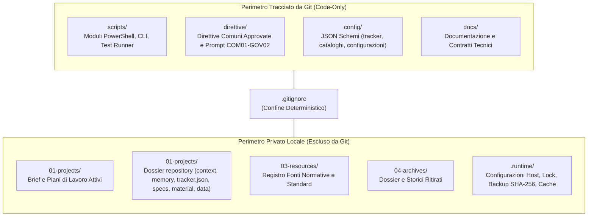
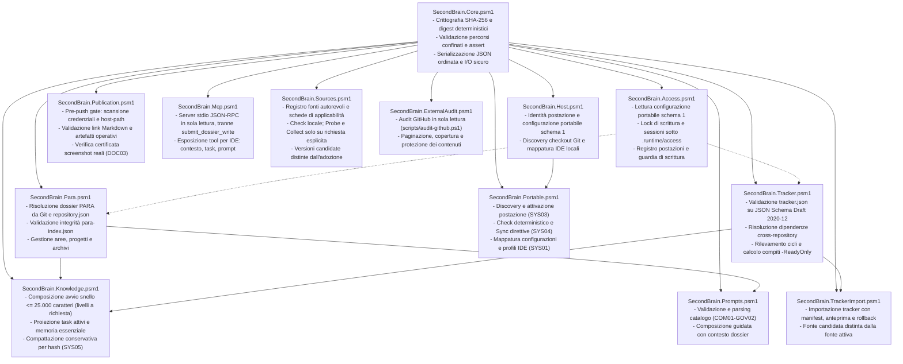
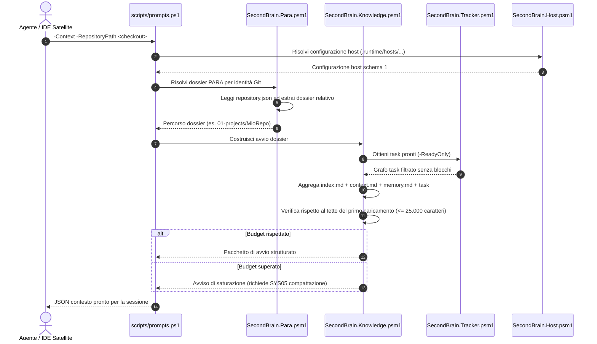
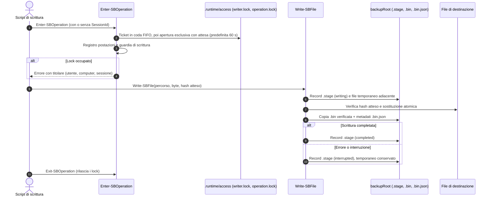
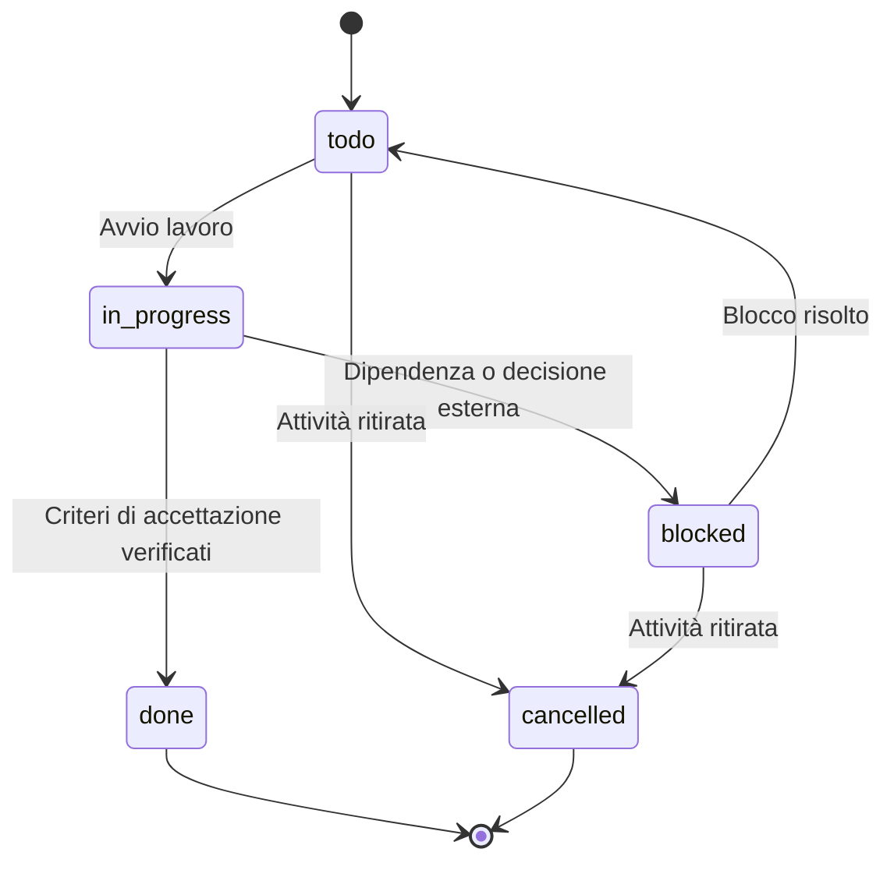
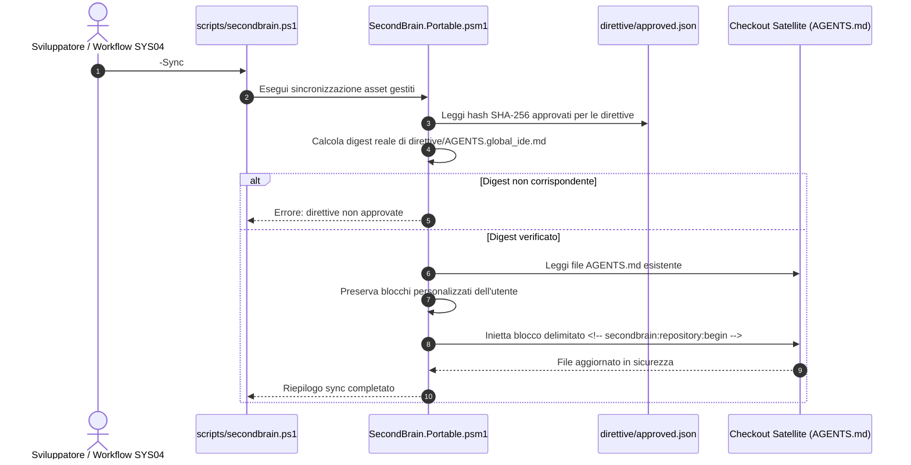
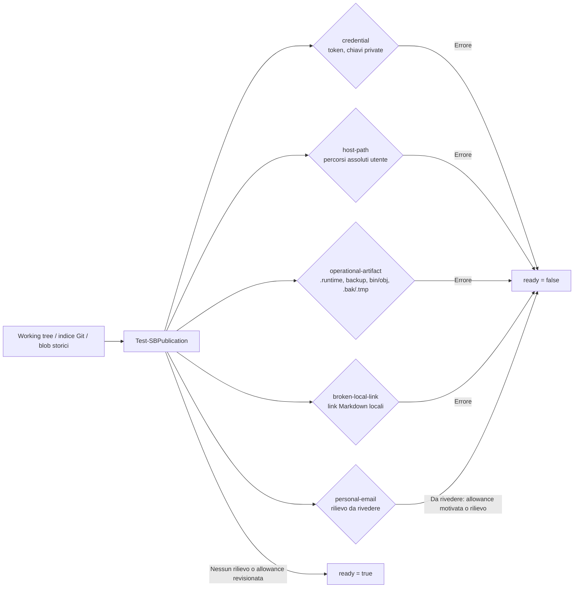

# Architettura e Moduli di SecondBrain

Documentazione tecnica e architetturale di **SecondBrain** basata sull'implementazione reale dei moduli PowerShell 7.5+ (`scripts/SecondBrain.*.psm1`), degli schemi JSON e delle interfacce CLI.

---

## 1. Visione d'Insieme e Modello a Doppio Confine

SecondBrain adotta un modello a **doppio confine** che separa categoricamente il codice distribuibile e le direttive comuni dai dati operativi, dossier privati e cache locali della singola postazione di sviluppo.

Modalità Code-Only: Git traccia solo codice e documentazione (`scripts/`, `config/`, `direttive/`, `docs/`, `README.md`, `LICENSE`, `CHANGELOG.md`, `CREDITS.md`); dossier, archivi e `.runtime/` stanno nel clone locale, protetti da `.gitignore` (il clone può stare anche su una share di rete usata da più PC: vedere [shared-brain.md](shared-brain.md)).

---

## 2. Decomposizione dei Moduli PowerShell

Il sistema è strutturato in una libreria di moduli PowerShell (`scripts/SecondBrain.*.psm1`), ciascuno con responsabilità rigorose e contratti verificati da test deterministici:

---

## 3. Sequenza di Risoluzione Contesto e Avvio Agente (Avvio Snello 25.000 Caratteri)

Quando un coding agent opera all'interno di un repository satellite, risolve il contesto storico e i task dal dossier SecondBrain corrispondente tramite `scripts/prompts.ps1 -Context` o `scripts/knowledge.ps1 -Startup`:

---

## 4. Transazioni Atomiche, Lock e Ripristino

Le scritture sono coordinate da `SecondBrain.Access.psm1` (lock) e `SecondBrain.Core.psm1` (`Write-SBFile`, `Remove-SBFile`). Lock e sessioni risiedono in `.runtime/access`; backup e record di staging in `backupRoot` della postazione (`.runtime/hosts/<id>/backups`):

Il recupero è esplicito: `scripts/restore-managed.ps1 -MetadataPath <.bin.json>` ripristina un file solo se la destinazione coincide ancora con l'hash distribuito; `scripts/recover.ps1` risolve le transazioni PARA e tracker interrotte (marker `.runtime/para-transaction.json`, anteprima di default, `-Apply` per applicare). I record `.stage` e i backup non vengono eliminati automaticamente.

---

## 5. Ciclo di Vita dei Task nel Grafo Cross-Repository

Ogni repository tracciato dispone di un `tracker.json` (schema `config/tracker.schema.json`, Draft 2020-12) letto da `SecondBrain.Tracker.psm1`. Gli stati ammessi dallo schema sono `todo`, `in_progress`, `blocked`, `done`, `cancelled` e `unknown`; ogni task dichiara anche `execution` (`autonomous`, `user_required`, `unspecified`), priorità, dipendenze e criteri di accettazione. Un task è pronto (`-ReadyOnly`) quando le sue dipendenze sono soddisfatte. Lo schema non impone le transizioni: le regole di chiusura (verifica dei criteri, evidenze con `outcome` in `passed`, `failed`, `partial`, `unverified`) sono nelle direttive e nei workflow.

`unknown` marca task migrati il cui stato originale non è riconducibile con certezza.

---

## 6. Sincronizzazione Direttive Comuni nei Repository Satellite

Le direttive per coding agent (`AGENTS.md`) sono distribuite tramite `scripts/secondbrain.ps1 -Sync`, garantendo che solo versioni formalmente approvate e firmate con SHA-256 vengano iniettate:

---

## 7. Pre-Push Gate e Controllo di Pubblicabilità (SEC07)

Due controlli distinti, entrambi in sola lettura:

- `scripts/check-distribution.ps1` verifica che l'indice Git contenga solo il perimetro pubblico (`scripts/`, `config/`, `direttive/`, `docs/`, `app/` e i file di radice ammessi) e nessun percorso PARA o `.runtime`; exit 1 in presenza di violazioni.
- `scripts/publication.ps1` (`Test-SBPublication`, modulo `SecondBrain.Publication.psm1`) analizza working tree, indice e blob storici:

I binari sopra soglia o non testuali richiedono una revisione registrata nella policy tracciata (`config/publication-policy.json`; `publication.ps1 -MigratePolicy -ApplyMigration` copia la vecchia `.runtime/publication/policy.json`); la copertura incompleta è dichiarata e non equivale a esito pulito.

---

## 8. Specifiche di Sicurezza e Invarianti Ingegneristici

1. **Esecuzione disconnessa e deterministica**: nessun comando, modulo o test runner effettua chiamate di rete implicite verso servizi esterni o LLM commerciali.
2. **Nessun demone in background**: SecondBrain non installa né richiede servizi, demoni o agenti in background; ogni azione è attivata esplicitamente da comandi CLI o chiamate JSON-RPC.
3. **Isolamento dei dati personali**: tutte le note private, memorie storiche, configurazioni delle postazioni e cache risiedono sotto `.runtime/` e nelle cartelle PARA locali, categoricamente escluse da Git tramite `.gitignore`.
4. **Preservazione dei file originali**: qualsiasi trasformazione o compattazione conserva gli originali tramite digest SHA-256 in cartelle immutabili, prevenendo ogni perdita di dati accidentale.
