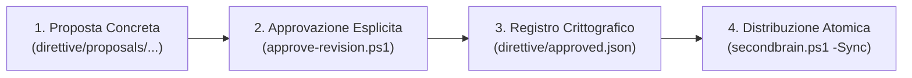
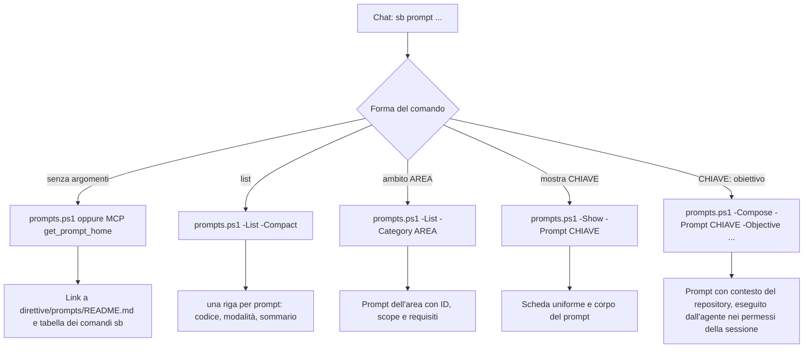

# Prompt e direttive: uso, personalizzazione e manutenzione

> Tool portabile: [procedura corrente](portable-brain.md). Nessun monitor; output operativi sotto .runtime e pulizia solo su richiesta.

Guida operativa per usare il catalogo dei prompt (chat e CLI), estenderlo con nuove schede workflow, aggiornare le direttive comuni e allineare le istruzioni negli IDE e nei coding agent. [Indice generato](../../direttive/prompts/README.md), [metadati autorevoli](../../direttive/prompts/catalog.json). Per l'uso dalla chat e dalla CLI vedi la sezione 7; fonti, manutenzione centrale e verifiche sono nelle sezioni 9-11.

---

## Modifica dei prompt

Percorso unico per aggiungere, modificare o ritirare un prompt (da chat: `sb prompt SYS11: …`, che guida le scelte):

1. scheda inglese `direttive/prompts/<CODICE>.md`, controparte italiana `direttive/prompts/it/<CODICE>.md` e voce in `direttive/prompts/catalog.json` (ID `pmt-…` immutabile, codice libero dell'area, `summary` entro 82 caratteri): sezioni 1 e 4 sotto;
2. `pwsh -NoProfile -File scripts/build-prompts.ps1` rigenera `direttive/prompts/README.md` e `README.it.md` (mai a mano); `-Check` verifica senza scrivere;
3. `pwsh -NoProfile -File scripts/test-secondbrain.ps1 -Only prompts` controlla schede, ID, direttive e conteggi.

Un prompt superato si rimuove con la sua voce, le due schede e i riferimenti nei `related`; il codice non si riusa. Il catalogo è dati del progetto: non tocca i tuoi file fuori dal clone.

## Modifica delle direttive

Preparare una cartella con un `README.md` e i Markdown da modificare. I nomi comuni sono `AGENTS.global_ide.md`, `workstation.template.md` e `AGENTS.repo.managed.md`. Per un singolo repository, riprodurre nel candidato il percorso relativo del dossier e aggiungere `AGENTS.managed.md`. Usare una cartella di proposta nel runtime per testi privati. Un Markdown specifico vuoto ritira il solo contributo specifico.


`scripts/approve-revision.ps1 -Preview -ProposalPath <cartella>` mostra i testi prima e dopo, gli hash per file e `proposalHash`. Dopo approvazione, ripetere senza `-Preview` passando `-ExpectedProposalHash <hash>` e `-Authorization <riferimento>`. Una modifica intervenuta dopo la revisione richiede una nuova anteprima. L'applicazione conserva il manifest di recupero. Ogni postazione esegue `-Sync` e `-Check`; i conflitti locali vengono segnalati. Le impronte delle direttive comuni stanno in `direttive/approved.json`. Quelle dei dossier stanno in `.runtime/directive-approvals.json`, condiviso tra le postazioni e privato.


---

## 1. Architettura dei Workflow e Catalogo Prompts

I prompt di SecondBrain sono una lista unica: metadati in `catalog.json`, una scheda Markdown inglese per prompt (`direttive/prompts/<CODICE>.md`), la traduzione italiana in `direttive/prompts/it/<CODICE>.md` e due indici generati (`README.md`, `README.it.md`). Il catalogo conta 114 prompt in 17 aree tematiche; le aree `memory` (MEM) e `system` (SYS) contengono i prompt che gestiscono SecondBrain stesso. Non esistono pacchetti, alias, deprecazioni o stati: i codici sono identificatori stabili, mai riusati, e un prompt superato si rimuove (restano vuoti nella numerazione).

Il caricamento è selettivo: l'elenco legge solo i metadati; `-Show` e `-Compose` caricano la sola scheda richiesta. La build valida tutte le schede prima di generare gli indici. Una riga dell'elenco è lunga al massimo 88 caratteri.

Un prompt si richiama per ID (`pmt-a709a792`) o codice (`COM01`), con `prompts.ps1 -Show|-Compose -Prompt <chiave>` e dagli strumenti MCP `get_prompt`/`prompts/get`: entrambe le chiavi risolvono allo stesso prompt. `-Compose` e `get_prompt` accettano `-Objective`/`objective` per impostare il compito.

### Struttura di una Scheda Prompt
Ogni scheda inizia con `# CODICE — <sommario>` (il sommario è identico a quello del catalogo) e contiene i tag XML seguenti, ciascuno su una riga propria e nell'ordine indicato. Fonti di riferimento: le guide di prompt engineering di Anthropic (ruolo, tag XML, istruzioni positive, formato di output esplicito), OpenAI e Google, e il framework CO-STAR.

```markdown
# DEV99 — Summary of the workflow

<role>
Who the agent is for this task.
</role>
<context>
When to use the prompt and its limits.
</context>
<inputs>
- what is needed before starting.
</inputs>
<decisions>
- (optional) choices to put to the user with a structured multiple-choice question;
</decisions>
<procedure>
1. Numbered, unambiguous steps (at least two).
2. ...
</procedure>
<constraints>
- What not to do.
</constraints>
<exit_criteria>
- Verifiable conditions that say the work is done.
</exit_criteria>
<output_format>
How to report the result.
</output_format>
```

I tag obbligatori sono `role`, `context`, `inputs`, `procedure` (almeno due passi numerati), `constraints`, `exit_criteria`, `output_format`; `decisions` è facoltativo e, se presente, è un elenco puntato di scelte. Fuori dai tag non c'è altro testo. Una scheda sta in circa una pagina.

### Registrazione in `catalog.json`
Ogni prompt deve essere censito in `direttive/prompts/catalog.json`:
- `id`: identificatore opaco e immutabile `pmt-` + 8 esadecimali minuscoli, generato una sola volta (`New-SBWorkflowPromptId`) e mai riusato. Le relazioni (`related`) usano solo ID.
- `code`: pattern `^[A-Z]{2,4}[0-9]{2}$` per area tematica (es. `COM01`, `DEV01`, `SYS01`); dà il nome alla scheda (`<CODE>.md`).
- `category`: una delle 17 aree registrate in `categories`; ogni area ha un `group` (`repository` o `central`: le aree centrali contengono solo prompt `central`) e un titolo italiano in `i18n.it.title`. Le aree raggruppano per attività o necessità, non per prefisso del codice.
- `summary`: descrizione sintetica in inglese (massimo 82 caratteri; `code + ' | ' + summary` non supera 88).
- `target`: `repository` (eseguibile nei repository prodotto) o `central` (manutenzione di SecondBrain: si compone solo per SecondBrain; SYS03 dispone del bootstrap senza configurazione).
- `mode`: `read`, `write` o `verify`; descrive il workflow e non aumenta i permessi né supera la modalità Plan. `destructive` (facoltativo) segna le scritture irreversibili.
- `scope`, `requires`, `example`: ambito, prerequisiti ed esempio d'uso.
- `file`: nome della scheda (es. `DEV99.md`).
- `related`: da 1 a 10 ID di prompt vicini, esistenti e diversi dal prompt; includono ogni codice citato nel testo della scheda (EN e IT), che a sua volta deve esistere; la composizione li propone a fine task insieme ai task pronti del repository, senza avviare nulla.
- `i18n.it`: `summary`, `requires` ed `example` in italiano.
- Il validatore controlla schema, unicità di ID e codici, categorie, percorsi confinati, tag, titolo della scheda (uguale al `summary`) e riferimenti dei `related`, per entrambe le lingue. La procedura per aggiungere, modificare o rimuovere un prompt è SYS11.
- La risoluzione delle memorie con `-Context` funziona anche se il catalogo dei prompt è assente o non valido. Il resolver confronta indice PARA e metadati reali del dossier; dossier archiviati o ritirati, identità escluse, tracker dichiarati mancanti o invalidi e ambiguità non producono fallback.

### Rigenerazione e Validazione con `build-prompts.ps1`
Dopo aver modificato o aggiunto una scheda:

```powershell
# Verifica in sola lettura (exit 0 se allineato, 1 se c'è drift)
pwsh -NoProfile -File scripts/build-prompts.ps1 -Check

# Rigenera direttive/prompts/README.md aggiornando indici e collegamenti
pwsh -NoProfile -File scripts/build-prompts.ps1
```

Metadati in `catalog.json` e singole schede Markdown sono le sorgenti; `README.md` è generato. Il Check operativo (`secondbrain.ps1 -Check`) comprende l'indice e richiede il catalogo con le direttive approvate. `build-prompts.ps1 -Check` restituisce 1 per indice da rigenerare; input invalidi interrompono la generazione prima delle scritture.

---

## 2. Integrazione delle Direttive nei Diversi IDE

SecondBrain supporta un modello ibrido che distingue tra **file di configurazione su disco** e **superfici manuali/account web**.

AGENTS.md è la fonte unica nel repository (standard aperto [agents.md](https://agents.md)). Lo leggono direttamente Codex, Cursor, Windsurf, GitHub Copilot (VS Code e coding agent), JetBrains Junie, Zed, Roo Code, Kilo Code, Warp, goose e altri; non lo leggono per nome Claude Code (usa `CLAUDE.md`), Gemini CLI (usa `GEMINI.md` o `context.fileName`) e Aider (`read: AGENTS.md` in `.aider.conf.yml`). Per questo `secondbrain.ps1 -Sync` mantiene in ogni repository gestito, oltre al blocco in `AGENTS.md`, due puntatori sottili `CLAUDE.md` e `GEMINI.md` con un blocco gestito `secondbrain:pointer` che contiene soltanto `@AGENTS.md`: il testo dell'utente nel file resta intatto e `rollback-repo.ps1` rimuove i blocchi.

| Strumento | Istruzioni di repository | Istruzioni globali |
|---|---|---|
| Codex | `AGENTS.md` | file `AGENTS.md` nella cartella Codex dell'utente (gestito) |
| Claude Code | `CLAUDE.md` → `@AGENTS.md` (gestito) | `CLAUDE.md` nella cartella di configurazione (gestito) |
| Claude Desktop e account Anthropic | — | *Custom Instructions*: incolla il testo approvato (superficie manuale) |
| Antigravity / Gemini CLI | `GEMINI.md` → `@AGENTS.md` (gestito) | file `GEMINI.md` (gestito per Antigravity) |
| VS Code (Copilot) e Continue | `AGENTS.md` (Copilot lo legge; Continue: aggiungilo ai file di contesto) | superficie manuale |
| Cursor, Windsurf | `AGENTS.md` | superficie manuale (impostazioni dell'account) |
| JetBrains Junie, Zed, Cline, Roo, Kiro, Aider | `AGENTS.md` o la propria cartella di regole; Aider con `read: AGENTS.md` | non gestite: nessun percorso globale documentato per file |

Le superfici manuali non si scrivono: `ide-map.ps1 -Verify` non scrive nulla e confronta i file mappati con il testo approvato; il caricamento nell'account o nella sessione si dimostra solo con una ricevuta di osservazione locale passata con `-ObservationPath` (SYS01).

---

## 3. Ciclo di Approvazione e Distribuzione delle Direttive

Per preservare l'integrità crittografica e prevenire allucinazioni o modifiche non tracciate, le modifiche alle direttive comuni seguono un ciclo formale in 4 fasi:



Le regole comuni attive sono [AGENTS.global_ide.md](../../direttive/AGENTS.global_ide.md) e [workstation.template.md](../../direttive/workstation.template.md); [approved.json](../../direttive/approved.json) registra hash e autorizzazione e la [proposta team-rete approvata](../../direttive/proposals/2026-11-04-team-rete/README.md) contiene il testo approvato; le proposte precedenti restano come storico. Le proposte approvate restano immutabili: non modificare hash o blocchi generati per eludere il processo. Dopo la distribuzione si esegue anche [SYS01](adapters.md).

Gli AGENTS applicativi distinguono revisione comune applicata e revisione specifica del progetto; per la parte specifica si parte dal modello [AGENTS.repo.template.md](../../direttive/AGENTS.repo.template.md), mentre il blocco comune gestito è generato da `New-SBPortableRepositoryBody` (`scripts/SecondBrain.Portable.psm1`). Una marcatura allineata non prova il caricamento in sessione né la validità tecnica di tutti i contenuti applicativi: il caricamento va verificato in nuove sessioni, separatamente dall'allineamento dei file.

### 1. Creazione della Proposta
Redigi i file proposti sotto `direttive/proposals/<data>-<nome-proposta>/`:
- `AGENTS.global_ide.md`
- `workstation.template.md`
- `README.md` con motivazione e perimetro

### 2. Approvazione Formale
Registra l'autorizzazione calcolando gli hash crittografici:

```powershell
$proposal = pwsh -NoProfile -File scripts/approve-revision.ps1 `
    -ConfigPath .runtime/hosts/<id>/workstation.json `
    -ProposalPath direttive/proposals/<data>-<nome> -Preview | ConvertFrom-Json

# Dopo la revisione dei testi restituiti e l'approvazione dell'utente.
pwsh -NoProfile -File scripts/approve-revision.ps1 `
    -ConfigPath .runtime/hosts/<id>/workstation.json `
    -ProposalPath direttive/proposals/<data>-<nome> `
    -ExpectedProposalHash $proposal.proposalHash -Authorization "Ricevuta approvazione esplicita utente"
```

La proposta include i soli Markdown da cambiare e un `README.md`. `-Preview` restituisce il digest da passare come `-ExpectedProposalHash`. L'applicazione registra i testi e `approved.json` nella stessa transazione con backup. `-SessionId` riusa una sessione di scrittura aperta con `scripts/access.ps1`.

### 3. Distribuzione con `secondbrain.ps1 -Sync`
Applica la nuova revisione a tutti i checkout gestiti:

```powershell
# Esegui la sincronizzazione
pwsh -NoProfile -File scripts/secondbrain.ps1 -Sync

# Verifica che tutti i repository risultino allineati (exit 0)
pwsh -NoProfile -File scripts/secondbrain.ps1 -Check
```
Le modifiche personali fuori dal blocco gestito e le impostazioni specifiche del singolo repository rimangono integre e intoccate.


---

## 4. Gestione del Catalogo: Rimozione, Deprecazione e Nuove Aree

- **Con l'agente**: il prompt `SYS11` guida aggiunta, modifica e rimozione con scelte strutturate; i passi sotto sono la procedura manuale equivalente. Le schede che chiedono scelte hanno il tag opzionale `decisions`.
- **Aggiungere una scheda**: genera l'ID con `Import-Module scripts/SecondBrain.Prompts.psm1; New-SBWorkflowPromptId (Read-SBWorkflowCatalog $PWD.Path)` dalla radice di SecondBrain, scrivi le due schede (EN e IT) e registra la voce con `id`, `code`, `related` e `i18n.it`.
- **Modificare una scheda**: cambia il testo; se cambia il `summary`, aggiornalo nel catalogo e nel titolo di entrambe le schede.
- **Rimuovere una scheda**: elimina la voce da `prompts`, le due schede e il suo ID dai `related` degli altri prompt; poi esegui `build-prompts.ps1`. Codice e ID rimossi non vanno riutilizzati.
- **Creare una nuova area**: aggiungi `{ "id": "cloud", "title": "Cloud e infrastruttura" }` a `categories`. Un'area deve contenere almeno un prompt, altrimenti `build-prompts.ps1 -Check` fallisce ("Categoria senza prompt"). Registra quindi la prima scheda con `"category": "cloud"`.
- Dopo ogni modifica: `build-prompts.ps1` (rigenera `direttive/prompts/README.md` e `README.it.md`) e `build-prompts.ps1 -Check` (exit 0 se allineato).

## 5. Repository su Percorsi e Dischi Arbitrari

SecondBrain non vincola i repository a una cartella: la Discovery accetta radici qualsiasi.

```powershell
# Attivazione guidata (proposta, conferma, anteprima) sulle cartelle o i dischi indicati
pwsh -NoProfile -File scripts/secondbrain.ps1 -Setup -Interactive -Roots "D:\Sviluppo","E:\Clienti","C:\Progetti"

# Oppure in due passi non interattivi: report e selezione per host in .runtime/hosts/<id>/
pwsh -NoProfile -File scripts/secondbrain.ps1 -Setup -Roots "D:\Sviluppo" -Select mio-prodotto -Yes -Apply
```

`config/shared.json` regola il comportamento condiviso:

| Chiave | Effetto |
|---|---|
| `allowedOwners` | Elenco di owner GitHub ammessi, valido per Discovery e dossier (si somma a quello della postazione); `[]` (default) non pone vincoli. |
| `excludedDirectories` | Nomi di cartella ignorati dalla Discovery (`node_modules`, `dist`, `.venv`, …), oltre a quelli di sistema. Una cartella con uno di questi nomi che contiene `.git` (per esempio un checkout chiamato `build` o `dist`) è comunque scoperta; senza `.git` è saltata e riportata in `excluded` con motivo `known-system-or-build-tree`. Le cartelle di sistema o di altri profili non leggibili per permessi sono riportate in `warnings`; un accesso negato in una cartella dell'utente corrente è un problema (`issues`, `kind: access-denied`) e rende la ricognizione incompleta (exit 2). Il file è obbligatorio: se manca la configurazione non si carica. |
| `forbiddenRepositories` | Identità (`github.com/<owner>/<repo>`) mai gestite; si aggiornano con `scripts/rollback-repo.ps1 -Forbid`. |

## 6. Tracker di Progetto

Il tracker autorevole di un prodotto è `01-projects/<Prodotto>/tracker.json` (schema 1, validato da `config/tracker.schema.json`) oppure `tracker.md` nel dossier. Per importare un tracker esistente, JSON o Markdown, nel formato standard:

```powershell
# Anteprima (nessuna scrittura)
pwsh -NoProfile -File scripts/import-tracker.ps1 -Repository github.com/<owner>/<repo> -SourcePath <percorso\tracker.json|tracker.md>

# Applicazione con manifest e backup
pwsh -NoProfile -File scripts/import-tracker.ps1 -Repository github.com/<owner>/<repo> -SourcePath <percorso> -Apply
```

Dettagli del contratto in [trackers.md](trackers.md).

## 7. Uso dalla chat e dalla CLI

Con le direttive comuni caricate nella sessione:

```text
sb prompt
sb prompt list
sb prompt ambito test
sb prompt mostra TST04
sb prompt TST04: analizza e correggi il fallimento del job Windows
```

La chat è l’interfaccia comune: non è uno slash command nativo né un alias installato nella shell. `sb prompt` mostra il link al file Markdown del catalogo completo e la tabella dei comandi `sb`; `sb prompt list` riporta l’elenco compatto integrale (una riga per prompt, mai riassunto). L’agente esegue la CLI centrale e riporta l’output senza riassumerlo. Per applicare il modello carica solo la scheda scelta, risolve il repository corrente e svolge il task nei permessi della conversazione. In modalità Plan prepara il piano senza implementarlo. Se manca un input sostanziale, cerca prima nei file e nella conversazione, poi chiede un chiarimento mirato.

Flusso delle cinque forme (percorso verificato sui set di parametri di `scripts/prompts.ps1`):



### CLI centrale

PowerShell 7.5 o successivo, da qualsiasi directory:

```powershell
$brain = $env:SECONDBRAIN_HOME # es. 'C:/Progetti/SecondBrain'
$cfg = "$brain/.runtime/hosts/<id>/workstation.json"
& "$brain/scripts/prompts.ps1"                      # link al catalogo e comandi sb
& "$brain/scripts/prompts.ps1" -List -Compact        # tutti i prompt, una riga ciascuno
& "$brain/scripts/prompts.ps1" -List
& "$brain/scripts/prompts.ps1" -List -Category test   # anche TST o Test
& "$brain/scripts/prompts.ps1" -Show -Prompt TST04
& "$brain/scripts/prompts.ps1" -Context -ConfigPath $cfg
& "$brain/scripts/prompts.ps1" -Compose -Prompt TST04 -Objective 'Correggi il job Windows' -ConfigPath $cfg
& "$brain/scripts/prompts.ps1" -Compose -Prompt SEC01 -RepositoryPath 'C:/Progetti/Repo/src' -ConfigPath $cfg
```

`-List` e `-Show` non richiedono configurazione né repository associato. `-Context` e `-Compose` richiedono `-ConfigPath`; in assenza di selezione esplicita usano Git dalla directory corrente, compresi sottocartelle e worktree. Per identità esplicita usare `-Repository github.com/owner/repo`, eventualmente con `-CheckoutPath`; identità con più checkout richiede selezione. Il checkout deve esistere e avere l’origin dell’identità ammessa, senza deduzioni dal nome della cartella.

Per Progetti usare `-ProjectId`; se ci sono più checkout, `-CheckoutMapPath` contiene un oggetto JSON identità GitHub → percorso checkout. Il compositore include il brief come dato codificato JSON e riferimenti locali, non il contenuto di contesto, memoria o tracker. Non esegue il task e non trasmette dati a servizi AI.

`-OutputPath` crea solo un nuovo TXT. Non sovrascrive file e non segue reparse point. Exit code: 0 successo, 2 errore. `build-prompts.ps1 -Check` restituisce 1 per indice da rigenerare; input invalidi interrompono la generazione prima delle scritture.

Per generare e verificare l'indice e provare una composizione:

```powershell
$cfg = '.runtime/hosts/<id>/workstation.json'
./scripts/build-prompts.ps1 -Check -ConfigPath $cfg
./scripts/build-prompts.ps1 -ConfigPath $cfg
./scripts/prompts.ps1 -Compose -Prompt SEC01 -Objective 'Revisionare le modifiche locali' -ConfigPath $cfg
```

## 8. Interazione Strutturata e Scelta Multipla

Le direttive e i prompt non nominano uno strumento specifico: quando serve una decisione sostanziale non desumibile dal codice (per esempio in `COM01`, `PRG01`, `SYS03`, `SYS04`, `SYS05`, `SEC07`), l'agente usa lo strumento di domanda strutturata a scelta multipla del proprio client, se esiste (in Claude Code `AskUserQuestion`, in altri client l'equivalente), altrimenti pone una sola domanda concisa con opzioni.
- Indica la scelta raccomandata come prima opzione, con opzioni atomiche e non numerate.
- Evita domande a testo libero ripetute o richieste di conferma per operazioni già autorizzate nel perimetro del task.

## 9. Fonti e scelte

Consultazione online: 28 ottobre 2026. Le schede del registro comune sono riferimenti con URL e sintesi originali; nessun corpus integrale è stato acquisito. Applicabilità tecnica e revisione di una trascrizione sono distinte.

| Fonte | Uso nel catalogo |
|---|---|
| [OpenAI prompt engineering](https://developers.openai.com/api/docs/guides/prompt-engineering) | Istruzioni esplicite, delimitazione di dati, esempi e valutazioni |
| [OpenAI sviluppo per fasi](https://developers.openai.com/cookbook/examples/codex/iterating-development-workflows-with-codex) | Impatto, pianificazione, esecuzione, verifica e continuità |
| [Claude workflow](https://code.claude.com/docs/en/common-workflows) e [libreria](https://code.claude.com/docs/en/prompt-library) | Orientamento, tracciamento, bug, test e risultati osservabili |
| [GitHub Cookbook](https://docs.github.com/en/copilot/tutorials/copilot-cookbook) | CI, dipendenze, dati, prestazioni, integrazioni e test |
| [GitHub prompt files](https://docs.github.com/en/copilot/tutorials/customization-library/prompt-files) | Schede task separate da istruzioni persistenti; README, API e review |
| [Awesome Copilot](https://github.com/github/awesome-copilot) | Esempi comunitari specialistici; nessuna installazione né adozione delle regole degli esempi |
| [Google strategie](https://ai.google.dev/gemini-api/docs/prompting-strategies) | Struttura coerente e iterazione, senza presumere equivalenza fra modelli |

Schede di registro: `openai-prompt-engineering`, `openai-development-workflows`, `anthropic-code-workflows`, `github-copilot-cookbook`, `github-prompt-files`, `github-awesome-copilot`, `google-prompt-strategies`.

I workflow di repository e di sistema (REP01, REP04 e SYS01–SYS02) incorporano anche convenzioni locali SecondBrain: tracker autorevole, blocchi gestiti, migrazione con recupero, centralità delle memorie e distinzione centrale/prodotto. Queste scelte non vengono attribuite ai fornitori. Nessuna raccomandazione specifica di framework, modello o browser è resa universale.

## 10. Manutenzione centrale e prodotti

SecondBrain mantiene direttive, prompt, blocchi AGENTS gestiti e riferimenti. I task prodotto restano ai rispettivi agenti, anche se registrati qui come autonomous. REP01 seleziona solo attività del repository aperto; DOC01 (alias REP02) e MEM01 coprono documentazione, memoria, pulizia e tracker; MEM02 l'importazione nel dossier; SYS01-SYS02 richiedono SecondBrain come repository operativo.

L'agente del prodotto confronta codice e stato Git con dossier corrente, fonte tracker e schede di applicabilità. Consultare un riferimento non autorizza automaticamente esecuzione o modifica delle prescrizioni comuni.

## 11. Verifiche e limiti

`scripts/test-secondbrain-workflows.ps1` verifica catalogo, caricamento selettivo, CLI, risoluzione Git/PARA, output e composizione in fixture isolate sotto SecondBrain/.runtime/tests. Sei fixture per esplorazione, CI, dipendenze, migrazione dati, accessibilità e handoff verificano tramite la CLI selezione della scheda, modalità, preservazione della richiesta e caricamento selettivo. Non sono valutazioni dell’efficacia di un LLM.

La suite principale include queste prove. Generazione: `scripts/build-prompts.ps1 -ConfigPath <config>`; verifica senza scritture con `-Check`. Il Check operativo comprende l indice e richiede il catalogo con le direttive approvate. Dopo attivazione sono necessari nuovi avvii per provare il caricamento delle direttive; file allineati e fixture superate non ne costituiscono prova.
