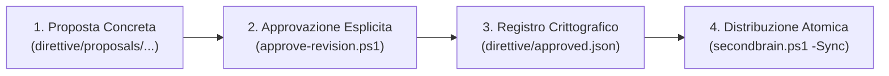

# Personalizzazione Manuale di Prompt e Direttive negli IDE

Guida operativa per estendere il catalogo dei prompt, aggiungere nuove schede workflow, aggiornare le direttive comuni e allineare manualmente le istruzioni negli IDE e nei coding agent.

---

## Modifica dei prompt

Percorso unico per aggiungere, modificare o ritirare un prompt (da chat: `sb prompt SYS11: …`, che guida le scelte):

1. scheda `direttive/prompts/<CODICE>.md` e voce in `direttive/prompts/catalog.json` (ID `pmt-…` immutabile, codice libero dell'area, `summary` entro 88 caratteri): sezioni 1 e 4 sotto;
2. `pwsh -NoProfile -File scripts/build-prompts.ps1` rigenera `direttive/prompts/README.md` (mai a mano); `-Check` verifica senza scrivere;
3. `pwsh -NoProfile -File scripts/test-secondbrain-workflows.ps1` controlla schede, ID, alias e conteggi.

Un prompt si ritira (con sostituto), non si cancella, salvo richiesta esplicita. Il catalogo è dati del progetto: non tocca i tuoi file fuori dal clone.

## Modifica delle direttive

Le direttive comuni (`direttive/AGENTS.global_ide.md`) e l'integrazione di postazione (`direttive/workstation.template.md`) arrivano agli IDE solo dopo approvazione e distribuzione:

1. proposta in `direttive/proposals/<data>-<nome>/` con i due testi e un `README.md` con gli hash (sezione 3);
2. `scripts/approve-revision.ps1 -Authorization <testo> -ConfigPath <config> -ProposalPath <cartella>` registra l'approvazione e copia i testi in `direttive/` (con backup);
3. `secondbrain.ps1 -Check`, poi `-Sync`: scrive solo il blocco gestito in `AGENTS.md` e nei file IDE, con backup ([cosa viene toccato](safety-backups.md)). Gli IDE manuali si aggiornano incollando il testo di `.runtime/hosts/<id>/istruzioni-globali.md`.

---

## 1. Architettura dei Workflow e Catalogo Prompts

I prompt di SecondBrain sono organizzati in formato modulare con separazione netta tra metadati (`catalog.json`), schede Markdown per area tematica e indice generato (`direttive/prompts/README.md`).

### Struttura di una Scheda Prompt
Ogni scheda deve iniziare con `# CODICE — <Titolo>` (es. `DEV01`, `SYS03`) e contenere esattamente le **7 sezioni canoniche obbligatorie**:

```markdown
# DEV99 — Titolo del workflow

## Scopo
Sintesi dell'obiettivo operativo in 1-2 frasi.

## Quando usarlo
Casi d'uso e condizioni in cui attivare questo specifico workflow.

## Input
File, contesti, repository o argomenti necessari all'agente.

## Attività specifiche
Istruzioni operative passo-passo senza ambiguità. Nessun segnaposto {{...}} non risolto.

## Verifiche
Asserzioni e controlli per validare il completamento del task.

## Consegna
Formato e contenuto dell'output finale atteso dall'agente.

## Prompt vicini
- DEV01: Descrizione breve del workflow correlato.
- DEV02: Descrizione breve del workflow correlato.
```

### Registrazione in `catalog.json`
Ogni prompt deve essere censito in `direttive/prompts/catalog.json`:
- `id`: identificatore opaco e immutabile `pmt-` + 8 esadecimali minuscoli, generato una sola volta (`New-SBWorkflowPromptId`) e mai riusato, anche dopo rimozione. Le relazioni (`related`, `supersededBy`, `deprecations`) usano solo ID.
- `code`: alias primario conforme al pattern per area tematica (es. `COM01`, `DEV01`, `SYS01`); dà il nome alla scheda (`<CODE>.md`) e compare nell'indice.
- `aliases`: array (anche vuoto) di ulteriori codici che risolvono allo stesso prompt, per esempio il vecchio codice dopo una rinomina. ID, codici, alias e alias ritirati condividono un solo spazio di nomi: un duplicato fa fallire la validazione.
- `category`: identificativo di una delle 13 aree tematiche registrate in `categories`.
- `summary`: descrizione sintetica (massimo 82 caratteri; `code + ' | ' + summary` non deve superare 88 caratteri).
- `target`: `repository` (eseguibile nei repository prodotto) o `central` (riservato alla manutenzione di SecondBrain).
- `mode`: `read`, `write` o `verify`.
- `file`: nome del file corrispondente (es. `DEV99.md`).
- `references`: array di URL HTTPS ufficiali compatibili.
- `related`: array di ID di prompt vicini; deve contenere almeno un ID esistente e il codice di ciascun prompt vicino deve comparire nel testo della scheda (sezione *Prompt vicini*).
- Sono obbligatori anche `scope`, `requires`, `status` (`active` o `deprecated`) ed `example`; il codice segue `^[A-Z]{2,4}[0-9]{2}$` e la scheda deve iniziare con `# <CODE> — ` e contenere le sezioni *Scopo, Quando usarlo, Input, Attività specifiche, Verifiche, Consegna, Prompt vicini*. Il modo più rapido è copiare una scheda esistente e la sua voce.

### Rigenerazione e Validazione con `build-prompts.ps1`
Dopo aver modificato o aggiunto una scheda:

```powershell
# Verifica in sola lettura (exit 0 se allineato, 1 se c'è drift)
pwsh -NoProfile -File scripts/build-prompts.ps1 -Check

# Rigenera direttive/prompts/README.md aggiornando indici e collegamenti
pwsh -NoProfile -File scripts/build-prompts.ps1
```

---

## 2. Integrazione delle Direttive nei Diversi IDE

SecondBrain supporta un modello ibrido che distingue tra **file di configurazione su disco** e **superfici manuali/account web**.

### VS Code & Continue
- **File di Progetto**: `.vscode/settings.json` e `AGENTS.md` nella radice del checkout.
- **Configurazione Continue**: `~/.continue/config.json`.
- **Procedura di allineamento**:
  1. Includi il blocco gestito di SecondBrain in `AGENTS.md`.
  2. In Continue, aggiungi `AGENTS.md` tra i file di contesto di sistema o usa il slash command di lettura memoria.

### Cursor & Windsurf
- **File di Progetto**: `.cursorrules` / `.windsurfrules` o `AGENTS.md`.
- **Procedura di allineamento**:
  1. `scripts/secondbrain.ps1 -Sync` inietta il router comune in `AGENTS.md`.
  2. Configura le impostazioni di Cursor/Windsurf per indicizzare `AGENTS.md` e il dossier locale associato.

### Claude Code (CLI) & Claude Desktop
- **Claude Code CLI**: legge automaticamente `CLAUDE.md` o `AGENTS.md` nella directory di lavoro corrente.
- **Istruzioni Account / Web**: copia il testo approvato da `direttive/AGENTS.global_ide.md` nelle impostazioni *Custom Instructions* dell'account Anthropic.
- **Verifica**: `scripts/ide-map.ps1 -Verify` non scrive nulla: confronta i file mappati con il testo approvato. Il caricamento nell'account o nella sessione si dimostra solo con una ricevuta di osservazione locale passata con `-ObservationPath`.

### Google Antigravity & Gemini
- **File di Progetto**: `AGENTS.md` e regole `.gemini/antigravity`.
- **Istruzioni Globali**: SecondBrain allinea il blocco gestito nelle regole di workspace. Le slash command (es. `/goal`, `/plan`, `/learn`) interagiscono con gli 80 workflow del catalogo (COM01–GOV02).

---

## 3. Ciclo di Approvazione e Distribuzione delle Direttive

Per preservare l'integrità crittografica e prevenire allucinazioni o modifiche non tracciate, le modifiche alle direttive comuni seguono un ciclo formale in 4 fasi:



### 1. Creazione della Proposta
Redigi i file proposti sotto `direttive/proposals/<data>-<nome-proposta>/`:
- `AGENTS.global_ide.md`
- `workstation.template.md`
- `README.md` con motivazione e perimetro

### 2. Approvazione Formale
Registra l'autorizzazione calcolando gli hash crittografici:

```powershell
pwsh -NoProfile -File scripts/approve-revision.ps1 `
    -ConfigPath .runtime/hosts/<id>/workstation.json `
    -ProposalPath direttive/proposals/<data>-<nome> `
    -Authorization "Ricevuta approvazione esplicita utente"
```

Con `-ProposalPath` lo script copia `AGENTS.global_ide.md` e `workstation.template.md` della proposta in `direttive/` (con backup), richiede il `README.md` della proposta e registra in `direttive/approved.json` gli hash SHA-256, l'autorizzazione e l'hash del README. Senza `-ProposalPath` registra gli hash dei testi già presenti in `direttive/`. `-SessionId` riusa una sessione di scrittura aperta con `scripts/access.ps1`.

### 3. Distribuzione con `secondbrain.ps1 -Sync`
Applica la nuova revisione a tutti i checkout gestiti:

```powershell
# Esegui la sincronizzazione
pwsh -NoProfile -File scripts/secondbrain.ps1 -Sync

# Verifica che tutti i repository risultino allineati (exit 0)
pwsh -NoProfile -File scripts/secondbrain.ps1 -Check
```
Le modifiche personali fuori dal blocco gestito e le impostazioni specifiche del singolo repository rimangono integre e intoccate.


---

## 4. Gestione del Catalogo: Rimozione, Deprecazione e Nuove Aree

- **Con l'agente**: il prompt `SYS11` guida aggiunta, modifica, ritiro ed eliminazione con scelte a Function Calling / Tool Use; i passi sotto sono la procedura manuale equivalente. Le schede che chiedono scelte hanno la sezione opzionale «Decisioni da raccogliere» (unica, non vuota, con rimando a Function Calling o Tool Use).
- **Aggiungere una scheda**: genera l'ID con `Import-Module scripts/SecondBrain.Prompts.psm1; New-SBWorkflowPromptId (Read-SBWorkflowCatalog $PWD.Path)` dalla radice di SecondBrain, copia una scheda esistente e registra la voce con `id`, `code` e `aliases: []`.
- **Rinominare un codice**: cambia `code` e `file` (e l'intestazione `# <CODE> — ` della scheda), sposta il vecchio codice in `aliases`. L'ID non cambia, quindi `related`, docs e dossier che citano il vecchio codice continuano a risolvere.
- **Deprecare una scheda**: in `catalog.json` imposta `"status": "deprecated"` e `"supersededBy": "<ID sostituto>"`. La scheda resta nel file ma viene esclusa dagli elenchi; `prompts.ps1` e MCP la risolvono comunque, mostrando un avviso che indica il sostituto.
- **Rimuovere una scheda**: elimina la voce da `prompts` e il relativo `<CODE>.md`, togli il suo ID dai `related` delle altre schede e aggiungi in `deprecations` un elemento `{"alias": "<CODE>", "supersededBy": "<ID sostituto>"}` per ogni codice da mantenere risolvibile; poi esegui `build-prompts.ps1`. L'ID rimosso non va riutilizzato.
- **Creare una nuova area**: aggiungi `{ "id": "cloud", "title": "Cloud e infrastruttura" }` a `categories`. Un'area deve contenere almeno un prompt, altrimenti `build-prompts.ps1 -Check` fallisce ("Categoria senza prompt"). Registra quindi la prima scheda con `"category": "cloud"`.
- Dopo ogni modifica: `build-prompts.ps1` (rigenera `direttive/prompts/README.md`) e `build-prompts.ps1 -Check` (exit 0 se allineato).

## 5. Repository su Percorsi e Dischi Arbitrari

SecondBrain non vincola i repository a una cartella: la Discovery accetta radici qualsiasi.

```powershell
# Attivazione guidata (proposta, conferma, anteprima) sulle cartelle o i dischi indicati
pwsh -NoProfile -File scripts/secondbrain.ps1 -Setup -Interactive -Roots "D:\Sviluppo","E:\Clienti","C:\Progetti"

# Oppure in due passi non interattivi: report e selezione per host in .runtime/hosts/<id>/
pwsh -NoProfile -File scripts/secondbrain.ps1 -Setup -Roots "D:\Sviluppo" -Select mio-prodotto -Yes -Apply
```

`config/shared.json` regola il comportamento condiviso:

| Chiave | Effetto |
|---|---|
| `allowedOwners` | Elenco di owner GitHub ammessi, valido per Discovery e dossier (si somma a quello della postazione); `[]` (default) non pone vincoli. |
| `excludedDirectories` | Nomi di cartella ignorati dalla Discovery (`node_modules`, `dist`, `.venv`, …), oltre a quelli di sistema. Una cartella con uno di questi nomi che contiene `.git` (per esempio un checkout chiamato `build` o `dist`) è comunque scoperta; senza `.git` è saltata e riportata in `excluded` con motivo `known-system-or-build-tree`. Le cartelle di sistema o di altri profili non leggibili per permessi sono riportate in `warnings`; un accesso negato in una cartella dell'utente corrente è un problema (`issues`, `kind: access-denied`) e rende la ricognizione incompleta (exit 2). Il file è obbligatorio: se manca la configurazione non si carica. |
| `forbiddenRepositories` | Identità (`github.com/<owner>/<repo>`) mai gestite; si aggiornano con `scripts/rollback-repo.ps1 -Forbid`. |

## 6. Tracker di Progetto

Il tracker autorevole di un prodotto è `02-areas/products/<Prodotto>/tracker.json` (schema 1, validato da `config/tracker.schema.json`) oppure `tracker.md` nel dossier. Per importare un tracker esistente, JSON o Markdown, nel formato standard:

```powershell
# Anteprima (nessuna scrittura)
pwsh -NoProfile -File scripts/import-tracker.ps1 -Repository github.com/<owner>/<repo> -SourcePath <percorso\tracker.json|tracker.md>

# Applicazione con manifest e backup
pwsh -NoProfile -File scripts/import-tracker.ps1 -Repository github.com/<owner>/<repo> -SourcePath <percorso> -Apply
```

Dettagli del contratto in [trackers.md](trackers.md).
