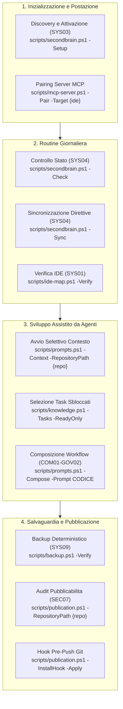

# Guida operativa

> Tool portabile: [procedura corrente](portable-brain.md). Nessun monitor; output operativi sotto .runtime e pulizia solo su richiesta.

Comandi dalla radice di SecondBrain, con PowerShell 7.5+ e Git. `-ConfigPath` è facoltativo: senza di esso si usa la configurazione della postazione attivata (`.runtime/hosts/<id>/workstation.json`); un percorso inesistente produce l’errore «Configurazione non trovata».

## Mappa delle Procedure Operative



## Controllo e sincronizzazione su richiesta

SecondBrain non programma scansioni, controlli o aggiornamenti in background: Check e Sync si eseguono solo su richiesta.

### Controllare e aggiornare

Nella chat dell'IDE, `sb controlla` carica SYS04 in verifica; `sb allinea` applica gli aggiornamenti già autorizzati nel perimetro gestito. Entrambi distinguono i nuovi asset che richiedono selezione tramite SYS03.

```powershell
pwsh -NoProfile -File scripts/secondbrain.ps1 -Check
pwsh -NoProfile -File scripts/secondbrain.ps1 -Sync
```


Check integra prima i pendenti autorizzati dei dossier, senza attesa sul lock; il controllo degli asset non applica correzioni: con un writer attivo o una transazione interrotta il JSON contiene `warnings` (`concurrent-writer`, `pending-transaction`) e il risultato può essere intermedio. Sync usa lock, backup verificati e stato per rilevare modifiche concorrenti; aggiorna TOC e indici. Distribuisce soltanto direttive comuni approvate, conserva il testo personale e segnala conflitti. Una proposta non approvata non viene distribuita.

**Codice di uscita.** `-Check` e `ide-map.ps1 -Verify` escono con 1 ogni volta che `aligned` è false, cioè a qualsiasi problema e non solo per file disallineati (2 = errore, 3 = writer occupato, 4 = scrittura negata). Su una postazione senza evidenze dal vivo sono attesi `ide-write-scope-unverified`, `ide-loading-unverified`, `account-unverified` (istruzioni account Claude manuali) e `candidate-pending`: sono ambientali e si risolvono solo con una ricevuta di sessione reale, una prova di ambito di scrittura o un account rivisto; `changed` e `authoritative-source` richiedono `resources.ps1 -Sync` o SYS05. Il codice 0 richiede che non ce ne sia nessuno.

### Verifica prima del push

Prima di inviare modifiche a un remote pubblico (GitHub o GitLab) controlla che nessun dato locale, cartella PARA o runtime sia nell'indice Git:

```powershell
pwsh -NoProfile -File scripts/check-distribution.ps1
```

Restituisce 0 se l'indice è conforme e pulito; restituisce 1 e blocca la procedura se individua dati locali tracciati per errore. La verifica di pubblicabilità completa è SEC07 (`scripts/publication.ps1`).

### Output e stato

L'inventario e la mappa IDE risiedono nel runtime locale della postazione. I dossier e l'indice PARA sono condivisi. La presenza di un nuovo checkout nel filesystem non lo aggiunge al perimetro gestito; l'assenza di un percorso non elimina dossier o task.

Il profilo Slim include indice, sezioni essenziali, task pronti e riferimenti agli approfondimenti. Al superamento di 50.000 caratteri seleziona automaticamente sezioni e righe task intere, con priorità stabili e senza inferenza. I riferimenti riportano al dettaglio con `-Section`, `-Task` o `-Startup -Profile Full`. SYS05 resta il flusso revisionato per modificare i Markdown sorgente.

La chiusura con `knowledge.ps1 -UpdateTaskId ID -Status done` restituisce `closureAdvice`: memoria, contesto, riepilogo minimo e Sync/Check. Ogni nuova transizione a `done` registra `extensions.lastClosure` nel tracker; ripetere `done` conserva la data precedente. Check emette il solo avviso `closure-memory-pending` se `memory.md` manca o precede l'ultima chiusura. L'avviso tace dopo l'aggiornamento della memoria, non blocca l'allineamento e non certifica il contenuto del riepilogo. Non si ricostruiscono date per task storici e non si leggono trascrizioni. MEM03 propone il riepilogo aggiuntivo in memoria, nello storico o «salta», preservando gli aggiornamenti obbligatori.

| Exit code | Significato |
|---|---|
| 0 | Verifiche richieste concluse senza segnalazioni |
| 1 | Disallineamenti, conflitti o verifiche mancanti |
| 2 | Errore operativo o discovery incompleta |
| 3 | Lock di scrittura non ottenuto entro l'attesa (`-WaitSeconds`, predefinita 60 s) |
| 4 | Accesso negato durante una scrittura; diagnostico `core.write.denied` e comando PowerShell da ripetere fuori dalla sandbox |

Il risultato JSON espone i problemi specifici. Le prove IDE sono vincolate alla sessione e all'account osservati: il confronto dei file non certifica il caricamento.

### Recupero

Non esistono monitor o task pianificati.

Per interruzioni usare il [recupero da manifest](recovery.md) e la [guida portabile](portable-brain.md).

## Esecuzione dei task del tracker in sessioni nuove

`scripts/run-ready-tasks.ps1` esegue uno dopo l’altro i task autonomi pronti del tracker di un solo repository, ciascuno in una sessione agente nuova (`claude -p`, prompt su standard input). Lo avvii tu: non è uno scheduler né un monitor e per impostazione predefinita non esegue nulla.

~~~powershell
# Solo anteprima: elenca i task che verrebbero eseguiti e il prompt di ogni sessione; non modifica nulla.
pwsh -NoProfile -File scripts/run-ready-tasks.ps1

# Esegue il prossimo task di questo checkout (-MaxTasks 0 = senza limite, predefinito 3).
pwsh -NoProfile -File scripts/run-ready-tasks.ps1 -MaxTasks 1 -Run > .runtime/run-result.json

# Un altro repository: indica al runner il suo checkout (dossier e tracker si risolvono dall’identità Git).
pwsh -NoProfile -File scripts/run-ready-tasks.ps1 -CheckoutPath C:/Progetti/MioProdotto -MaxTasks 1 -Run
~~~

**Uno script per repository.** Il runner gestisce un solo repository. Ogni repository gestito ha un proprio lanciatore sottile, `.secondbrain/run-tasks.ps1`, senza logica: trova SecondBrain con la variabile d’ambiente `SECONDBRAIN_HOME` ed esegue il runner solo per quel checkout.

~~~powershell
# Da SecondBrain: anteprima, poi installa il lanciatore dove manca (solo file nuovi; nulla viene aggiunto all’indice né committato).
pwsh -NoProfile -File scripts/install-task-launcher.ps1
pwsh -NoProfile -File scripts/install-task-launcher.ps1 -Apply [-Repository github.com/owner/prodotto]

# Da un repository: anteprima, poi esegue il prossimo task.
pwsh -NoProfile -File .secondbrain/run-tasks.ps1
pwsh -NoProfile -File .secondbrain/run-tasks.ps1 -MaxTasks 1 -Run
~~~

Il generatore non sovrascrive mai un file diverso già presente (lo riporta come `different`), salta SecondBrain stesso e non scrive percorsi personali. I file dei lanciatori non sono tracciati e esistono solo sulla postazione dove è stato eseguito il generatore. Committarne uno nel repository di un prodotto è un passo separato e autorizzato e richiede che il gate SEC07 di quel prodotto sia pronto (vedi [verifica prima del push](#verifica-prima-del-push)); un prodotto con rilievi storici non valutati non può pubblicarlo.

**Tutti i repository.** Non c’è un comando unico per tutti i repository: scorri i lanciatori, un repository alla volta. Il ciclo seguente è un suggerimento non eseguito su più repository. Non si ferma all’esaurimento della quota (ogni lanciatore si ferma solo dopo i propri tre fallimenti consecutivi), quindi tieni `-MaxTasks` basso.

~~~powershell
Get-ChildItem C:/Progetti -Directory |
  Where-Object { Test-Path "$($_.FullName)/.secondbrain/run-tasks.ps1" } |
  ForEach-Object { pwsh -NoProfile -File "$($_.FullName)/.secondbrain/run-tasks.ps1" -MaxTasks 1 -Run }
~~~

SecondBrain non ha il lanciatore: lì si usa `scripts/run-ready-tasks.ps1`. I task dello stream `coordinamento-prodotti` non vengono mai selezionati, quindi un prodotto può non avere nulla di eseguibile; l’anteprima mostra cosa partirebbe.

**Perimetro di lettura nel codice.** Il runner avvia ogni agente con `SECONDBRAIN_RUNNER_REPOSITORY` (il repository del task) e `SECONDBRAIN_RUNNER_READS` (l’allowlist `readRepositories` del task, separata da `;`). Con queste variabili, `knowledge.ps1` e i tool MCP rifiutano `-All`, `-AllDossiers`, `all=true` e `allDossiers=true`; leggono un altro repository (con `-Repository`, `-CheckoutPath` o `-Dossier`) solo se è nell’allowlist e scrivono solo nel repository del task. Un ambito di ricerca non risolvibile ricade sul repository del task invece che su tutte le aree. Le sessioni avviate da te non hanno le variabili e conservano le viste globali. Il controllo protegge dagli errori, non è una sandbox: un processo che azzera le variabili non è più limitato. Il punto d’ingresso dei test le azzera per le proprie fixture sintetiche. Coperto dal gruppo `runner` su fixture; non ancora osservato con un agente reale e il suo server MCP.

**Avvio non presidiato.** Il runner lo avvii tu o uno scheduler che configuri tu; per lui non si installa nulla. Con l’Utilità di pianificazione di Windows esegui `pwsh -NoProfile -File <SecondBrain>\scripts\run-ready-tasks.ps1 -MaxTasks 0 -Run` con il tuo utente, con `claude` e `SECONDBRAIN_HOME` disponibili a quell’utente. Questa configurazione non è stata provata qui e il computer non deve andare in sospensione durante il run. Gli agenti non hanno una sandbox: dopo ogni run controlla `git status` e i report. Una sessione di un assistente di codice può rifiutarsi di avviare agenti non presidiati di questo tipo, quindi avviala tu o dallo scheduler.

**Avanzamento.** La console mostra la lettura del tracker, il numero di task eseguibili, `[n/totale]` all’avvio e alla fine di ogni task (codice di uscita, cambio di stato, secondi), un segnale ogni minuto mentre un agente lavora e un riepilogo finale. Le righe di avanzamento vanno su standard error; standard output contiene solo il JSON finale, quindi `> file` lascia leggibile la console e pulito il file (resta vuoto fino alla fine del run).

**Selezione.** Solo task `todo` con `execution=autonomous`, fuori dagli stream `qualifica-finale`, `intervento-su-richiesta` e `coordinamento-prodotti` e che non attendono una persona. Ordine: priorità, poi numero. Quando il checkout non è quello di SecondBrain (per esempio tramite il lanciatore), l’agente parte al suo interno e il prompt indica i percorsi assoluti degli strumenti SecondBrain. Un checkout senza dossier attivo è riportato in `skipped`, come ogni task pronto escluso, nella forma `{repository,id,seq,reason}` con motivo `stream:<nome>`, `execution:<modo>`, `awaiting:<valore>`, `status:<valore>`, `requires:computer-use` (il task dichiara `extensions.requires` con `computer-use`, che richiede una sessione presidiata: `claude -p` non può approvare le app; si imposta con `knowledge.ps1 -UpdateTaskId <id> -Requires computer-use`, `-NewTask ... -Requires computer-use` o il campo `requires` dei tool MCP di scrittura; un valore vuoto lo azzera) o `max-tasks` (tagliato da `-MaxTasks`).

**Computer use senza persona.** `scripts/computer-use.ps1 -Table` stampa la tabella delle capacità per IDE: Claude Code è solo interattivo (`claude -p` non può approvare le app), Codex su Windows può pre-approvare app con `[computer_use.windows] always_allowed_app_ids` (documentato nel riferimento di configurazione di Codex, non verificato qui con `codex exec`), Cursor, Antigravity e Copilot espongono solo strumenti MCP, Windsurf non documenta nulla. `computer-use.ps1 -CodexApps -AppId <id>[,<id>]` mostra in anteprima l'aggiunta di app al `config.toml` di Codex (aggiunge soltanto, rifiuta forme ambigue o su più righe e non scrive nulla); `-Apply -PreviewSha256 <hash>` la scrive con backup verificato. Il preflight del runner segue la tabella: i task con `requires:computer-use` girano solo se l'agente ha un opt-in documentato e l'impostazione è presente; l'anteprima lo riporta come `computerUse`.

**Sicurezza.** Il prompt vieta commit, push, pubblicazione, cancellazioni, SYS05 e altri task, e l’agente parte con `--disallowedTools` per `git commit`, `git push`, `git tag`, `git reset`, `git clean`, `rm` e `Remove-Item`. L’agente può usare `Bash`, `Read`, `Edit`, `Write`, `Grep`, `Glob` e `Skill` (`--allowedTools`); gli ultimi tre solo leggono o consultano. Non è una sandbox: l’agente può comunque modificare file e scrivere il dossier con la propria sessione coordinata, quindi controlla `git status` e i report dopo il run. Lo script non scrive mai il tracker.

**Risultati.** Ogni task lascia una cartella di lavoro `report` chiusa (`agent-output.json`, `agent-error.txt`, `report.json`) nel runtime della postazione. Un codice di uscita negativo è riportato come `crashed` e una risposta vuota come `no-output`, mai come `finished`. Il run si ferma all’esaurimento della quota (`stopReason: quota`), dopo tre fallimenti consecutivi (`failures`) o quando `-TimeoutMinutes` (predefinito 30) interrompe un agente (`timeout`). Il codice di uscita 1 indica almeno un task non concluso correttamente.

**Verifiche e limiti.** Selezione, condizioni di arresto, avanzamento, lanciatore e generatore sono verificati su fixture sintetiche con un agente finto (`test-secondbrain.ps1 -Only runner`, incluso in Full), che non tocca mai i tracker reali. Un agente reale è stato eseguito solo su singoli task; il comportamento al limite settimanale con un agente reale non è stato osservato.

## Indice dei Documenti Operativi

| Ambito | Contenuto |
|---|---|
| [Manutenzione di .runtime e contesto iniziale](runtime-maintenance.md) | Categorie di .runtime, routine mensile, proposta di pulizia, profilo di avvio snello |
| [Sicurezza e backup](safety-backups.md) | Cosa modifica SecondBrain, dove sono i backup, ripristino e disinstallazione (da leggere per primo) |
| [Architettura](architecture.md) | Visione d'insieme, moduli PowerShell, diagrammi Mermaid e invarianti |
| [Integrazione MCP](mcp-setup.md) | Setup server stdio locale e pairing con Codex, Claude, Cursor, VS Code |
| [Prompt e direttive](customizing-prompts-and-directives.md) | Uso dalla chat e dalla CLI, catalogo dei workflow attivi per area, schede, approvazione direttive, generazione e manutenzione |
| [Accessi](access.md) | Letture dirette, sessioni Write, lock e rinnovo |
| [Recupero](recovery.md) | Pulizia, backup gestiti e transazioni PARA |
| [Alberatura](tree.md) | Ogni cartella del clone e di `.runtime`, chi la scrive e cosa si può cancellare a mano |
| [IDE](adapters.md) | Mappa, verifica dei file e caricamento manuale |
| [PARA e Progetti](tree.md#para-gestione-dei-progetti) | Metadati, Progetti, composizione e archiviazione |
| [Tracker](trackers.md) | Fonti autorevoli, conversione, manifest, ripresa e recupero |
| [Registro delle fonti](authoritative-sources.md) | Normative, standard, dati ufficiali, applicabilita e verifica settimanale |
| [Audit GitHub](external-audit.md) | Raccolta GET esplicita, paginazione, copertura e limiti esterni |

Fonti operative: [script installati](../../scripts/), [regole del repository](../../AGENTS.md). Guide per iniziare: [README](../../README.md).

### Scritture negate e Trace

Un accesso negato è distinto da una contesa tra scrittori e dagli altri errori operativi. Le CLI interessate riportano su stderr il codice `core.write.denied` e l'invocazione PowerShell con parametri quotati. Eseguire il comando in PowerShell 7.5+ fuori dalla sandbox, rispettando le autorizzazioni già previste dal comando. Le radici scrivibili non vengono ampliate automaticamente.

L'hook `trace.ps1 -Event stop` rimane fail-open: esce con 0 anche se non può registrare l'evento. Registra solo se il payload dichiara `persistence=allowed` e `policyEvidence` per il turno corrente; politica assente o vietata non crea file. In caso di errore I/O emette su stderr `trace.event.lost`; l'evento non è stato salvato. La diagnostica non contiene il testo del prompt o della trascrizione. Il bridge e i permessi per la cattura strutturata sono descritti nel [ciclo memorie](memory-cycle.md).

La selezione Slim usa blocchi Markdown interi e ordinamento stabile. La documentazione Microsoft descrive allocazione del budget, scelta dei blocchi e deduplicazione. SecondBrain applica la selezione nel processo PowerShell locale. [Microsoft Learn](https://learn.microsoft.com/en-us/azure/architecture/ai-ml/guide/rag/rag-prompt-engineering)
