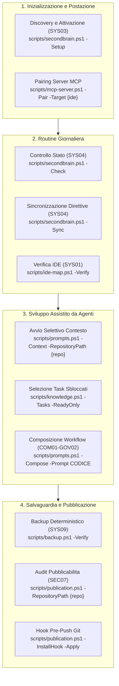
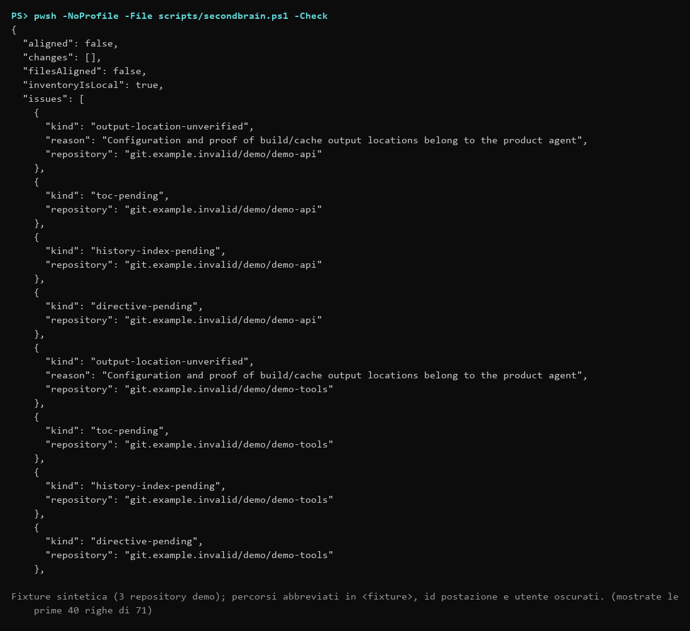

# Guida operativa

> Tool portabile: [procedura corrente](portable-brain.md). Nessun monitor; output operativi sotto .runtime e pulizia solo su richiesta.

Comandi dalla radice di SecondBrain, con PowerShell 7.5+ e Git. `-ConfigPath` è facoltativo: senza di esso si usa la configurazione della postazione attivata (`.runtime/hosts/<id>/workstation.json`); un percorso inesistente produce l’errore «Configurazione non trovata».

## Mappa delle Procedure Operative



## Controllo e sincronizzazione su richiesta

SecondBrain non programma scansioni, controlli o aggiornamenti in background: Check e Sync si eseguono solo su richiesta.

### Controllare e aggiornare

Nella chat dell'IDE, `sb controlla` carica SYS04 in verifica; `sb allinea` applica gli aggiornamenti già autorizzati nel perimetro gestito. Entrambi distinguono i nuovi asset che richiedono selezione tramite SYS03.

```powershell
pwsh -NoProfile -File scripts/secondbrain.ps1 -Check
pwsh -NoProfile -File scripts/secondbrain.ps1 -Sync
```



Check integra prima i pendenti autorizzati dei dossier, senza attesa sul lock; il controllo degli asset non applica correzioni: con un writer attivo o una transazione interrotta il JSON contiene `warnings` (`concurrent-writer`, `pending-transaction`) e il risultato può essere intermedio. Sync usa lock, backup verificati e stato per rilevare modifiche concorrenti; aggiorna TOC e indici. Distribuisce soltanto direttive comuni approvate, conserva il testo personale e segnala conflitti. Una proposta non approvata non viene distribuita.

### Verifica prima del push

Prima di inviare modifiche a un remote pubblico (GitHub o GitLab) controlla che nessun dato locale, cartella PARA o runtime sia nell'indice Git:

```powershell
pwsh -NoProfile -File scripts/check-distribution.ps1
```

Restituisce 0 se l'indice è conforme e pulito; restituisce 1 e blocca la procedura se individua dati locali tracciati per errore. La verifica di pubblicabilità completa è SEC07 (`scripts/publication.ps1`).

### Output e stato

L'inventario e la mappa IDE risiedono nel runtime locale della postazione. I dossier e l'indice PARA sono condivisi. La presenza di un nuovo checkout nel filesystem non lo aggiunge al perimetro gestito; l'assenza di un percorso non elimina dossier o task.

Il profilo Slim include indice, sezioni essenziali, task pronti e riferimenti agli approfondimenti. Al superamento di 30.000 caratteri seleziona automaticamente sezioni e righe task intere, con priorità stabili e senza inferenza. I riferimenti riportano al dettaglio con `-Section`, `-Task` o `-Startup -Profile Full`. SYS05 resta il flusso revisionato per modificare i Markdown sorgente.

La chiusura con `knowledge.ps1 -UpdateTaskId ID -Status done` restituisce `closureAdvice`: memoria, contesto, riepilogo minimo e Sync/Check. Ogni nuova transizione a `done` registra `extensions.lastClosure` nel tracker; ripetere `done` conserva la data precedente. Check emette il solo avviso `closure-memory-pending` se `memory.md` manca o precede l'ultima chiusura. L'avviso tace dopo l'aggiornamento della memoria, non blocca l'allineamento e non certifica il contenuto del riepilogo. Non si ricostruiscono date per task storici e non si leggono trascrizioni. MEM03 propone il riepilogo aggiuntivo in memoria, nello storico o «salta», preservando gli aggiornamenti obbligatori.

| Exit code | Significato |
|---|---|
| 0 | Verifiche richieste concluse senza segnalazioni |
| 1 | Disallineamenti, conflitti o verifiche mancanti |
| 2 | Errore operativo o discovery incompleta |
| 3 | Lock di scrittura non ottenuto entro l'attesa (`-WaitSeconds`, predefinita 60 s) |
| 4 | Accesso negato durante una scrittura; diagnostico `core.write.denied` e comando PowerShell da ripetere fuori dalla sandbox |

Il risultato JSON espone i problemi specifici. Le prove IDE sono vincolate alla sessione e all'account osservati: il confronto dei file non certifica il caricamento.

### Recupero

Non esistono monitor o task pianificati.

Per interruzioni usare il [recupero da manifest](recovery.md) e la [guida portabile](portable-brain.md).

## Indice dei Documenti Operativi

| Ambito | Contenuto |
|---|---|
| [Manutenzione di .runtime e contesto iniziale](runtime-maintenance.md) | Categorie di .runtime, routine mensile, proposta di pulizia, profilo di avvio snello |
| [Sicurezza e backup](safety-backups.md) | Cosa modifica SecondBrain, dove sono i backup, ripristino e disinstallazione (da leggere per primo) |
| [Architettura](architecture.md) | Visione d'insieme, moduli PowerShell, diagrammi Mermaid e invarianti |
| [Integrazione MCP](mcp-setup.md) | Setup server stdio locale e pairing con Codex, Claude, Cursor, VS Code |
| [Prompt e direttive](customizing-prompts-and-directives.md) | Uso dalla chat e dalla CLI, catalogo dei workflow attivi per area, schede, approvazione direttive, generazione e manutenzione |
| [Accessi](access.md) | Letture dirette, sessioni Write, lock e rinnovo |
| [Recupero](recovery.md) | Pulizia, backup gestiti e transazioni PARA |
| [Alberatura](tree.md) | Ogni cartella del clone e di `.runtime`, chi la scrive e cosa si può cancellare a mano |
| [IDE](adapters.md) | Mappa, verifica dei file e caricamento manuale |
| [PARA e Progetti](tree.md#para-gestione-dei-progetti) | Metadati, Progetti, composizione e archiviazione |
| [Tracker](trackers.md) | Fonti autorevoli, conversione, manifest, ripresa e recupero |
| [Registro delle fonti](authoritative-sources.md) | Normative, standard, dati ufficiali, applicabilita e verifica settimanale |
| [Audit GitHub](external-audit.md) | Raccolta GET esplicita, paginazione, copertura e limiti esterni |

Fonti operative: [script installati](../../scripts/), [regole del repository](../../AGENTS.md). Guide per iniziare: [README](../../README.md).

### Scritture negate e Trace

Un accesso negato è distinto da una contesa tra scrittori e dagli altri errori operativi. Le CLI interessate riportano su stderr il codice `core.write.denied` e l'invocazione PowerShell con parametri quotati. Eseguire il comando in PowerShell 7.5+ fuori dalla sandbox, rispettando le autorizzazioni già previste dal comando. Le radici scrivibili non vengono ampliate automaticamente.

L'hook `trace.ps1 -Event stop` rimane fail-open: esce con 0 anche se non può registrare l'evento. Registra solo se il payload dichiara `persistence=allowed` e `policyEvidence` per il turno corrente; politica assente o vietata non crea file. In caso di errore I/O emette su stderr `trace.event.lost`; l'evento non è stato salvato. La diagnostica non contiene il testo del prompt o della trascrizione. Il bridge e i permessi per la cattura strutturata sono descritti nel [ciclo memorie](memory-cycle.md).

La selezione Slim usa blocchi Markdown interi e ordinamento stabile. La documentazione Microsoft descrive allocazione del budget, scelta dei blocchi e deduplicazione. SecondBrain applica la selezione nel processo PowerShell locale. [Microsoft Learn](https://learn.microsoft.com/en-us/azure/architecture/ai-ml/guide/rag/rag-prompt-engineering)
