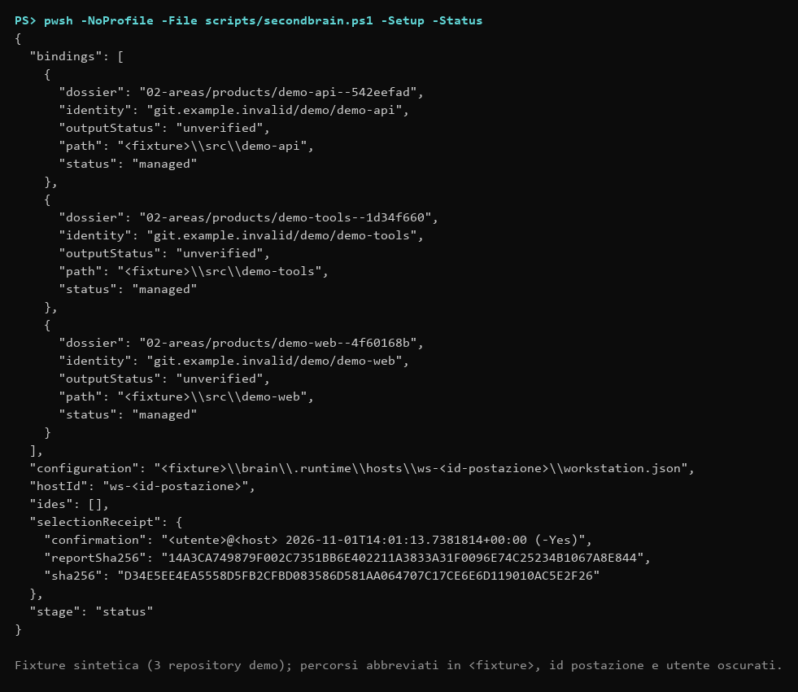

# SecondBrain portabile

## Stato della consegna

Motore portabile e workflow disponibili. Autorizzazione e hash registrati in [direttive/approved.json](../../direttive/approved.json); prove di attivazione e distribuzione conservate nel dossier locale SecondBrain (`02-areas/products/SecondBrain/history/`). La distribuzione richiede sempre hash approvati validi. Nessun monitor viene installato.

## Avvio da un nuovo PC

Apri questo checkout nell'IDE e usa `sb attiva`. Se l'IDE non legge AGENTS.md, incolla:

> Leggi AGENTS.md e direttive/prompts/SYS03.md del checkout SecondBrain corrente. Esegui `scripts/secondbrain.ps1 -Setup` senza `-Select` per discovery e proposta, senza inizializzare repository o modificare IDE, mostra copertura e candidati, poi chiedi quali asset attivare. Rispetta la modalità corrente dell'IDE.

Senza agent: `pwsh -NoProfile -File scripts/secondbrain.ps1 -Setup -Interactive`. Git e PowerShell 7.5+ sono prerequisiti; non vengono installati silenziosamente. `-Setup` esegue preflight, discovery, proposta, conferma, anteprima e (con `-Apply`) attivazione; report e selezione sono per host in `.runtime/hosts/<id>/`. `scripts/secondbrain.ps1 -Discover` usa i volumi locali fissi accessibili; `-Roots` include esplicitamente altri percorsi. `-MaxDirectories` e `-ReportPath` consentono checkpoint riprendibili con `-ResumePath`. Rapporti e selezioni devono risiedere sotto .runtime. La scansione esclude gli alberi di sistema e di build noti (`Windows`, `Program Files`, `Program Files (x86)`, `AppData`, `node_modules`, `.venv`, `bin`, `obj`), registrandoli in `excluded` senza esplorarne le directory per ridurre l'occupazione e i tempi di visita. La scansione legge metadati e Git; non legge archivi di credenziali. Gli errori non diventano assenza di asset.

## Configurazione e prerequisiti

SecondBrain richiede Windows, Git e PowerShell 7.5+. Il bootstrap non installa software, non richiede percorsi preimpostati e non registra monitor.

Requisiti: Windows 10/11 a 64 bit o Windows Server 2022+, PowerShell 7.5 o successivo (`pwsh`), Git per Windows 2.40+. Strumenti convalidati: Claude, ChatGPT Codex e Antigravity, tutti per Windows. Verifica: `$PSVersionTable.PSVersion` e `git --version`.

### Procedura rapida

Prima leggi [cosa modifica SecondBrain e dove sono i backup](safety-backups.md). Dalla radice del clone, in PowerShell 7.5+:

```powershell
# 1. Clone (privato o tuo fork) e ingresso nella cartella: scegli un percorso senza spazi
git clone https://github.com/dennidalpos/SecondBrain.git C:/Progetti/SecondBrain
cd C:/Progetti/SecondBrain

# 2. Schermata iniziale (è ciò che mostra `sb prompt` in chat) e controllo in sola lettura
pwsh -NoProfile -File scripts/prompts.ps1
pwsh -NoProfile -File scripts/secondbrain.ps1 -Check

# 3. Attivazione guidata: elenca repository e IDE, scrive solo dopo CONFERMO e APPLICA
pwsh -NoProfile -File scripts/secondbrain.ps1 -Setup -Interactive

# 4. Server MCP: anteprima, poi applicazione a un IDE (backup automatico)
pwsh -NoProfile -File scripts/mcp-server.ps1 -Pair -Target claude
pwsh -NoProfile -File scripts/mcp-server.ps1 -Pair -Target claude -Apply

# 5. Direttive globali: distribuzione del blocco gestito e verifica
pwsh -NoProfile -File scripts/secondbrain.ps1 -Sync
pwsh -NoProfile -File scripts/ide-map.ps1 -Verify
```

`SECONDBRAIN_HOME` è una variabile utente impostata da `-Setup -Apply` (non con `-NoRegisterEnvironment`): indica il clone ai tuoi agent. Gli IDE già aperti vanno riavviati per leggerla. Per gli IDE senza file locale (impostazioni account web, Continue, Android Studio) copia a mano il testo di `.runtime/hosts/<id>/istruzioni-globali.md`: vedi [IDE](adapters.md).

### Primo avvio con un agent

Apri il checkout SecondBrain nell'IDE e scrivi `sb attiva`. Se l'IDE non carica AGENTS.md, usa il prompt completo di [Avvio da un nuovo PC](#avvio-da-un-nuovo-pc). SYS03 guida discovery, selezione e attivazione tramite `scripts/secondbrain.ps1 -Setup` (utilizzabile anche senza agent: `-Setup -Interactive`): i repository scoperti non vengono gestiti finché non li selezioni.

Il clone corrente viene registrato nella variabile utente `SECONDBRAIN_HOME`. Configurazione, inventario host, backup e output restano sotto `.runtime` nel clone e sono esclusi da Git. Ogni PC mantiene la propria mappa; dossier e identità sono condivisi tramite il Git privato di SecondBrain.

### File e percorsi

La configurazione locale viene generata dall'attivazione. [L'esempio schema 1](../../config/workstation.example.json) illustra i campi senza contenere percorsi personali; non copiarlo come autorizzazione a gestire asset. `-ConfigPath` è un override esplicito; in assenza di override le CLI risolvono la configurazione della postazione.

Le istruzioni comuni e gli account IDE non devono contenere percorsi del singolo PC. Gli IDE già aperti possono avere una vecchia copia dell'ambiente di processo: verificare il valore utente aggiornato senza sovrascrivere variabili globali dei tool prodotto.

### Schemi

| Dato | Schema |
|---|---|
| Configurazione postazione | 1 |
| Inventario locale | 1 |
| Mappa IDE con profili e account | 1 |
| Metadati PARA e tracker dei dossier | 1 |
| Catalogo prompt | 1 |

### Verifiche e limiti

Eseguire suite principale, Check, verifica IDE e catalogo. File allineati, account osservati, funzionamento reale e copertura della scansione sono esiti distinti. La prova di portabilità su un secondo PC rimane distinta dalle fixture.

La prima implementazione usa Windows; non è dichiarato supporto macOS/Linux. JSON è validato con [PowerShell Test-Json](https://learn.microsoft.com/en-us/powershell/module/microsoft.powershell.utility/test-json?view=powershell-7.5).

## Selezione e attivazione

Dopo l'attivazione, `-Setup -Status` mostra binding, IDE e ricevuta di selezione (sola lettura):



Opzioni di `-Setup`:

| Opzione | Effetto |
| --- | --- |
| `-Roots` | Radici da analizzare (senza: volumi fissi). `-MaxDirectories` limita la visita. |
| `-Select` | Repository per id, nome o percorso (più valori separati da virgola). `-All` seleziona tutti. |
| `-Ides` / `-AllIdes` | IDE da associare (id o nome). |
| `-ApproveExistingBlocks` | Conferma di aver rivisto il blocco gestito già presente in `AGENTS.md`. |
| `-Yes` | Conferma non interattiva: registra utente, host e data nella selezione. Va usata solo dopo la conferma dell'utente. |
| `-Apply` | Applica; senza, resta l'anteprima. Registra `SECONDBRAIN_HOME` (salvo `-NoRegisterEnvironment`). |
| `-AndSync` | Dopo l'applicazione esegue `-Sync` invece di `-Check`. |

In modalità non interattiva senza `-Select`/`-All` lo script non chiede nulla e termina con errore. `-Discover` (ricognizione in sola lettura) e `-Activate -SelectionPath <selezione> [-Apply]` restano disponibili come primitive; il file di selezione deve stare sotto `.runtime/` della radice SecondBrain. L'output reale di `-Discover` elenca IDE, eseguibili, unità e percorsi della postazione: non pubblicarlo né usarlo tal quale in guide e screenshot (`docs/assets/cli-discover.png` è un estratto dello stdout reale su una fixture sintetica, con profilo utente e `PATH` isolati e oscuramenti dichiarati, REP07).

`-Setup` genera la selezione e registra come `confirmation` utente, host, data e modalità (`-Yes` o interattiva); senza conferma resta una proposta con confirmed=false, rifiutata da `-Activate`. Formato (per gli usi diretti di `-Activate`): la selezione JSON ha schemaVersion=1, confirmed=true, confirmation (riferimento alla scelta umana), reportPath, reportSha256, repositories e ides. Ogni repository usa l'id del candidato; approveExistingBlock=true conferma il blocco esistente esaminato. Ogni IDE usa l'id del candidato e può specificare accountAlias/profile/environment. Il flag non sostituisce l'autorizzazione umana. `-Activate -SelectionPath` mostra l'anteprima; aggiungere `-Apply` solo dopo conferma. Fingerprint e hash impediscono di applicare una selezione divenuta obsoleta.

Le nuove Aree hanno tracker vuoto solo quando non esiste una fonte locale; altrimenti l'importazione resta esplicita tramite import-tracker.ps1. Le fonti in formati non supportati richiedono conversione revisionata. Memorie IDE vengono proposte, non importate indiscriminatamente. La prima attivazione dei metadati non certifica l'architettura del prodotto.

## Operatività

`sb controlla` e `sb allinea` corrispondono al workflow SYS04. -Sync aggiorna soltanto le associazioni approvate, mai altri checkout trovati. `Invoke-SBPortableSync` distingue l'allineamento dei file su disco (`filesAligned`, hash conformi delle istruzioni, TOC e cataloghi) dall'osservazione live dei 15 minuti (`liveLoadingVerified`), mantenendo `aligned` per la conformità complessiva. Account manuali, caricamento, conflitti e compattazione pendente impediscono una dichiarazione complessiva di allineamento. Le operazioni usano ConfigPath se esplicito, altrimenti la configurazione locale della postazione. SECONDBRAIN_HOME è registrata nell'ambiente utente; un IDE già aperto può avere un ambiente di processo precedente e deve leggere il valore utente aggiornato.

## Dati e output

Conoscenza e memorie personali viaggiano nel clone Git privato. Account, percorsi host, prove grezze e dati riservati sono esclusi da Git sotto .runtime. Non acquisire credenziali; eventuali originali riservati in backup non sono contenuti pubblicabili. Prima di un push di SecondBrain verificare la destinazione privata e i file indicizzati.

work.ps1 restituisce un piano di ambiente isolato per repository/progetto/runtime; con -Run richiede eseguibile, argomenti e working directory approvata. Non usa una shell e non modifica impostazioni globali. TEMP/TMP e cache riconosciute sono reindirizzate; gli output intermedi specifici del tool richiedono configurazione e prova nel prodotto. Per esempio .NET/MSBuild, Gradle e bundler non condividono un unico flag di output. Non dichiarare output centralizzati sulla sola base delle variabili. Tutte le eccezioni rimangono esplicite.

Fixture e artefatti sono conservati anche dopo esito positivo. REP04 e cleanup.ps1 richiedono richiesta esplicita e manifest per pulire dati portabili. Non riutilizzare residui di operazioni precedenti senza verificarli. Solo staging transazionale adiacente alla destinazione è eliminato alla conclusione della transazione; un errore preserva le prove di recupero.

## TOC e compattazione

Ogni dossier ha index.md. knowledge.ps1 -Tasks elenca i task del repository in lavoro (checkout corrente o -Repository; vista globale solo con -All, in sola lettura) senza duplicare; -Startup -Dossier compone il profilo snello (indice, sezioni essenziali di contesto e memoria, task pronti in una riga, elenco dei livelli non caricati) entro 20.000 caratteri, tetto valido solo per il primo caricamento; -Profile Full e -Search non hanno tetto salvo -Budget; -Report misura le parti. Se lo snello eccede segnala needsCompaction senza troncare. SYS05 guida la sintesi e il candidato revisionato; -Compact mostra l'anteprima e -Apply conserva originali per hash e transazione. Nessun riassunto automatico non verificato, nessuna cancellazione dello storico e nessun rinnovo di autorizzazioni.

La ricerca trasversale `knowledge.ps1 -Search <termine> [-Dossier <percorso>] [-Repository <identità>] [-Budget <caratteri>] [-Mode Literal|Relevance]` (funzione `Find-SBKnowledge`) esplora `context.md`, `memory.md`, `tracker.json` e l'intero albero `history/compaction/`, restituendo estratti con percorso relativo, riga, SHA-256 del file e testo corrispondente, rispettando il budget configurato (`withinBudget`). Con `-Mode Relevance` la richiesta è scomposta in termini (parole vuote ignorate) e le sezioni Markdown (o i blocchi di `tracker.json`) sono ordinate per pertinenza: termini distinti coperti, titolo, frase esatta, frequenza; ogni estratto aggiunge `score` e `section` e mantiene percorso, riga e SHA-256. Senza `-Mode` resta la ricerca letterale; nessun tetto per impostazione predefinita.

## Pubblicabilità e asset

publication.ps1 esamina working tree, indice e blob storici con regole locali; i rapporti non contengono i valori trovati. Codici: 0 pronto entro la copertura, 1 rilievi/revisioni, 2 incompleto o errore. I binari richiedono ispezione specifica e non sono certificati dal controllo testuale. Le eccezioni ammesse sono vincolate a fingerprint e motivazione nel runtime.

L'installazione opzionale dell'hook Git pre-push (`scripts/publication.ps1 -InstallHook -Apply`) collega la verifica REP05 all'operazione `git push`, bloccando tempestivamente tentativi di invio di credenziali, percorsi host o residui operativi. L'hook è scritto in shell POSIX portabile, non contiene percorsi personali o credenziali cablate, e supporta bypass autorizzato via `SECONDBRAIN_SKIP_PRE_PUSH=1`. Può essere verificato con `-HookStatus` e rimosso con `-UninstallHook -Apply`.

REP06 prepara README e guide Markdown, senza GitHub Pages implicito. REP07 richiede app reale, dati sintetici, versione e scenario. New-SBCaptureRecord registra PNG e provenienza; il manifest deve essere revisionato prima di Export-SBPublicCapture. Solo le copie pubbliche selezionate entrano in docs/assets. Non viene inventata una UI se la cattura non è disponibile. Pubblicazione, riscrittura di storia e rotazione di credenziali richiedono operazioni specifiche.

## Integrazione IDE via Server MCP (Model Context Protocol)

Per gli IDE e gli agenti conformi alle specifiche MCP (Cursor, Claude Desktop, Antigravity, VS Code, Windsurf, OpenAI Codex), SecondBrain fornisce un server stdio locale in sola lettura tramite `scripts/mcp-server.ps1` (modulo `scripts/SecondBrain.Mcp.psm1`).

Il server risponde a chiamate JSON-RPC 2.0 (protocollo MCP `2024-11-05`) su standard input e standard output, garantendo determinismo e sicurezza: non effettua mutazioni su disco, non acquisisce lock di scrittura ed espone gli strumenti informativi essenziali:
- `get_startup_context`: restituisce il pacchetto di avvio per il repository o dossier specificato: profilo `slim` (predefinito, 20.000 caratteri, solo primo caricamento) o `full` senza tetto.
- `get_ready_tasks`: restituisce la lista delle sole attività sbloccate con dipendenze soddisfatte (`-ReadyOnly`).
- `search_knowledge`: effettua la ricerca trasversale nei file di conoscenza (`context.md`, `memory.md`, `tracker.json`, `history/compaction/`) senza tetto per impostazione predefinita.
- `list_prompts`: elenca il catalogo dei prompt organizzati nelle 13 aree tematiche; con `compact` una riga per prompt, con `category` filtra per id o prefisso.
- `get_prompt_home`: schermata iniziale di `sb prompt` (link al catalogo e comandi `sb`).
- `get_prompt`: restituisce la scheda Markdown completa del prompt specificato (es. SYS03, REP05).
- `check_publication`: esegue la verifica di pubblicabilità REP05 sul repository indicato.

Configurazione JSON (Claude Desktop, Cursor, Antigravity, VS Code):
```json
{
  "mcpServers": {
    "secondbrain": {
      "command": "pwsh",
      "args": ["-NoProfile", "-File", "C:/Progetti/SecondBrain/scripts/mcp-server.ps1"]
    }
  }
}
```

Configurazione TOML per OpenAI Codex (`~/.codex/config.toml` o `%CODEX_HOME%\config.toml`):
```toml
[mcp_servers.secondbrain]
command = "pwsh"
args = ["-NoProfile", "-File", "C:\\Progetti\\SecondBrain\\scripts\\mcp-server.ps1"]
```

Comando rapido di accoppiamento per Codex:
```powershell
pwsh -NoProfile -File scripts/mcp-server.ps1 -Pair -Target codex
```

## Fonti primarie

- [Git: repository, working tree e common dir](https://git-scm.com/docs/git-rev-parse)
- [Microsoft: discovery software e problemi di Win32_Product](https://learn.microsoft.com/en-us/powershell/scripting/samples/working-with-software-installations?view=powershell-7.5)
- [File.Replace e vincolo dei volumi](https://learn.microsoft.com/en-us/dotnet/api/system.io.file.replace?view=net-10.0)
- [GitHub README](https://docs.github.com/en/repositories/managing-your-repositorys-settings-and-features/customizing-your-repository/about-readmes)
- [GitHub: dati sensibili nella storia](https://docs.github.com/en/authentication/keeping-your-account-and-data-secure/removing-sensitive-data-from-a-repository)
- [Claude: istruzioni account](https://support.claude.com/en/articles/10185728-understanding-claude-s-personalization-features)

La documentazione dei tool va verificata rispetto alle versioni installate. Le fixture non dimostrano funzionamento di prodotti, accesso ad altri account o portabilità reale su un secondo PC.

## Recupero e lettura selettiva

`recover.ps1 -ManifestPath` verifica in anteprima il manifest centrale anche se la configurazione è stata applicata solo in parte; `-Apply` esegue il ripristino verificato e conserva il journal. Modifiche successive alle destinazioni impediscono il recupero. Il comando non modifica SECONDBRAIN_HOME: dopo un rollback verificare il collegamento utente al clone.

La proiezione iniziale dei task conserva ID, titolo, stato, priorità, dipendenze e impedimenti. Criteri di accettazione ed evidenze integrali restano nel tracker autorevole e si leggono prima di lavorare sul task; `Get-SBTaskProjection -IncludeAcceptance` include i criteri. `knowledge.ps1 -Startup -TaskIds` seleziona le attività pertinenti senza duplicare il tracker.

`knowledge.ps1 -Tasks -ReadyOnly` (e `Get-SBTaskProjection -ReadyOnly`) filtra le sole attività sbloccate, verificando che tutte le dipendenze dichiarate (incluse dipendenze cross-repository verso altri dossier) siano soddisfatte con stato completato (`done` o `completed`). L'aggiornamento transazionale dei task `Set-SBTrackerTaskStatus` (o `Update-SBTrackerTask`) in `SecondBrain.Tracker.psm1` valida preventivamente la mutazione con `Test-SBTrackerData` prima di applicare la modifica tramite transazione atomica `Invoke-SBParaTransaction` con backup in `.runtime`.

## Contratti aggiuntivi

Le associazioni IDE hanno un id distinto per installazione, profilo, account e ambiente: più account della stessa app non si sovrascrivono. La selezione può disassociare esplicitamente vecchi percorsi con retireCheckoutPaths e vecchie integrazioni con retireIDEIds, senza cancellarne i dati; per repository e integrazioni IDE `secondbrain.ps1 -Setup -Unbind <identità|percorso|id IDE|nome IDE>` genera la selezione con anteprima e conferma, e `-Setup -Status` mostra lo stato in sola lettura; `-Setup -Output <identità|percorso> -OutputStatus verified|exception-accepted|unverified [-Evidence|-Exception]` registra nel binding l'esito della collocazione degli output (prova sotto `.runtime` legata al suo SHA-256, oppure eccezione motivata) con anteprima e conferma. Per un remoto rinominato associateIdentity indica l'identità esistente e aliasesReviewed=true conferma la riconciliazione vista dall'utente; collisioni restano errori.

Per SYS01 e Check passare -ObservationPath con un documento locale schemaVersion=1 e observations. Ogni riscontro contiene ideId, workstationId, profile, eventuale environment, accountAlias e accountVerified per account manuali, observedAt, observedHash (SHA-256 del testo globale normalizzato LF e Trim), loadingVerified, sessionId, evidencePath e evidenceSha256. La prova deve esistere sotto .runtime ed essere verificata dall'agente; una ricevuta non prova da sola l'autenticità di una schermata. Sono accettati soltanto riscontri della verifica corrente entro 15 minuti. Senza ricevuta aggiornata il caricamento resta non verificato, anche se i file sono allineati.

Per gli output del prodotto outputStatus resta unverified finché il relativo agente non registra una prova effettiva sotto .runtime (outputEvidence e outputEvidenceSha256). Una eccezione esplicitamente accettata usa outputStatus=exception-accepted e outputException motivata. Le variabili del wrapper non costituiscono quella prova. La checklist di qualificazione per i repository gestiti (consegna agli agent prodotto, nessuna esecuzione centrale) si genera dai binding della postazione e vive nel dossier privato di SecondBrain, non in questo repository; oggi nessuna CLI imposta questi campi del binding, che si compilano a mano dopo la prova dell'agent.

Una policy pubblicazione può contenere binaryReviews con path, sha256 della copia di lavoro, gitBlob per la versione indicizzata/storica, reviewed=true e reason. La revisione è specifica per i byte; un file modificato non eredita il riscontro. Le verifiche testuali non sostituiscono l'ispezione di immagini e binari.

cleanup.ps1 in modalità portabile richiede ManifestPath sotto .runtime con schemaVersion=1, reviewed=true, referencesChecked=true, reason e files (path e sha256). Prima mostrare l'anteprima; Apply richiede Authorization riferita alla richiesta effettiva dell'utente. File attivi e transazioni pendenti impediscono la rimozione. I backup delle rimozioni restano centrali e non vengono purgati automaticamente. `cleanup.ps1 -ListStageRecords [-OlderThanDays N]` elenca in sola lettura i record `.stage` completati più vecchi della soglia (default 90) nei backupRoot noti; `cleanup.ps1 -ListRuntime [-OlderThanDays N]` fornisce in sola lettura l'inventario delle voci di `.runtime` (età, dimensione, riferimenti, protezione); vedere [recovery.md](recovery.md). Rollback di un repository e riconciliazione della postazione (`access.ps1 -Reconcile`) sono descritti in [recovery.md](recovery.md) e [access.md](access.md).

Le postazioni nuove si attivano con `secondbrain.ps1 -Setup` (SYS03), che orchestra le primitive `-Discover` e `-Activate`.
