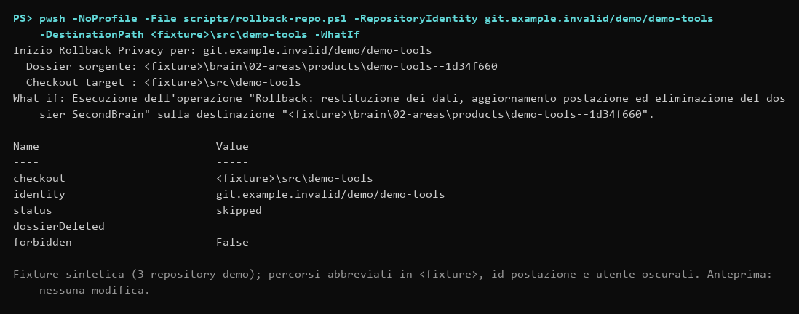

# Pulizia e recupero

Per il rapporto per categoria, la proposta di pulizia di `.runtime` e la routine mensile vedi [manutenzione di .runtime](runtime-maintenance.md).

## Conservazione ordinaria

Backup, rapporti, fixture, build, cache e catture restano sotto `.runtime` nel clone SecondBrain, anche dopo esito positivo. Non esiste retention distruttiva automatica. Dati storici conservati altrove non vengono spostati o cancellati implicitamente.

Gli unici file adiacenti alla destinazione sono lo staging tecnico e l'eventuale recupero di una transazione atomica. Il writer ne registra percorso e stato; lo staging viene rimosso alla conclusione, mentre un'interruzione conserva le prove necessarie.

## Pulizia esplicita

Richiedere la pulizia indicando un perimetro concreto. REP04 prepara un manifest sotto `.runtime`, con `schemaVersion: 1`, `reviewed: true`, `referencesChecked: true`, `reason` e `files` con `path` assoluto e `sha256`. Questi dati descrivono una selezione; l'autorizzazione deve provenire dall'utente.

```powershell
pwsh -NoProfile -File scripts/cleanup.ps1 -ManifestPath <manifest-locale>
pwsh -NoProfile -File scripts/cleanup.ps1 -ManifestPath <manifest-locale> -Apply -Authorization <richiesta-esplicita>
```

Prima esaminare l'anteprima. Apply ricontrolla i byte, i confini, le destinazioni protette e le transazioni pendenti e conserva backup verificati delle rimozioni. Non cancella checkout né decide in base a età o nomi delle directory. Con un manifest senza file `applied` resta `false`; se una rimozione fallisce a metà il riepilogo JSON elenca i file già rimossi (`removed`) e il guasto (`failed`, `status: partial`) ed esce con 1. Le configurazioni di origine mantengono il percorso di recupero precedente, non una pulizia automatica dei dati portabili.

### Record `.stage`

Ogni scrittura protetta lascia in `backupRoot` un record `.stage` che documenta il backup precedente. Per valutarne la crescita, in sola lettura:

```powershell
pwsh -NoProfile -File scripts/cleanup.ps1 -ListStageRecords -OlderThanDays 90
```

L'elenco comprende i soli record `completed` più vecchi della soglia (default 90, intervallo 1–3650) trovati, anche nelle sottocartelle, nel `backupRoot` corrente e in quelli delle postazioni registrate sotto `.runtime`. Backup `.bin`, staging interrotti e record illeggibili non sono mai candidati. Nessun file viene eliminato: la rimozione richiede un manifest revisionato con quell'elenco e il comando `-Apply` sopra.

### Inventario di `.runtime`

Per decidere cosa rivedere prima di una pulizia, in sola lettura:

```powershell
pwsh -NoProfile -File scripts/cleanup.ps1 -ListRuntime -OlderThanDays 90
```

Per ogni voce di primo livello sotto `.runtime` il rapporto JSON indica numero di file, dimensione, ultima scrittura (`ageDays`, `olderThanThreshold`), riferimenti testuali a `.runtime/<voce>` in README, docs, script, direttive, configurazioni e dossier (`references.mentions` con fino a 5 file d'esempio) e protezione (`protected`, `protectedReason`): sono protette `hosts`, `access`, `cleanup`, i file di stato e i percorsi della configurazione o del registro postazioni; un reparse point non viene seguito. `reviewable` elenca le voci non protette più vecchie della soglia, solo come indicazione da valutare insieme ai riferimenti. Non è combinabile con `-Apply` o `-ManifestPath`, non seleziona né elimina nulla: la rimozione resta possibile solo con un manifest revisionato di file con hash (sezione precedente).

## Rollback di un repository

`rollback-repo.ps1` restituisce un repository dismesso o vietato e rimuove il suo dossier da SecondBrain. **Senza `-Apply` mostra solo l'anteprima e non modifica nulla**; con `-Apply` esegue davvero e il dossier privato viene copiato in `<repo>/.secondbrain/` dentro il tuo repository (escluso da Git solo se esiste `.git/info/exclude`). Richiede una sessione di scrittura (`-SessionId` opzionale), rifiuta il dossier e il checkout di SecondBrain stesso e l'identità ambigua (confronti sensibili alle maiuscole). Ordine delle operazioni:

1. copia dell'intero dossier (inclusi `history/`, `snapshots/`, `tracker.md`) in `<repo>/.secondbrain/` con hash verificati; senza checkout (`-Force`) il dossier è salvato in `backupRoot/rollback-<id>/dossier`;
2. aggiornamento di `workstation.json` (binding rimosso, `forbiddenRepositories` con `-Forbid`) e `state.json`;
3. pulizia del blocco gestito in `AGENTS.md` del repository (scrittura con controllo dell'hash e backup, ripristinabile con `restore-managed.ps1`);
4. solo dopo, eliminazione del dossier e della cache di runtime e rigenerazione di `para-index.json`.

Un errore nei passi 1–3 lascia il dossier intatto e il comando è ripetibile.

L'anteprima (senza `-Apply`, oppure `-WhatIf`) non modifica nulla:



*Output reale dell'anteprima su una fixture sintetica (percorsi abbreviati, id postazione oscurati).*

## Recuperare un file gestito

`restore-managed.ps1 -List [-Path <file>]` elenca i backup per percorso originale (sola lettura); `restore-managed.ps1 -MetadataPath` usa i metadati di backup creati dal writer. Controlla payload, SHA-256 e hash distribuito; rifiuta una destinazione modificata successivamente. Conservare insieme payload e metadati nel runtime centrale.

## Transazioni interrotte

Il marker `.runtime/para-transaction.json` indica il manifest di una transazione incompleta (con host, utente e data di avvio, riportati da `access.ps1 -Status` e dal messaggio di errore). Blocca le scritture di tutti gli host e si recupera da qualunque PC che raggiunga il manifest, anche tramite un alias diverso dello stesso percorso (vedere [shared-brain.md](shared-brain.md)). Non forzare lock o cancellare il marker. Il recupero funziona anche quando la configurazione della postazione non è stata applicata interamente:

```powershell
pwsh -NoProfile -File scripts/recover.ps1 -ManifestPath <manifest-centrale>
pwsh -NoProfile -File scripts/recover.ps1 -ManifestPath <manifest-centrale> -Apply
# Con configurazione di postazione valida (manifest nel suo backupRoot):
pwsh -NoProfile -File scripts/recover.ps1 -ManifestPath <manifest> -ConfigPath .runtime/hosts/<id>/workstation.json -Apply
```

Il ripristino verifica tutte le destinazioni prima delle scritture, procede nel verso inverso e conserva journal e originali. Cambiamenti successivi non vengono sovrascritti. Verificare `SECONDBRAIN_HOME` dopo il recupero: il comando non riscrive l'ambiente utente.

Le importazioni tracker hanno un journal specifico e si recuperano tramite `import-tracker.ps1 -RollbackManifest`, prima in anteprima e poi con Apply. Una preparazione `verified` non è ancora una nuova fonte autorevole.

## Garanzie e limiti

Su Windows la rimozione protetta mantiene un handle READ/DELETE che esclude scritture e rinomine; writer già aperti o perdita della sessione impediscono l'operazione. [CreateFile e condivisione](https://learn.microsoft.com/en-us/windows/win32/api/fileapi/nf-fileapi-createfilew), [File.Replace e vincolo dei volumi](https://learn.microsoft.com/en-us/dotnet/api/system.io.file.replace?view=net-10.0).

Un backup verificato non autorizza da solo la cancellazione. Il collaudo delle fixture non certifica un ripristino su un altro PC o su filesystem non verificati.
