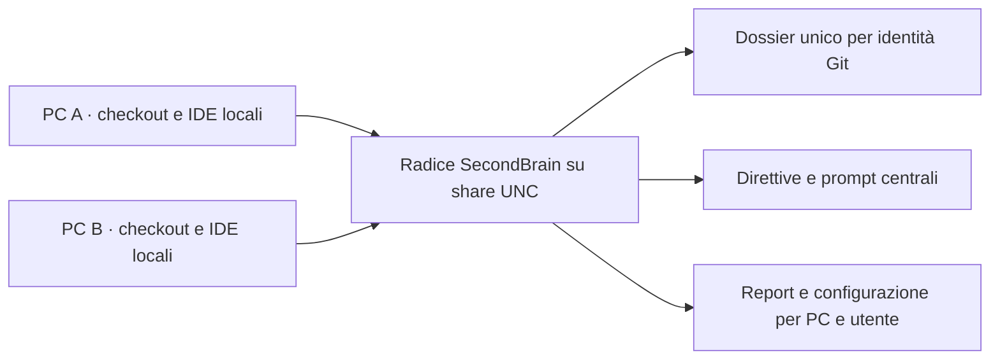

# SecondBrain su una share di rete

Uno stesso clone di SecondBrain può stare su una cartella condivisa (UNC) e servire più PC. Modello: **un cervello sulla share, configurazione per host, letture libere, un solo writer alla volta**. Fuori scopo: lock per dossier, scrittura concorrente multi-writer, storia e merge dei dossier (servirebbe un repository Git privato separato per le Aree).

Stato della verifica: i comportamenti sono provati su fixture locali (processi `pwsh` concorrenti, alias `\\localhost\X$`). È stata eseguita una prova su SMB di loopback (stesso PC e stesso utente, vedere [Prova su SMB di loopback](#prova-su-smb-di-loopback)); non esiste ancora una prova con più PC o utenti diversi: vedere la [checklist](#checklist-di-prova-manuale).

## Topologia

| Dato | Dove | Condivisione |
| --- | --- | --- |
| Dossier, `para-index.json`, `config/shared.json`, direttive | clone sulla share | condiviso |
| `.runtime/access/` (lock, coda FIFO `queue/`, sessioni, `workstations.json`), `.runtime/para-transaction.json` | clone sulla share | condiviso (coordinamento) |
| `.runtime/hosts/<id>/` (`workstation.json`, `discovery.json`, `selection.json`, `state.json`, `setup-result.json`, `inventory.json`, `ide-map.json`, backup) | clone sulla share | per host: `<id>` deriva da PC e utente |
| `SECONDBRAIN_HOME` | ambiente utente di ogni PC | per host |
| Cache e build dei prodotti | di norma `.runtime/hosts/<id>/` | per host; opzionalmente su disco locale |



## Permessi

SecondBrain non ha un modello di utenti: i permessi sono quelli della share e di NTFS.

- Chi solo consulta (letture, `-Check`, prompt, MCP): lettura sulla share.
- Chi aggiorna (`-Sync`, `-Setup -Apply`, task, `access.ps1`): modifica sulla share. Tutti gli utenti che scrivono devono poter creare e sostituire file in `.runtime/`.
- `direttive/approved.json` registra l'hash dei testi approvati: è integrità, non autorizzazione. `config/shared.json` è una policy globale per tutti gli host.
- Preferire il percorso UNC a un drive mappato: il mapping è per utente e sessione, quindi altri utenti, servizi e agent non lo vedono. `-Setup` lo segnala nel preflight.
- Script su UNC: l'ExecutionPolicy `RemoteSigned` blocca script scaricati; usare `Unblock-File` sul clone o un criterio adeguato. A seconda della zona di sicurezza con cui Windows classifica il percorso UNC (da verificare con FQDN e indirizzi IP), il blocco può riguardare anche i file del clone.
- Git: se la share ha un proprietario diverso, git risponde "dubious ownership". SecondBrain passa `safe.directory` per il solo cervello; per gli altri strumenti: `git config --global --add safe.directory '//server/share/SecondBrain'`.

In ambiente aziendale assegnare ai manutentori la modifica di script, configurazione condivisa, direttive approvate e catalogo. Ai contributori dare lettura a quei file e modifica alle aree dossier e al runtime di cui hanno bisogno, inclusa la coda condivisa. Verificare l'accesso effettivo al percorso UNC con ciascun profilo. [Microsoft Learn, controllo accessi Windows](https://learn.microsoft.com/windows/security/identity-protection/access-control/access-control)

## Attivazione di un nuovo PC

Anche da una copia locale, lanciare lo script della radice autorevole. Su ogni PC: `pwsh -NoProfile -File \\server\share\SecondBrain\scripts\secondbrain.ps1 -Setup -Interactive` (vedere [portable-brain.md](portable-brain.md)). Il report e la selezione sono per host in `.runtime/hosts/<id>/`, quindi non si sovrascrivono tra PC. Lo stesso `workstationId` con percorsi diversi richiede `access.ps1 -Reconcile`, ma gli alias dello stesso percorso (maiuscole, UNC con nome breve o FQDN, drive mappato, `\\localhost\X$`) non sono considerati uno spostamento.

## Scritture

Task, memoria, contesto e rapporti usano la [coda di scritture differite](pending-writes.md): se il centro e occupato salvano un JSON univoco e continuano senza attesa. Le richieste restano in coda finché `knowledge.ps1 -FlushPending` non le integra; avvio, consultazioni e MCP non le toccano. Una sessione `Write` ordinaria mantiene soltanto identita e heartbeat; il lock riguarda le singole transazioni. Configurazioni, direttive e PARA conservano le proprie operazioni esplicite e non entrano in questa coda.

- Un solo writer alla volta: `writer.lock` e `operation.lock`, con coda FIFO dei ticket in `.runtime/access/queue/` (chi arriva prima entra prima; un ticket di un processo morto è rimosso senza forzare i lock). Chi trova il lock occupato attende (predefinito 60 s; `-WaitSeconds` su `secondbrain.ps1`, `SECONDBRAIN_LOCK_WAIT_SECONDS`, oppure `lockWaitSeconds` 0–600 in `config/shared.json`) e scrive su stderr il titolare (utente, PC, client, sessione). Solo a timeout esce con exit 3 e lo stesso messaggio.
- Letture (`-Check`, `prompts.ps1 -Context`, `knowledge.ps1` in lettura, `ide-map.ps1 -Verify`, MCP) non prendono lock bloccanti e non fanno attendere il writer. Se un writer è attivo o c'è una transazione pendente, il risultato porta un avviso (`warnings`: `concurrent-writer`, `pending-transaction`; su stderr per gli altri comandi): il dato letto può essere intermedio, ripetere il controllo.
- Le scritture protette (`Write-SBFile`) verificano l'hash precedente e conservano backup; i metadati di sessione si sostituiscono in modo atomico con nuovi tentativi, così un lettore su un altro PC non segna la sessione come fallita.

## Transazione interrotta

Il marker `.runtime/para-transaction.json` blocca le scritture di tutti gli host finché il manifest non è recuperato. Registra host, utente, data, radice e manifest. `access.ps1 -Status` e il messaggio di errore li riepilogano. Recupero da **qualunque** PC che raggiunga il manifest:

```powershell
pwsh -NoProfile -File scripts/recover.ps1 -ManifestPath <manifest riportato nel messaggio>
pwsh -NoProfile -File scripts/recover.ps1 -ManifestPath <manifest> -Apply
```

Il percorso del manifest riportato è già riscritto sull'alias del PC corrente. Il journal scritto da un altro PC con un alias diverso è accettato se la radice è la stessa. Non cancellare il marker e non forzare i lock; un recupero rifiuta file modificati dopo la transazione (vedere [recovery.md](recovery.md)).

## Prestazioni

- Con il cervello su UNC la scansione dei dossier (`Get-SBParaEntities`) è memorizzata per 10 s e invalidata da ogni scrittura del processo; in locale è disattivata (`SECONDBRAIN_PARA_CACHE=1` la forza).
- TEMP, cache e build dei prodotti stanno di norma sotto `.runtime/hosts/<id>/` e quindi sulla rete. Con `SECONDBRAIN_WORK_LOCAL_ROOT=<disco locale>` il piano di `work.ps1` li colloca in `<radice>/<id>/…` (eccezione dichiarata nel risultato: `location: local-override`). I percorsi di rete sono rifiutati.

## Runbook

| Sintomo | Azione |
| --- | --- |
| Exit 3 "occupato" | Contattare il titolare indicato; aumentare l'attesa con `-WaitSeconds`; `access.ps1 -Status` mostra le sessioni e `-Queue` i writer in coda. Non cancellare i lock. |
| "workstationId già registrato con percorsi diversi" | Verificare che sia davvero uno spostamento, poi `access.ps1 -Reconcile`. |
| "Transazione PARA incompleta" | `recover.ps1` come sopra, da qualunque PC. |
| git "dubious ownership" | `safe.directory` come sopra. |
| Script bloccato | `Unblock-File` / ExecutionPolicy. |
| Avviso `concurrent-writer` | Ripetere il controllo a scrittura conclusa. |

## Checklist di prova manuale

### Cosa è già simulato in locale (non è una prova SMB)
`test-secondbrain-portable.ps1` esercita su NTFS locale, con processi `pwsh` distinti: un writer in un altro processo che tiene il lock, due writer concorrenti che escono con exit 3 e il titolare (per ogni script che scrive), l'ordine di ingresso in coda FIFO con un ticket orfano scaduto senza forzature, l'attesa governata da `lockWaitSeconds` e da `SECONDBRAIN_LOCK_WAIT_SECONDS` (l'ambiente prevale), il processo writer terminato con `Stop-Process -Force` (il sistema rilascia il lock, nessun marker, il successivo writer procede), tre `-Sync` simultanei che si serializzano, la transazione interrotta e il suo recupero (anche tramite `\\localhost\<drive>$`, se raggiungibile), gli alias di percorso (loopback, nome macchina, FQDN, maiuscole, share non amministrative escluse). Non coperti: semantica di `FileShare.None`, oplocks e lease su SMB, comportamento di NAS/Samba, utenti e permessi diversi, latenza.

### Secondo host simulato (non è una prova su un secondo PC)
Sempre in `test-secondbrain-portable.ps1`: un clone del cervello in un percorso più profondo e con spazi, checkout con gli stessi remoti in una radice diversa e profilo utente deviato (`USERPROFILE`, `APPDATA`, `LOCALAPPDATA`). Il test verifica che `-Setup` sul secondo percorso crei binding propri con le stesse identità, riusi i dossier esistenti senza duplicarli, sia idempotente, non modifichi la configurazione del primo clone né `SECONDBRAIN_HOME`, e che `-Setup -Status` e `-Check` operino sulla sola configurazione locale. Resta non coperto, e quindi `SB-PORTABLE-SECONDHOST-20261029` non può dirsi chiuso: `MachineName` e SID reali di un altro PC (l'id di postazione deriva da entrambi), variabili utente persistenti, drive e permessi diversi, IDE e account realmente installati.

### Prova su SMB di loopback
`scripts/test-secondbrain-smb.ps1` raggiunge la share amministrativa dell'unità del clone (`\\<alias>\D$`) con `localhost`, `127.0.0.1` e nome macchina (e FQDN se diverso dal nome): le richieste passano dallo stack SMB, ma client e server sono lo stesso PC. Non crea share né utenti; con `-ShareRoot` e `-ShareLocalPath` si indica una share creata a mano. Esito del 2026-11-02 (12 controlli vincolanti su 12, esito `partial`):

- scrittura e lettura di 1 MiB con hash corretto su ogni alias;
- `FileShare.None` tenuto via un alias respinge l'apertura via tutti gli altri alias e dal percorso locale (HRESULT 32); il lock si rilascia alla chiusura e alla terminazione forzata del titolare;
- 4 processi su alias diversi con `Open-SBLockFile`: tutti completati, nessuna sovrapposizione;
- coda FIFO (`Open-SBWriterLock`) con coordinamento sulla share: 4 writer su alias diversi, accodati uno alla volta, entrano nell'ordine di arrivo e senza sovrapposizioni;
- ExecutionPolicy (Default, RemoteSigned, Bypass): lo script su UNC si esegue con tutti gli alias, con la policy locale `RemoteSigned`;
- una negazione ACL ereditabile vale anche via UNC.

Non coperti: secondo PC, utente diverso, NAS/Samba, FQDN diverso dal nome breve (il PC non è in dominio). L'ordine FIFO su SMB reale non è provato: i ticket sono ordinati dall'orologio UTC di ogni PC, quindi con orologi sfasati tra postazioni l'ordine di arrivo può risultare diverso (nel loopback l'orologio è unico). Lo scenario con il cervello su share resta quindi non dichiarato supportato per più PC. La fixture e `report.json` restano sotto `.runtime/tests/smb-<data>`.

### Prova su una vera share

Da eseguire su una vera share con 2–3 PC (non ancora eseguita; esito da registrare in `SB-RES-SMB-VALIDATION-20261031`, che resta `in_progress`; finché non è eseguita lo scenario con cervello su share non va dichiarato supportato):

1. `-Setup` su ogni PC con UNC e FQDN; verificare che `.runtime/hosts/` contenga un `<id>` per PC.
2. Due `-Sync` simultanei da PC diversi: il secondo attende e prosegue, oppure esce con 3 dopo `-WaitSeconds`.
3. `-Check` da un PC mentre un altro tiene `access.ps1 -Start -Mode Write`: nessun blocco, avviso `concurrent-writer`.
4. Interrompere un PC durante una transazione (spegnimento del processo): recupero da un altro PC.
5. Accesso con la share raggiunta tramite alias diversi (nome breve, FQDN, drive mappato).
6. Comportamento di `FileShare.None` e dei lease su NAS/Samba (non verificato).
