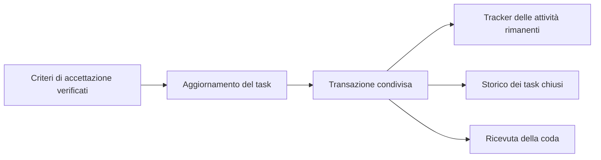

# Tracker e importazione

> Tool portabile: [procedura corrente](portable-brain.md). Nessun monitor; output operativi sotto .runtime e pulizia solo su richiesta.

## Fonte autorevole

Il resolver condiviso individua il dossier tramite identità del repository e metadati PARA. Su un checkout nuovo senza tracker sorgente, il bootstrap crea direttamente la dichiarazione e un tracker vuoto di schema 1.

Le letture ordinarie di un dossier greenfield richiedono la dichiarazione. Il resolver segnala `tracker.greenfield.declaration.required` se manca, `tracker.declared.missing` se il file dichiarato è assente e `tracker.schema.version` se la versione del payload è incompatibile. Le letture lasciano intatti i file. La sorgente non dichiarata di un dossier greenfield è accessibile tramite la procedura esplicita di importazione con `-Repository` e `-SourcePath`.

Il contratto JSON e attivo per ogni dossier; approved.json ne registra lo stato attivo. La dichiarazione nel `repository.json` del dossier e:

```json
"tracker": {"location":"dossier","path":"tracker.json","schemaVersion":1}
```

Una dichiarazione invalida, una destinazione mancante, un contratto non approvato o un tracker non valido sono errori, senza fallback. I Progetti collegati devono indicare la stessa fonte. Il generatore degli AGENTS usa il risultato del resolver; non modificare i blocchi a mano.

## Contratto e conversione

[Schema v1](../../config/tracker.schema.json). Il contratto usa [JSON Schema Draft 2020-12](https://json-schema.org/draft/2020-12/), validato tramite [Test-Json](https://learn.microsoft.com/en-us/powershell/module/microsoft.powershell.utility/test-json?view=powershell-7.5). La validazione applicativa verifica inoltre data, identita, unicita degli ID, dipendenze esistenti e cicli, anche fra repository gestiti. Gli schemi sono locali; non si aggiunge una dipendenza di rete al monitor. Suite completa e CLI in fixture verificate su PowerShell 7.5.11 e 7.6.9, inclusi DateKind, schema, ripresa e recupero (evidenze e collaudi conservati nel runtime di test).

Le otto collezioni censite alimentano i task conservando priorita e valori originali in `extensions.di origine`. Le note non diventano attivita. Gli ID presenti restano invariati; per testi senza ID viene usato un identificatore esplicito univoco oppure un hash stabile per identita, collezione e contenuto canonico. Collisioni richiedono risoluzione esplicita, senza fusione. Stati o dipendenze ambigui producono `unknown` e impediscono l attivazione. I criteri importati non diventano prove superate.

Il convertitore Markdown riconosce la tabella aperta e le checkbox dei residui del tracker SecondBrain, oltre ai completamenti espliciti della tabella nello storico indicato. Non e un importatore generico di Markdown: formati diversi richiedono una conversione esplicita. L intero originale rimane archiviato e conservato anche nelle estensioni. I record `done` consentono di risolvere le dipendenze storiche; le attivita aperte escludono `done` e `cancelled`.

Ogni riga di tabella o checkbox non riconosciuta fa fallire la conversione, anche dopo righe valide: l'errore indica la riga da revisionare. Non si attiva un tracker parziale o vuoto ignorando attivita. Note in prosa ed esempi nei blocchi di codice sono conservati senza importarli; un documento privo di attivita o una tabella supportata vuota restano validi. Anteprima e attivazione applicano lo stesso riconoscimento.

L'attivazione (SYS03) non crea mai un tracker vuoto al posto di quello del repository. Per un nuovo dossier cerca nel checkout, nell'ordine del resolver, `tracker.json`, `tracker.md`, `tasks.json` e `legacy-tasks.json`; `tracker.md` conta se esiste, un file JSON solo se è un oggetto valido. Se ne trova uno, il dossier nasce senza `tracker.json` né dichiarazione del tracker, l'associazione ha stato `tracker-import-required` e il resoconto di attivazione riporta `trackerSource` con il `path` relativo e `compatible` (vero se il file supera i controlli dello schema 1 dopo il riallineamento di `repository` all'identità di destinazione). L'importazione descritta sotto rende poi autorevole il tracker del dossier.

Una sorgente già in schema 1 attraversa la conversione invariata: ID, `seq`, stati, evidenze, provenienza, dipendenze, storico e le sue estensioni (per esempio `lastSeq`) restano come sono. Solo `repository` viene riallineato all'identità di destinazione; le dipendenze che indicavano l'identità originale diventano interne al repository, e l'intero documento originale, `repository` originale compreso, resta in `extensions.original`.

## Anteprima, preparazione e ripresa

Per riprendere un'importazione, individua il manifest dal registro `tracker-imports` nel runtime configurato. `-ResumeManifest` e `-RollbackManifest` accettano anche i journal precedenti alla 1.0 con registro `tracker-migrations` e archivio `history/tracker-migration-<id>`, dopo la validazione. Check e le protezioni degli spostamenti PARA continuano a rilevarli. Le nuove importazioni scrivono `tracker-import`. I dati originali importati sono in `extensions.original`. L'anteprima legge lo stato registrato in sola lettura.

```powershell
$cfg = '.runtime/hosts/<id>/workstation.json'
./scripts/import-tracker.ps1 -ConfigPath $cfg -ResumeManifest $manifest
```

Senza `-Apply` la CLI valida in sola lettura. Con `-Apply` prepara manifest, backup, copia storica esatta e candidato JSON nel backupRoot, fino a `verified`. Il candidato non e ancora la fonte autorevole. Exit 1 indica preparazione con attivazione pendente; exit 0 indica anteprima valida o migrazione completata. Gli errori PowerShell terminano con esito non zero e messaggio diagnostico.

Le fasi sono `pending`, `prepared`, `copied`, `verified`, `references_updated`, `originals_removed`, `completed`; il recupero termina in `rolled_back`. Il registro nel runtime collega ogni identita al proprio manifest nel backupRoot configurato. I manifest sono dati operativi, non autorizzazioni. Ogni operazione registra hash precedente, hash atteso e payload di recupero prima della scrittura. Le copie storiche hanno attributi Git `-text` per preservare i byte.

```powershell
# Solo dopo l approvazione esplicita della proposta concreta:
./scripts/import-tracker.ps1 -ConfigPath $cfg -ResumeManifest $manifest -Apply -Activate
# Anteprima del recupero, poi applicazione esplicita:
./scripts/import-tracker.ps1 -ConfigPath $cfg -RollbackManifest $manifest
./scripts/import-tracker.ps1 -ConfigPath $cfg -RollbackManifest $manifest -Apply
```

L attivazione aggiorna dichiarazione e riferimenti, inclusi i Progetti, e rimuove l originale solo dopo averne verificato le copie. Una sorgente modificata dopo la preparazione blocca la ripresa; non aggiornare a mano gli hash per superare il blocco. Il recupero verifica prima tutti i payload e le destinazioni e rifiuta di sovrascrivere modifiche successive. Una migrazione preparata non congela il tracker: se questo cambia, recuperare la preparazione e prepararne una nuova dalla fonte corrente.

La conversione usa le copie verificate, con il formato originale. Il controllo della fonte viene ripetuto prima dell attivazione e della rimozione, anche nella ripresa da `references_updated`; l hash atteso per rimuovere resta quello della fonte convertita. Una fonte gia assente e ammessa in questa fase soltanto se la rimozione e registrata nel journal con lo stesso hash. I riferimenti correnti nel dossier migrato e i Progetti che usavano tracker nel checkout vengono riconciliati nella transazione; storico, snapshot, esempi inline e fence restano conservati.

Anteprima, preparazione, attivazione e ripresa usano la stessa raccolta non ricorsiva dei tracker correlati del resolver. Il grafo viene rivalidato prima dell attivazione: una dipendenza rimossa dopo la preparazione blocca il passaggio, come un task inesistente, un ciclo o un identita non gestita.

Usare sessioni Write Start/End nello stesso script con `try/finally`, passando `-SessionId` alle CLI. Dopo le scritture eseguire Sync e i controlli del progetto. Build e CI dei prodotti restano indipendenti da SecondBrain.

## Copertura di Check

Check legge contesto, memoria, brief e tracker Markdown correnti delle Aree non archiviate: segnala riferimenti di origine e target Markdown locali mancanti, escludendo storico, snapshot, blocchi di codice e link dimostrativi nel codice inline. Non verifica anchor o URL remoti. Verifica inoltre fonti dichiarate, riferimenti dei Progetti e registri di migrazione; una preparazione `verified` resta una segnalazione di lavoro incompleto. Nessuna copia o correzione e eseguita da Check.

I limiti GitHub/Wiki restano separati: un'importazione locale o un esito strutturale non li risolve.

## Spostamenti PARA

Archive e Restore aggiornano anche i percorsi operativi dei manifest tracker delle postazioni registrate, nella stessa transazione del dossier e degli inventari. Gli hash di candidato, originali e payload non vengono ricalcolati; il registro continua a indicare il manifest nel backupRoot della relativa postazione. Il recupero PARA comprende i soli manifest registrati e validati, anche se il dossier e ancora spostato parzialmente.

Le migrazioni `completed` e `rolled_back` consentono lo spostamento; qualsiasi fase pendente lo impedisce prima delle scritture. Un manifest completato puo essere letto e ripreso anche con Area archiviata o ritirata. Il recupero tracker continua a rifiutare modifiche successive, compresi aggiornamenti al tracker dopo Archive/Restore. Queste operazioni richiedono comunque una richiesta esplicita; nessuna archiviazione e implicita nella importazione tracker.

Il tracker JSON corrente viene incluso nella transazione anche per i suoi riferimenti: provenance, evidence, history e extensions.source. I percorsi relativi al repository seguono lo spostamento; quelli relativi al dossier vengono risolti rispetto alla posizione precedente e ricalcolati dalla nuova, conservando i suffissi. Candidate e originali archiviati, hash delle fonti e valori importati in di origine restano invariati. Il journal aggiorna l'hash distribuito del tracker solo se questo coincideva ancora con la versione della migrazione: lo spostamento non rende ammissibile un rollback gia impedito da modifiche utente.

## Review esplicita della conversione

`import-tracker.ps1 -ReviewPath <file.json>` e facoltativo nella preparazione e nell anteprima. Il documento ha `schemaVersion: 1`, `repository`, `sourceSha256` e `tasks`: ogni decisione contiene `id`, `status`, `reason` e, quando necessario, `dependencies` tipizzate e `prerequisites` testuali. ID inesistenti o duplicati, identita/hash divergenti e dipendenze irrisolte senza riconciliazione esplicita sono rifiutati. Non si modificano i dati di origine.

La review viene copiata byte per byte nel manifest e nello storico; le decisioni e il loro hash restano nelle estensioni del tracker. La ripresa usa la copia registrata, controllando che anche la fonte sia invariata prima dell attivazione. Non modificare il candidato o i suoi hash a mano. Una review classifica lo stato e i prerequisiti: non costituisce una nuova verifica dei criteri applicativi. I manifest precedenti senza review restano compatibili.

## Proiezione e mutazione atomica dei task

La proiezione dei task con `Get-SBTaskProjection` (o `scripts/knowledge.ps1 -Tasks`) supporta il filtro `-ReadyOnly`, che seleziona le sole attività non bloccate le cui dipendenze risultano tutte soddisfatte (`done` o `completed`), risolvendo sia dipendenze locali che dipendenze cross-repository tramite il dizionario dei tracker correlati.

### Perimetro per repository

`knowledge.ps1 -Tasks`, `-Startup` e `-UpdateTaskId` (come i tool MCP `get_ready_tasks` e `get_startup_context`) operano sul repository in lavoro: `-Repository` esplicito oppure quello del checkout corrente (`-CheckoutPath` o directory corrente), risolto da binding e origin. Fuori da un checkout riconoscibile terminano con errore invece di elencare altri repository. La vista globale è un opt-in di consultazione in sola lettura (`knowledge.ps1 -Tasks -All`, MCP `all=true`), incompatibile con `-Repository`, con ogni voce etichettata `scope: global`. `-UpdateTaskId` e `Set-SBTrackerTaskStatus -WorkingRepository` rifiutano la scrittura sul tracker di un repository diverso da quello in lavoro.

`secondbrain.ps1 -Check|-Sync -Repository <identità>` limita il controllo a un solo repository gestito: nessun esito di altri repository, IDE o testi globali; il risultato dichiara la copertura in `scope` (`repository-only` con l'elenco di ciò che non copre; senza filtro `workstation`). Il Sync filtrato non riscrive inventario, mappa IDE né indice PARA. I prompt di repository (REP01) rifiutano task di altri repository anche se `autonomous`.

Per aggiornare lo stato di un task nel tracker autorevole senza rischiare corruzioni dello schema o incoerenze nel grafo delle dipendenze, `SecondBrain.Tracker.psm1` mette a disposizione le funzioni `Set-SBTrackerTaskStatus` e `Update-SBTrackerTask` (quest'ultima risolve il tracker da identità o percorso):
- Verifica preventivamente la validità dello schema v1 e delle regole del grafo tramite `Test-SBTrackerData` prima di qualsiasi scrittura su disco;
- Rifiuta stati sconosciuti, task inesistenti o cicli/dipendenze non valide;
- Esegue la scrittura in modo atomico tramite `Invoke-SBParaTransaction`, creando un backup di rollback e un manifest transazionale sotto `.runtime/backups`.

### Numerazione progressiva e creazione dei task

Ogni task può avere `seq`, un intero univoco nel tracker; il titolo inizia allora con `#NNN — `. Il contatore `extensions.lastSeq` non scende mai: i numeri dei task archiviati o rimossi non si riusano. `Test-SBTrackerData` rifiuta numeri duplicati, titoli senza il prefisso corrispondente e numeri oltre `lastSeq`.

```powershell
# Numerazione retroattiva (una sola volta per tracker): anteprima, poi applicazione.
pwsh -NoProfile -File scripts/knowledge.ps1 -RenumberTasks
pwsh -NoProfile -File scripts/knowledge.ps1 -RenumberTasks -Apply

# Nuovo task: seq = lastSeq + 1, ID predefinito TASK-NNN, provenienza relativa al dossier con hash calcolato.
# Con pwsh -File gli elenchi (-Acceptance, -DependsOn) arrivano come stringa unica: separali con ';' ("criterio 1; criterio 2").
# Da una sessione PowerShell si possono passare anche come array ('criterio 1','criterio 2').
& ./scripts/knowledge.ps1 -NewTask 'Titolo' -Acceptance 'criterio 1','criterio 2' -Provenance 'history/<lotto>/report.md' [-TaskId <id>] [-DependsOn <id>,<repo>#<id>] [-Priority P1] [-Execution user_required] [-Description '...']
```

- La numerazione retroattiva ordina archivio (`history/tracker-archive.json`) e tracker attivo per la data `aaaammgg` dell'ID; un ID senza data eredita quella del task precedente e l'ordine resta stabile. Gli originali sono copiati in `history/tracker-seq/<sha256>/` nella stessa transazione. Su un tracker già numerato non cambia nulla; una numerazione parziale è un errore.
- `-NewTask` rifiuta un tracker non ancora numerato, un ID già presente, criteri vuoti e una provenienza inesistente. Come `-UpdateTaskId`, scrive solo nel repository in lavoro.
- Proiezione, `-Tasks` e MCP `get_ready_tasks` riportano `seq` quando presente.
- Il record integro di un task (anche archiviato in `history/tracker-archive.json`) si legge con `knowledge.ps1 -Task <id|#seq>` o con il tool MCP `get_task`.

## Codici dei messaggi e storico

Gli errori prodotti dal programma hanno una chiave stabile in `Exception.Data['code']`; i consumatori PowerShell possono riconoscerli con `Test-SBError`. I report diagnostici di audit esterno, pubblicazione, fonti e numerazione tracker separano `code` e `message` localizzato. I campi macchina preesistenti (`reason`, stato, copertura) conservano il loro significato; motivazioni dell'utente e descrizioni private restano dati originali. La lingua non modifica l'esito della verifica.

Gli eventi `history` dello schema v1 possono aggiungere `code` e `messageArgs` insieme. `description`, `reference` e `sha256` restano invariati. Solo gli eventi riconosciuti esattamente ricevono una chiave specifica; il testo libero riceve `tracker.history.note`, senza traduzione o duplicazione della nota negli argomenti. Il messaggio localizzato è una vista derivata.

```powershell
# Dal checkout gestito: vista in sola lettura e anteprima della migrazione.
pwsh -NoProfile -File scripts/knowledge.ps1 -HistoryMessages -Language en
pwsh -NoProfile -File scripts/knowledge.ps1 -MigrateHistoryMessages
# Applica esclusivamente al dossier del repository in lavoro.
pwsh -NoProfile -File scripts/knowledge.ps1 -MigrateHistoryMessages -Apply
```

La migrazione comprende tracker attivo e metadati storici dell'archivio, se presente. Conserva gli originali esatti in `history/tracker-messages/<sha256>/`, usa la transazione PARA con backup verificati e rifiuta modifiche concorrenti. L'anteprima non scrive; una seconda applicazione non modifica file o timestamp. Il recupero usa il manifest della transazione, secondo la [procedura di recupero](operations.md). Non è una compattazione e non modifica gli altri dossier.

## Proiezione dei Task e Budget

`tracker.json` contiene le attività rimanenti. Dopo la verifica dei criteri di accettazione, gli stati `done` e `cancelled` passano in `history/tracker-archive.json`, con ID, numero, evidenze e provenienza. Tracker, archivio e ricevuta di una richiesta accodata sono scritti nella stessa transazione.



`-Tasks -ReadyOnly` e MCP `get_ready_tasks` risolvono le dipendenze anche nello storico, incluso quello di altri repository. Solo gli esiti completati soddisfano una dipendenza. `-Task <ID|#numero>` mostra il record completo e `-UpdateTaskId <ID> -Status todo` riapre esplicitamente lo stesso task.

Per migrare i terminali già presenti, aggiornare prima tutte le postazioni della share alla stessa revisione, eseguire `knowledge.ps1 -ArchiveTasks -Repository <identità>` in anteprima e aggiungere `-Apply` dopo aver verificato l'elenco. I dossier archiviati conservano i dati esistenti. Conservare il manifest e usare la procedura di recupero in caso di interruzione.

## Aggiornare stato e metadati

`knowledge.ps1 -UpdateTaskId <id>` e `Update-SBTrackerTask` accettano `Status`, `StateReason`, `Priority` (P0–P3), `Execution` (autonomous/user_required/unspecified), `DependsOn`, `Stream`, `Awaiting`, `Requires`, `Description`, `Acceptance` (separati da `;`), `Evidence` (`riferimento|esito`, esito passed, failed, partial o unverified, in aggiunta) e `DecisionsFile` (file JSON di decisioni della persona `{question, answer}`, salvate in `extensions.decisions[]`). Ogni cambio di stato, esecuzione o evidenza aggiunge un record al registro del dossier `history/task-runs.jsonl` nella stessa transazione; `knowledge.ps1 -Registry` elenca tutti i task del repository, archiviati compresi, con esecutori e rapporti del runner, e `-BackfillTaskRuns` copia i rapporti precedenti (anteprima senza `-Apply`). Il cambio di stato è facoltativo; almeno un campo va specificato. I campi omessi restano invariati: i valori predefiniti usati da `-NewTask` non si applicano agli aggiornamenti.

```powershell
pwsh -NoProfile -File scripts/knowledge.ps1 -UpdateTaskId TASK-278 -Priority P2 -Stream urgent
pwsh -NoProfile -File scripts/knowledge.ps1 -UpdateTaskId TASK-278 -DependsOn 'TASK-261;github.com/example/repo#TASK-1'
pwsh -NoProfile -File scripts/knowledge.ps1 -UpdateTaskId TASK-278 -DependsOn '' -Stream ''
```

`DependsOn` vuoto elimina tutte le dipendenze; `Stream` vuoto rimuove il campo. Riferimenti assenti, repository non gestiti, cicli e scritture su un repository diverso da quello in lavoro sono rifiutati. Le richieste `task.update` usano hash del task, ricevuta e transazione con backup; una modifica concorrente produce conflitto senza sovrascrittura. `task.status` resta supportato. Il segnale di chiusura è emesso solo quando si richiede esplicitamente `Status=done`, anche se un task già concluso riceve soltanto metadati.
