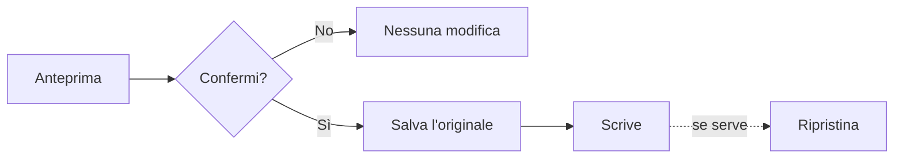

# Sicurezza

SecondBrain non tocca il tuo codice e non invia dati a nessuno. Scrive solo pochi file, e prima li salva.



## Cosa viene modificato

| Comando | Fuori dalla cartella SecondBrain |
|---|---|
| `-Check`, `prompts.ps1` | Niente |
| `-Setup -Interactive` | La variabile utente `SECONDBRAIN_HOME` |
| `-Sync` | Un testo delimitato in `AGENTS.md` dei progetti e nei file di regole degli agenti |
| `-Pair -Apply` | Il file di configurazione MCP dell'agente scelto |

`-Sync` scrive subito: esegui prima `-Check` per vedere le differenze. Se un tuo file di regole non contiene già il blocco di SecondBrain, non viene toccato.

Non vengono mai toccati: il tuo codice, le password, gli archivi di accesso. Per questo SecondBrain non rileva gli account di un IDE: con più account li dichiari tu (`sb prompt SYS12`).

## Dove sono i backup

In `.runtime/hosts/<id>/backups/`, sul tuo PC. I file MCP sono in `.runtime/backup/mcp-pairing/`. Nulla finisce su GitHub e nulla viene cancellato in automatico.

Per un archivio dei tuoi appunti:

```powershell
pwsh -NoProfile -File scripts/backup.ps1
```

## Ripristina un file

```powershell
pwsh -NoProfile -File scripts/restore-managed.ps1 -List -Path "$HOME/.claude/CLAUDE.md"
pwsh -NoProfile -File scripts/restore-managed.ps1 -MetadataPath .runtime/hosts/<id>/backups/<guid>.bin.json
```

Il primo trova i backup, il secondo ne ripristina uno. Se hai modificato il file dopo, il ripristino si ferma per non sovrascriverti.

## Disinstalla

1. Scollega progetti e agenti: `secondbrain.ps1 -Setup -Unbind <nome> -Yes -Apply`.
2. Togli il testo tra i marcatori `secondbrain:` nei file di regole e in `AGENTS.md`.
3. Togli la voce `secondbrain` dai file MCP.
4. Elimina la variabile `SECONDBRAIN_HOME`.
5. Copia ciò che vuoi tenere, poi cancella la cartella: contiene anche i backup.

Tutti i dettagli: [file modificati e backup](riferimento/safety-backups.md), [recupero](riferimento/recovery.md).
