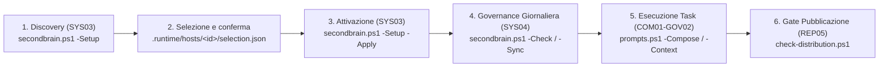

# Guida Utente di SecondBrain

Guida operativa end-to-end all'installazione, configurazione, utilizzo quotidiano e salvaguardia di **SecondBrain** su Windows (PowerShell 7.5+ e Git).

---

## 1. Prerequisiti e Configurazione Iniziale

### Requisiti di Sistema
- **Sistema Operativo**: Windows 10/11 a 64 bit o Windows Server 2022+
- **Shell**: PowerShell 7.5 o versione successiva (`pwsh`)
- **Version Control**: Git per Windows (2.40+)
- **IDE Supportati**: VS Code, Cursor, Windsurf, Claude Code / Desktop, Google Antigravity, Android Studio

### Verifica dell'Ambiente
Apri una sessione di PowerShell 7 ed esegui:

```powershell
# Verifica versione di PowerShell
$PSVersionTable.PSVersion

# Verifica presenza di Git
git --version
```

---

## 2. Installazione e Struttura Locale

### Clone del Repository
Clona SecondBrain in una directory dedicata della tua postazione (ad esempio `C:\Progetti\SecondBrain` o `C:\Dev\SecondBrain`):

```powershell
git clone https://github.com/dennidalpos/SecondBrain.git C:\Progetti\SecondBrain
cd C:\Progetti\SecondBrain
```

### Struttura Code-Only e Confine Locale
Il repository adotta la modalità **Code-Only**:
- I file tracciati da Git comprendono solo codice e documentazione (`scripts/`, `config/`, `direttive/`, `docs/`, `README.md`, `LICENSE`, `CREDITS.md`).
- Tutti i dati di progetto (`01-projects/`), i dossier dei repository (`02-areas/`), i registri di fonti (`03-resources/`), gli archivi (`04-archives/`) e l'area di runtime (`.runtime/`) risiedono nel clone locale e sono protetti da `.gitignore`. Il clone può stare anche su una share di rete usata da più PC: vedere [shared-brain.md](shared-brain.md).

### Ciclo Operativo della Postazione



---

## 3. Discovery e Attivazione della Postazione (SYS03)

Il workflow di bootstrap non modifica nulla senza una ricognizione trasparente e la conferma esplicita dell'utente.

### Percorso principale: `-Setup`
Lo script guidato esegue in sequenza preflight, discovery, proposta, conferma, anteprima e applicazione. Genera lui `discovery.json` e `selection.json` in `.runtime/hosts/<id>/` (un file per host): la selezione non si scrive a mano.

```powershell
# Interattivo: elenca repository e IDE, poi chiede CONFERMO e APPLICA
pwsh -NoProfile -File scripts/secondbrain.ps1 -Setup -Interactive -Roots D:\Sviluppo

# Non interattivo: proposta (exit 1), anteprima con conferma, applicazione
pwsh -NoProfile -File scripts/secondbrain.ps1 -Setup -Roots D:\Sviluppo
pwsh -NoProfile -File scripts/secondbrain.ps1 -Setup -Roots D:\Sviluppo -Select mio-prodotto -Yes
pwsh -NoProfile -File scripts/secondbrain.ps1 -Setup -Roots D:\Sviluppo -Select mio-prodotto -Yes -Apply
```

| Opzione | Effetto |
| --- | --- |
| `-Roots` | Radici da analizzare (senza: volumi fissi). `-MaxDirectories` limita la visita. |
| `-Select` | Repository per id, nome o percorso (più valori separati da virgola). `-All` seleziona tutti. |
| `-Ides` / `-AllIdes` | IDE da associare (id o nome). |
| `-ApproveExistingBlocks` | Conferma di aver rivisto il blocco gestito già presente in `AGENTS.md`. |
| `-Yes` | Conferma non interattiva: registra utente, host e data nella selezione. Va usata solo dopo la conferma dell'utente. |
| `-Apply` | Applica; senza, resta l'anteprima. Registra `SECONDBRAIN_HOME` (salvo `-NoRegisterEnvironment`). |
| `-AndSync` | Dopo l'applicazione esegue `-Sync` invece di `-Check`. |

Senza conferma la selezione resta una proposta (`confirmed=false`, exit 1) e `-Activate` la rifiuta. In modalità non interattiva senza `-Select`/`-All` lo script non chiede nulla e termina con errore.

### Rivedere e disassociare: `-Setup -Status` e `-Setup -Unbind`
```powershell
# Sola lettura: binding, IDE e ultima ricevuta di selezione (exit 0, nessun lock, nessuna discovery)
pwsh -NoProfile -File scripts/secondbrain.ps1 -Setup -Status

# Disassociazione: proposta (exit 1), anteprima con -Yes, applicazione con -Apply
pwsh -NoProfile -File scripts/secondbrain.ps1 -Setup -Unbind github.com/org/prodotto
pwsh -NoProfile -File scripts/secondbrain.ps1 -Setup -Unbind github.com/org/prodotto -Yes
pwsh -NoProfile -File scripts/secondbrain.ps1 -Setup -Unbind D:\Sviluppo\prodotto -Yes -Apply

# Integrazione IDE: id (da -Status) o nome se univoco
pwsh -NoProfile -File scripts/secondbrain.ps1 -Setup -Unbind <id-IDE> -Yes -Apply
```
`-Unbind` accetta identità o percorso di repository già gestiti e id o nome di integrazioni IDE già gestite (più valori separati da virgola, anche misti) e produce `unbind-selection.json` con `retireCheckoutPaths` e `retireIDEIds`, con la stessa conferma di `-Setup` (`-Yes` o `-Interactive`: CONFERMO / APPLICA). L'anteprima elenca `retiredCheckouts` e `retiredIdes`. Binding e integrazioni vengono rimossi dalla configurazione della postazione; dossier, dati e file di istruzioni dell'IDE (compreso il blocco già scritto) non vengono modificati o eliminati e `SECONDBRAIN_HOME` non cambia. Un token non gestito o ambiguo (nome IDE condiviso da più account, o che coincide con un repository) è un errore: usare l'id. `-Status` e `-Unbind` sono alternativi tra loro e non accettano le opzioni di selezione (`-Roots`, `-Select`, `-All`, `-Ides`, `-AllIdes`, `-ApproveExistingBlocks`, `-AndSync`).

Dopo un cambio di login, profilo o radice di configurazione di un IDE `-Status` mostra `contextStatus: changed` e `-Check` segnala `ide-context-changed`: riattiva l'IDE con la nuova selezione (nuovo id per profilo e alias), ritira il vecchio id con `-Unbind` e registra una nuova ricevuta di osservazione (procedura e limiti in [adapters.md](adapters.md)).

### Registrare l'esito degli output: `-Setup -Output`
Dopo che l'agent del prodotto ha qualificato dove vanno build e cache, l'esito si registra nel binding invece di modificare la configurazione a mano (altrimenti `-Check` segnala `output-location-unverified`):
```powershell
# Prova sotto .runtime: lo stato resta legato ai suoi byte (SHA-256)
pwsh -NoProfile -File scripts/secondbrain.ps1 -Setup -Output github.com/org/prodotto -OutputStatus verified -Evidence .runtime/proofs/prodotto-output.json -Yes -Apply

# Eccezione approvata, con motivo
pwsh -NoProfile -File scripts/secondbrain.ps1 -Setup -Output D:\Sviluppo\prodotto -OutputStatus exception-accepted -Exception "motivo approvato" -Yes -Apply

# Ripristino dello stato iniziale (la prova resta su disco)
pwsh -NoProfile -File scripts/secondbrain.ps1 -Setup -Output github.com/org/prodotto -OutputStatus unverified -Yes -Apply
```
Un solo repository gestito per volta (identità o percorso). `verified` richiede `-Evidence` esistente sotto `.runtime` e non accetta `-Exception`; `exception-accepted` richiede un motivo non vuoto e non accetta `-Evidence`; `unverified` non accetta nessuno dei due. Stessa conferma di `-Setup` (`-Yes` o `-Interactive`, exit 1 se manca) e anteprima senza `-Apply`; la scrittura passa dalla transazione con backup. Cambiando i byte della prova dopo la registrazione, `-Check` torna a segnalare l'output non verificato. Non esegue build o test del prodotto e non è combinabile con `-Status`, `-Unbind` né con le opzioni di selezione.

### Primitive: `-Discover` e `-Activate`
`-Setup` orchestra due comandi che restano disponibili:

```powershell
# Ricognizione in sola lettura (senza -ReportPath scrive .runtime/hosts/<id>/discovery.json)
pwsh -NoProfile -File scripts/secondbrain.ps1 -Discover -Roots D:\Sviluppo

# Anteprima e applicazione di una selezione già confermata
pwsh -NoProfile -File scripts/secondbrain.ps1 -Activate -SelectionPath .runtime/hosts/<id>/selection.json
pwsh -NoProfile -File scripts/secondbrain.ps1 -Activate -SelectionPath .runtime/hosts/<id>/selection.json -Apply
```

L'output reale di `-Discover` elenca IDE, eseguibili, unità e percorsi della postazione: non pubblicarlo né usarlo tal quale in guide e screenshot. L'immagine in `docs/assets/cli-discover.png` è un estratto dello stdout reale su una fixture sintetica, con profilo utente e `PATH` del processo isolati e oscuramenti dichiarati (REP07).

Schema della selezione (`schemaVersion` 1: `confirmed`, `confirmation`, `reportPath`, `reportSha256`, `repositories[]` con `id`, `ides[]`) e campi opzionali in [portable-brain.md](portable-brain.md). Il file deve stare sotto `.runtime/` della radice SecondBrain.

---

## 4. Uso Quotidiano e Sincronizzazione (SYS04)

### Verifica dello Stato di Salute (`-Check`)
Prima di iniziare a lavorare o a fine giornata, esegui il controllo deterministico:

```powershell
pwsh -NoProfile -File scripts/secondbrain.ps1 -Check
```
Il comando verifica:
- La corrispondenza tra direttive approvate e file `AGENTS.md` nei repository gestiti.
- L'allineamento degli indici PARA e la consistenza dei file `tracker.json`.
- La saturazione del budget di contesto nei dossier (tetto di 20.000 caratteri per l'avvio snello; vedi [manutenzione di .runtime e contesto iniziale](runtime-maintenance.md)).
- Lo stato delle superfici IDE registrate in `ide-map.json`.

### Distribuzione delle Regole Approvate (`-Sync`)
Quando vengono aggiornate le direttive comuni approvate o si aggiunge un nuovo repository:

```powershell
pwsh -NoProfile -File scripts/secondbrain.ps1 -Sync
```
Il comando inietta il blocco gestito nei file `AGENTS.md` preservando scrupolosamente le sezioni personali e il testo locale dello sviluppatore.

### Qualificazione delle Superfici IDE Manuali (Claude app, Continue, Android Studio)

Non tutti gli ambienti IDE e interfacce AI supportano file globali di istruzioni sul filesystem locale (come `CLAUDE.md`, `AGENTS.md` o `GEMINI.md`). SecondBrain classifica tali interfacce come superfici manuali (`mode: manual` in `ide-map.json`):

- **Claude app (impostazioni account)**: le direttive risiedono nel cloud Anthropic (*Account Settings > Personalization > Instructions for Claude*). Copiare il testo approvato da `runtimeRoot/istruzioni-globali.md` nel profilo utente.
- **VS Code + Continue**: memorizza la configurazione in `~/.continue/` ed estensione VS Code. Verificare le regole caricate tramite l'icona penna del pannello Continue o applicare le regole nei file `.continue/rules/` del progetto.
- **Android Studio (Gemini)**: legge nativamente il file `AGENTS.md` del repository nel cassetto *Context > AGENTS.md Files*. Per progetti non gestiti o prompt globali, iniettare le direttive a inizio chat.

Il comando `scripts/ide-map.ps1 -Verify` segnala `manuale, account/profilo e caricamento non verificati` in assenza di una ricevuta di osservazione recente (<15 minuti). La procedura dettagliata di qualificazione e riscontro è documentata in [adapters.md](adapters.md).

---

## 5. Consultazione e Composizione dei Workflow (COM01–GOV02)

SecondBrain mette a disposizione un catalogo strutturato di 80 workflow ingegneristici suddivisi in 13 aree tematiche.

### Elenco dei Prompt
```powershell
# Schermata iniziale: link al catalogo completo e comandi sb con descrizione
pwsh -NoProfile -File scripts/prompts.ps1

# Tutti i prompt, una riga ciascuno (codice, modalità, sommario)
pwsh -NoProfile -File scripts/prompts.ps1 -List -Compact

# Elenco esteso con ID, scope, requisiti ed esempio
pwsh -NoProfile -File scripts/prompts.ps1 -List

# Filtra per area: id (test, sicurezza, sistema, governance) o prefisso dei codici (TST, SEC, SYS, GOV), senza distinguere le maiuscole
pwsh -NoProfile -File scripts/prompts.ps1 -List -Category test
pwsh -NoProfile -File scripts/prompts.ps1 -List -Category SYS
```

### Visualizzazione di una Scheda
```powershell
pwsh -NoProfile -File scripts/prompts.ps1 -Show -Prompt REP05
```

### Composizione del Prompt per l'Agente AI
Il comando `-Compose` genera il testo pronto da incollare o trasmettere all'agente, arricchito con il contesto reale del repository:

```powershell
pwsh -NoProfile -File scripts/prompts.ps1 -Compose -Prompt DEV01 -Objective "Implementa validazione token JWT" -RepositoryPath C:/Progetti/MioProgettoA
```

---

## 6. Integrazione con Coding Agent via Server MCP

Per consentire ai coding agent (OpenAI Codex, Claude Desktop, Cursor, Antigravity, VS Code, Windsurf) di consultare il contesto di avvio e i task pronti senza uscire dall'ambiente di sviluppo, SecondBrain fornisce un server stdio locale JSON-RPC (`scripts/mcp-server.ps1`).

### Pairing Guidato con gli IDE
```powershell
# Esegui l'accoppiamento per l'IDE target (es. codex, claude, cursor, vscode, antigravity)
pwsh -NoProfile -File scripts/mcp-server.ps1 -Pair -Target codex

# Per applicare direttamente la configurazione su disco con backup atomico:
pwsh -NoProfile -File scripts/mcp-server.ps1 -Pair -Target codex -Apply
```

### Strumenti Informativi Esposti dal Server MCP
* `get_startup_context`: Pacchetto di avvio del repository: profilo `slim` (predefinito, 20.000 caratteri, solo primo caricamento) o `full` senza tetto.
* `get_ready_tasks`: Elenco dei soli compiti eseguibili con dipendenze soddisfatte.
* `search_knowledge`: Ricerca deterministica nei dossier PARA e nello storico compattato; con `mode=relevance` più termini ordinati per pertinenza (sezioni, titolo, frase esatta).
* `list_prompts` / `get_prompt` / `get_prompt_home`: Consultazione del catalogo degli 80 workflow v2 (COM01–GOV02) e schermata iniziale di `sb prompt`.

Per i dettagli su configurazioni manuali e file TOML/JSON, consulta la [Guida Setup MCP](mcp-setup.md).

---

## 7. Salvaguardia, Backup e Integrità (SYS09)

Per prevenire qualsiasi perdita di dati nelle cartelle non tracciate da Git, SecondBrain include un motore di backup deterministico compresso con manifest crittografico SHA-256.

### Creazione del Backup
```powershell
# Esegue il backup di 01-projects, 02-areas, 03-resources, 04-archives, PARA.md, para-index.json e .runtime/hosts
pwsh -NoProfile -File scripts/backup.ps1

# Specifica un percorso di output personalizzato
pwsh -NoProfile -File scripts/backup.ps1 -OutputPath D:/Backups/SecondBrain/backup-20261029.zip
```

### Verifica dell'Integrità Crittografica
```powershell
# Convalida l'ultimo backup presente in .runtime/backups/
pwsh -NoProfile -File scripts/backup.ps1 -Verify

# Convalida un archivio specifico
pwsh -NoProfile -File scripts/backup.ps1 -Verify -BackupPath D:/Backups/SecondBrain/backup-20261029.zip
```

---

## 8. Verifica di Pre-Distribuzione (Pre-Push Gate)

Prima di inviare modifiche a un remote pubblico GitHub o GitLab, esegui il controllo di sicurezza:

```powershell
# Verifica che nessun dato locale, cartella PARA o runtime sia presente nell'indice Git
pwsh -NoProfile -File scripts/check-distribution.ps1
```
Il comando restituisce codice di uscita `0` se l'indice è conforme e pulito; restituisce `1` e blocca la procedura se individua dati locali tracciati per errore.

---

## 9. Approfondimenti Architetturali

Per l'architettura dettagliata dei moduli PowerShell, sequenze transazionali atomiche, ciclo di vita dei task e contratti formali di sicurezza, consulta la [Guida all'Architettura di SecondBrain](architecture.md).
