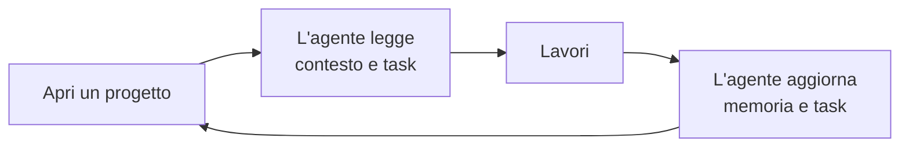
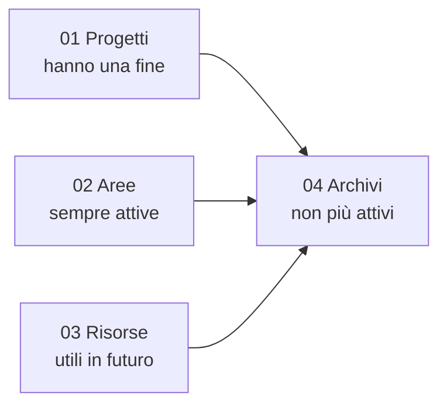

# Uso quotidiano

Parli con l'agente come sempre. SecondBrain gli porta memoria e regole.



## Comandi da scrivere in chat

| Scrivi | Succede |
|---|---|
| `sb prompt` | Mostra comandi e guide |
| `sb prompt list` | Elenca tutti i prompt (una sola lista) |
| `sb prompt ambito test` | Elenca i prompt di un'area |
| `sb prompt mostra TST04` | Mostra un prompt |
| `sb prompt TST04: controlla il login` | Usa il prompt per il tuo obiettivo |
| `sb controlla` | Verifica lo stato, senza modificare |
| `sb allinea` | Aggiorna le regole approvate |
| `sb attiva` | Aggiunge progetti o agenti |
| `sb compatta` | Accorcia gli appunti di un progetto, conservando gli originali |
| `sb runner` | Esegue i task pronti del repository corrente dall'app desktop o dalla riga di comando |

I passi in ordine, in chat e da script, sono nel [flusso per prodotto](flusso-prodotto.md).

## Dove stanno le cose: PARA

Quattro cartelle, un solo criterio: quanto è attivo un'informazione.



| Cartella | Esempio |
|---|---|
| `01-projects` | Una cartella per ogni repository gestito (specifiche, materiale, dati, contesto, memoria, tracker) e altri lavori a termine |
| `02-areas` | Responsabilità continuative che non sono un repository |
| `03-resources` | Norme e riferimenti |
| `04-archives` | Lavori conclusi |

Queste cartelle restano sul tuo PC e non finiscono su GitHub.

## Ogni progetto ha

| File | Cosa contiene |
|---|---|
| `context.md` | A che punto sei |
| `memory.md` | Decisioni e trappole da ricordare, in una riga `Decisione: … — Motivo: …` |
| `tracker.json` | L'elenco dei task |

L'agente li legge a strati (Progressive Summarization): prima il riassunto essenziale, poi i dettagli solo se servono. Come funziona: [caricamento a strati](riferimento/runtime-maintenance.md).

## Prima di pubblicare

```powershell
pwsh -NoProfile -File scripts/publication.ps1 -RepositoryPath C:/Progetti/MioRepo
```

Cerca dati privati, segreti e file di lavoro. Commit e push restano sempre una tua richiesta.

## Eseguire i task del tracker

Per eseguire i task autonomi pronti, una sessione agente nuova per task e un repository alla volta, usa `scripts/run-ready-tasks.ps1`. Per impostazione predefinita mostra solo l’anteprima e durante l’esecuzione stampa l’avanzamento in console. `-Run` richiede anche `-Model` ed `-Effort`, oppure `-UseCliDefault`; senza scelta esce con 2 ed elenca le opzioni della CLI installata. Opzioni, limiti di sicurezza e risultati sono in [esecuzione dei task del tracker](riferimento/operations.it.md#esecuzione-dei-task-del-tracker-in-sessioni-nuove).

## Cambiare versione

Non ogni modifica merita un nuovo numero. L'agente, quando serve, propone la versione e **ti chiede se vuoi cambiarla**. Se dici sì, fa tutto lui e annota la modifica in [CHANGELOG](../CHANGELOG.md). Se dici no, resta com'è e il registro non cambia.

## Parole da sapere

| Parola | Significa |
|---|---|
| Dossier | La cartella di un progetto dentro SecondBrain |
| Tracker | L'elenco dei task |
| Blocco gestito | Il testo aggiunto da SecondBrain in un file |
| Allineare | Aggiornare quel testo |
| MCP | Il collegamento tra agente e SecondBrain |

Più dettagli: [PARA](riferimento/tree.it.md#para-gestione-dei-progetti), [task](riferimento/trackers.md), [controlli](riferimento/operations.it.md#controllo-e-sincronizzazione-su-richiesta).
