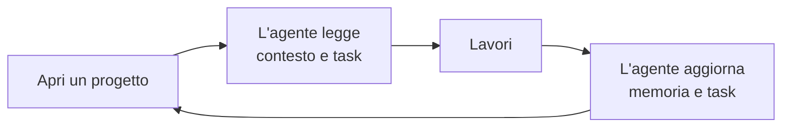
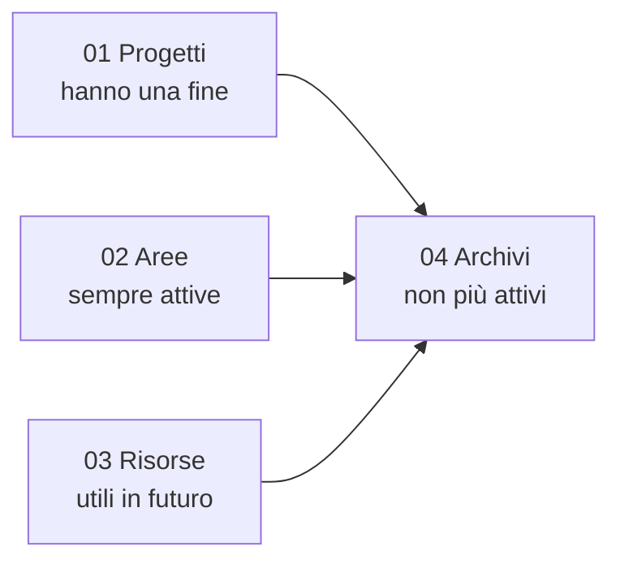

# Uso quotidiano

Parli con l'agente come sempre. SecondBrain gli porta memoria e regole.



## Comandi da scrivere in chat

| Scrivi | Succede |
|---|---|
| `sb prompt` | Mostra comandi e guide |
| `sb prompt tutti` | Elenca tutti i prompt |
| `sb prompt ambito test` | Elenca i prompt di un'area |
| `sb prompt mostra TST04` | Mostra un prompt |
| `sb prompt TST04: controlla il login` | Usa il prompt per il tuo obiettivo |
| `sb controlla` | Verifica lo stato, senza modificare |
| `sb allinea` | Aggiorna le regole approvate |
| `sb attiva` | Aggiunge progetti o agenti |
| `sb compatta` | Accorcia gli appunti di un progetto, conservando gli originali |

## Dove stanno le cose: PARA

Quattro cartelle, un solo criterio: quanto è attivo un'informazione.



| Cartella | Esempio |
|---|---|
| `01-projects` | Rilascio di una nuova app |
| `02-areas` | Un prodotto che mantieni |
| `03-resources` | Norme e riferimenti |
| `04-archives` | Lavori conclusi |

Queste cartelle restano sul tuo PC e non finiscono su GitHub.

## Ogni progetto ha

| File | Cosa contiene |
|---|---|
| `context.md` | A che punto sei |
| `memory.md` | Decisioni e trappole da ricordare |
| `tracker.json` | L'elenco dei task |

## Prima di pubblicare

```powershell
pwsh -NoProfile -File scripts/publication.ps1 -RepositoryPath C:/Progetti/MioRepo
```

Cerca dati privati, segreti e file di lavoro. Commit e push restano sempre una tua richiesta.

## Cambiare versione

Non ogni modifica merita un nuovo numero. L'agente, quando serve, propone la versione e **ti chiede se vuoi cambiarla**. Se dici sì, fa tutto lui. Se dici no, resta com'è.

## Parole da sapere

| Parola | Significa |
|---|---|
| Dossier | La cartella di un progetto dentro SecondBrain |
| Tracker | L'elenco dei task |
| Blocco gestito | Il testo aggiunto da SecondBrain in un file |
| Allineare | Aggiornare quel testo |
| MCP | Il collegamento tra agente e SecondBrain |

Più dettagli: [PARA](riferimento/tree.md#para-gestione-dei-progetti), [task](riferimento/trackers.md), [controlli](riferimento/operations.md#controllo-e-sincronizzazione-su-richiesta).
